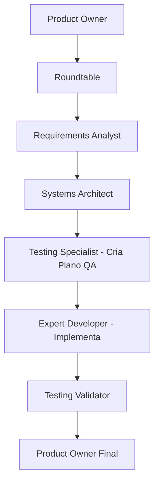

# RickytechAgileAgent - AI Coding Assistant Instructions

This is an **AI Agent Development Framework** for building .NET applications using **automated workflows** with **Scrum practices**, **BDD**, **DDD**, and **Clean Architecture**.

## �s�️ CRITICAL: File Encoding and Formatting Standards

### �YZ� MANDATORY ENCODING RULES - ALWAYS FOLLOW

**BEFORE creating, editing, or saving ANY file in this project, you MUST:**

1. **Use UTF-8 encoding WITHOUT BOM** for all files except C#
2. **NEVER use UTF-8 WITH BOM** for Markdown, PowerShell, YAML, JSON, or Gherkin files
3. **Check encoding in VS Code** (bottom-right corner) before saving
4. **Validate line endings** match the file type requirements

### �Y"< Official Encoding Standards by File Type

| File Type | Encoding | BOM | Line Ending | Indent |
|-----------|----------|-----|-------------|--------|
| **Markdown** (.md) | UTF-8 | �O NO BOM | CRLF | 2 spaces |
| **PowerShell** (.ps1, .psm1) | UTF-8 | �O NO BOM | CRLF | 4 spaces |
| **YAML** (.yaml, .yml) | UTF-8 | �O NO BOM | LF | 2 spaces |
| **JSON** (.json) | UTF-8 | �O NO BOM | LF | 2 spaces |
| **Gherkin** (.feature) | UTF-8 | �O NO BOM | LF | 2 spaces |
| **C#** (.cs) | UTF-8 | �o. WITH BOM | CRLF | 4 spaces |
| **TypeScript/JS** (.ts, .js) | UTF-8 | �O NO BOM | LF | 2 spaces |
| **HTML** (.html) | UTF-8 | �O NO BOM | LF | 2 spaces |

### �Ys� CRITICAL VALIDATION CHECKLIST

**Before every file creation/edit operation:**
- [ ] Verify encoding is UTF-8 (without BOM for most files)
- [ ] Confirm line endings match file type (CRLF vs LF)
- [ ] Check indentation (2 or 4 spaces, NO TABS)
- [ ] Ensure final newline is present
- [ ] Trim trailing whitespace (except Markdown)

### �Y>�️ How to Verify Encoding in VS Code

1. Look at **bottom-right corner** of VS Code window
2. Should display: `UTF-8` (NOT "UTF-8 with BOM")
3. If incorrect:
   - Click on encoding indicator
   - Select "Save with Encoding"
   - Choose `UTF-8` (without BOM)

### �o. Configuration Files (Already Set Up)

- **`.editorconfig`** (root) - Universal encoding rules for all editors
- **`.vscode/settings.json`** - VS Code specific encoding configuration
- **`docs/PADRAO-ENCODING-FORMATACAO.md`** - Complete encoding documentation (400+ lines)

### �Y"� Portuguese Characters Must Display Correctly

These characters MUST appear correctly in all files:
- `ç` (cedilha) - NOT `�f§` or `�f�,§`
- `ã` (a-til) - NOT `�f£` or `�f�,£`
- `é` (e-agudo) - NOT `�f©` or `�f�,©`
- `á` (a-agudo) - NOT `�f¡` or `�f�,¡`
- `ó` (o-agudo) - NOT `�f³` or `�f�,³`

### �Ys� NEVER Create Files With:
- �O Double UTF-8 encoding (�f§ instead of ç)
- �O Triple UTF-8 encoding (�f�,§ instead of ç)
- �O Mixed line endings (CRLF + LF in same file)
- �O Tabs instead of spaces
- �O UTF-8 BOM on Markdown/PowerShell/YAML files
- �O Missing BOM on C# files

### �Y"- Full Documentation Reference

For complete encoding standards, troubleshooting, and examples:
- Read: `docs/PADRAO-ENCODING-FORMATACAO.md`
- Includes: UTF-8 byte sequences, character tables, validation scripts
- Status: Project is 100% compliant (87/87 files correct)

## Architecture Overview

### Multi-Modal Agent System
- **Manual agents** (`agents/manual/`): GitHub Copilot Chat compatible agents with YAML frontmatter configuration
- **Automated orchestration** (`Install/orchestrators/` in repo; `orchestrators/` in client projects): CrewAI and AutoGen scripts for agent coordination (preview)
- **Structured workflows** (`scripts/powershell/` in repo; `powershell/` in client projects): PowerShell scripts for setup and execution automation
- **Input/Output model**: `data/in/sprint{X}/{activity}/` (or `in/`) -> `data/out/sprint{X}/{activity}/` with standardized artifacts

### Agent Workflow Pattern (TDD - Test-Driven Development)


**FLUXO TDD (Test-First):**
1. **Systems Architect** define a arquitetura (03-arquitetura.md)
2. **Testing Specialist** cria plano de QA ANTES do código (05-qa-plano.md)
3. **Expert Developer** implementa seguindo os testes já definidos (04-desenvolvimento.md)
4. **Testing Validator** valida se implementação atende aos testes planejados

Each agent **requests approval [SIM/NÃO]** before auto-executing the next agent in sequence.

## �Y"� File Creation and Editing Guidelines

### �YZ� MANDATORY PROCESS FOR ALL FILE OPERATIONS

**When creating or editing ANY file:**

1. **BEFORE Creating:**
   - Check file type and determine correct encoding from table above
   - Verify if BOM is required (only C# files need BOM)
   - Confirm correct line ending (CRLF for Windows files, LF for Unix files)
   - Set correct indentation (2 spaces or 4 spaces, NEVER tabs)

2. **DURING Creation:**
   - Use UTF-8 encoding without BOM (except C#)
   - Apply correct line endings per file type
   - Use spaces for indentation (NO TABS)
   - Ensure proper formatting according to `.editorconfig`

3. **AFTER Saving:**
   - Verify encoding in VS Code (bottom-right corner)
   - Check that Portuguese characters display correctly (ç, ã, é, á, ó)
   - Confirm no BOM markers for non-C# files
   - Validate final newline is present

### �Ys� CRITICAL: Portuguese Language Support

**All Portuguese text MUST be readable:**
- �o. `configuração` - NOT `configura�f§�f£o`
- �o. `validação` - NOT `valida�f§�f£o`
- �o. `implementação` - NOT `implementa�f§�f£o`
- �o. `documentação` - NOT `documenta�f§�f£o`

**If you see corrupted characters:**
1. STOP immediately
2. Reopen file with correct encoding (UTF-8)
3. Fix characters manually if needed
4. Save with UTF-8 without BOM

### �Y"< File Type Specific Rules

**Markdown Files (.md):**
- Encoding: UTF-8 without BOM
- Line endings: CRLF (Windows)
- Indentation: 2 spaces
- Allow trailing whitespace for line breaks
- Must include final newline

**PowerShell Files (.ps1, .psm1):**
- Encoding: UTF-8 without BOM
- Line endings: CRLF (Windows)
- Indentation: 4 spaces
- Trim trailing whitespace
- Must include final newline

**YAML Files (.yaml, .yml):**
- Encoding: UTF-8 without BOM
- Line endings: LF (Unix)
- Indentation: 2 spaces (CRITICAL for YAML syntax)
- Trim trailing whitespace
- Must include final newline

**JSON Files (.json):**
- Encoding: UTF-8 without BOM
- Line endings: LF (Unix)
- Indentation: 2 spaces
- Trim trailing whitespace
- Must include final newline

**Gherkin Files (.feature):**
- Encoding: UTF-8 without BOM
- Line endings: LF (Unix)
- Indentation: 2 spaces
- Trim trailing whitespace
- Must include final newline
- Portuguese keywords: `Funcionalidade:`, `Cenário:`, `Dado`, `Quando`, `Então`

**C# Files (.cs):**
- Encoding: UTF-8 **WITH BOM** (ONLY exception)
- Line endings: CRLF (Windows)
- Indentation: 4 spaces
- Trim trailing whitespace
- Must include final newline

### �Y"� VS Code Configuration

**Check these settings in VS Code:**
```json
{
  "files.encoding": "utf8",
  "files.autoGuessEncoding": false,
  "files.insertFinalNewline": true,
  "files.trimTrailingWhitespace": true,
  "[markdown]": {
    "files.encoding": "utf8",
    "files.eol": "\r\n"
  },
  "[powershell]": {
    "files.encoding": "utf8",
    "files.eol": "\r\n"
  },
  "[yaml]": {
    "files.encoding": "utf8",
    "files.eol": "\n"
  }
}
```

### �s�️ Common Mistakes to Avoid

1. **NEVER save with wrong encoding:**
   - �O Using Latin-1/ISO-8859-1 instead of UTF-8
   - �O Adding BOM to Markdown/PowerShell/YAML files
   - �O Forgetting BOM on C# files

2. **NEVER mix line endings:**
   - �O CRLF in YAML files (must be LF)
   - �O LF in PowerShell files (must be CRLF)

3. **NEVER use tabs:**
   - �O Tabs in any file type
   - �o. Always use spaces (2 or 4 depending on file type)

4. **NEVER skip validation:**
   - �O Assuming encoding is correct
   - �o. Always check VS Code encoding indicator after saving

### �Y"- Reference Documentation

For complete details, consult:
- `docs/PADRAO-ENCODING-FORMATACAO.md` - Complete encoding guide (400+ lines)
- `.editorconfig` - Project-wide formatting rules
- `.vscode/settings.json` - VS Code specific settings

## Essential Development Patterns

### Agent Definition Structure
All agents use YAML frontmatter with:
```yaml
---
id: agent_name
model_preferences:
  - provider: openai
    model: gpt-4o
inputs: {business_request: "data/in/sprint{sprint}/{activity}/business_request/"}
outputs: {artifact_name: "data/out/sprint{sprint}/{activity}/00-artifact.md"}
parameters: [sprint, activity]
---
```

### Standardized Artifacts (TDD Flow)
- `00-business-context.md` + `00-requirements-brief.md` (Product Owner)
- `01-ata-mesa-redonda.md` (Roundtable facilitation)
- `02-requisitos-bdd.md` + `features/*.feature` (BDD scenarios)
- `03-arquitetura.md` + `adrs/` + `diagrams/` (Architecture + ADRs)
- `05-qa-plano.md` + `engineering/reports/` (QA strategy - **BEFORE implementation**)
- `04-desenvolvimento.md` + `engineering/src/` + `engineering/tests/` (Implementation - **AFTER QA plan**)
- `05.1-testing-validation.md` (Testing Validator - validates implementation against QA plan)
- `99-checklist-final.md` (Final validation)

## Critical Development Commands

### Project Setup
```powershell
# One-command installation with project analysis
powershell -NoProfile -ExecutionPolicy Bypass -File .\Install\setup-workflow.ps1

# Manual structure creation
.\powershell\start-manual.ps1 -Sprint 01 -Activity rn0001

# Diagram rendering (requires Node.js + mermaid-cli)
.\powershell\render-diagrams.ps1
```

### Environment Configuration
- Copy `.env.example` to `.env` and configure `LLM_PROVIDER`, `LLM_MODEL`, API keys
- Supports OpenAI, Azure OpenAI, and OpenAI-compatible providers (Ollama/LM Studio)
- Python environment in `.venv-1` with `requirements.txt` (CrewAI, AutoGen, OpenAI)

## Project-Specific Conventions

### .NET Development Standards (from `agents.index.json`)
- **Framework**: .NET Framework 4.8
- **Architecture**: Clean Architecture (Domain/Application/Infrastructure/API layers)
- **Patterns**: DDD, SOLID, Result envelope pattern
- **Validation**: FluentValidation required for all input validation
- **Logging**: Serilog with structured logging
- **Testing**: xUnit + FluentAssertions + Bogus (90%+ coverage required)
- **Naming**: English code, Portuguese user messages

### File Organization Patterns
- **Business rules**: `RN-00xx.md` format in `references-data/business-rules/`
- **Architecture decisions**: Nygard ADR template in `adrs/`
- **Diagrams**: Mermaid format (`.mmd`) in `diagrams/`
- **Features**: Gherkin BDD scenarios in `features/`
- **Source code**: Clean Architecture structure in `engineering/src/`

### Agent Execution Patterns
- **No questions policy**: Agents make up to 3 reasonable assumptions instead of asking
- **Auto-execution**: Each agent ends with next agent invocation after approval
- **Context propagation**: Previous artifacts are inputs for subsequent agents
- **Project analysis integration**: Auto-reads `project-analysis.md` when working on existing projects

### Git Commit Standards
Follow the market standard commit pattern with gitemoji:
```
[gitemoji] [tipo do commit] - [Descrição da atividade]
```

**Examples:**
- `�o� feat - Add user authentication system`
- `�Y�> fix - Resolve null reference in payment validation`
- `�Y"� docs - Update API documentation for notification service`
- `�T�️ refactor - Restructure domain entities using DDD patterns`
- `�o. test - Add unit tests for calculation engine`
- `�Y"� chore - Update NuGet packages to latest versions`

**Common Gitemojis:**
- `�o�` - New feature
- `�Y�>` - Bug fix
- `�Y"�` - Documentation
- `�T�️` - Refactoring
- `�o.` - Tests
- `�Y"�` - Configuration/tooling
- `�Ys?` - Performance improvements
- `�Y"'` - Security fixes

## Integration Points

### VS Code Copilot Chat Usage
Execute agents via: `@agents/manual/agent-name.agent.md` with context like:
```
"Analyze demand RN-0015 - Notification System:
- Context: Desktop notification system
- Stakeholders: End users, admins
- Priority: High"
```

### Orchestration Systems
- **CrewAI** (`Install/orchestrators/crewai_runner.py`): Multi-agent coordination (preview)
- **AutoGen** (`Install/orchestrators/autogen_dev_team.py`): Conversational agents (preview)
- **Manual workflow** (`powershell/start-manual.ps1`): Production-ready process

### External Dependencies
- **Mermaid CLI**: For diagram rendering to PNG/SVG
- **PostgreSQL**: Primary database for .NET applications
- **GitHub Copilot**: Primary IDE integration point
- **Various LLM providers**: OpenAI, Azure, Ollama support

## Working with Existing Projects

The framework includes automatic project analysis:
1. Detects project type (.NET/Node/Angular/React)
2. Analyzes architecture, technologies, patterns
3. Generates `project-analysis.md` with context
4. Integrates existing `.github/copilot-instructions.md` if found
5. Contextualizes all agents with existing project knowledge

When working on existing codebases, **always reference `project-analysis.md` first** to maintain consistency with established patterns and technologies.

## �YZ� Quick Reference: File Creation Checklist

**Every time you create or edit a file, follow this checklist:**

### �o. Pre-Creation
- [ ] Identify file type (.md, .ps1, .yaml, .json, .feature, .cs, .ts, .html)
- [ ] Check encoding table: UTF-8 with or without BOM?
- [ ] Check line ending: CRLF (Windows) or LF (Unix)?
- [ ] Check indentation: 2 spaces or 4 spaces?

### �o. During Creation
- [ ] Use correct encoding (UTF-8 without BOM for most files)
- [ ] Apply correct line endings
- [ ] Use spaces for indentation (NEVER tabs)
- [ ] Follow language-specific conventions

### �o. Post-Save Validation
- [ ] VS Code encoding indicator shows "UTF-8" (not "UTF-8 with BOM" unless C#)
- [ ] Portuguese characters display correctly: ç ã é á ó
- [ ] No encoding corruption visible: NOT �f§, �f�,§, configura�f§�f£o
- [ ] Final newline is present
- [ ] No trailing whitespace (except Markdown)

### �Ys� Red Flags - STOP if you see:
- �O `�f§` instead of `ç`
- �O `�f�,§` instead of `ç`
- �O `configura�f§�f£o` instead of `configuração`
- �O VS Code shows "UTF-8 with BOM" for .md, .ps1, .yaml files
- �O Mixed tabs and spaces
- �O Mixed line endings (CRLF + LF in same file)

**If you see any red flag:** Reopen file with correct encoding, fix, and save with UTF-8 (without BOM).

## �Y"S Project Status

- **Total files:** 87
- **Encoding compliance:** 100% �o.
- **Files with correct UTF-8:** 87/87
- **Files needing correction:** 0
- **Configuration files:** `.editorconfig` �o. | `.vscode/settings.json` �o.

**All encoding standards are documented in:** `docs/PADRAO-ENCODING-FORMATACAO.md`
