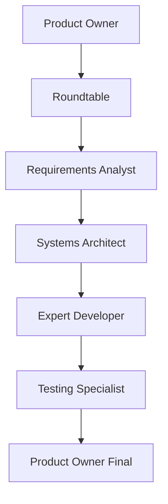

# AgileDevAgent - AI Coding Assistant Instructions

This is an **AI Agent Development Framework** for building .NET applications using **automated workflows** with **Scrum practices**, **BDD**, **DDD**, and **Clean Architecture**.

## Architecture Overview

### Multi-Modal Agent System
- **Manual agents** (`agents/manual/`): GitHub Copilot Chat compatible agents with YAML frontmatter configuration
- **Automated orchestration** (`orchestrators/`): CrewAI and AutoGen scripts for agent coordination (preview)
- **Structured workflows** (`powershell/`): PowerShell scripts for setup and execution automation
- **Input/Output model**: `in/sprint{X}/{activity}/` → `out/sprint{X}/{activity}/` with standardized artifacts

### Agent Workflow Pattern


Each agent **requests approval [SIM/NÃO]** before auto-executing the next agent in sequence.

## Essential Development Patterns

### Agent Definition Structure
All agents use YAML frontmatter with:
```yaml
---
id: agent_name
model_preferences:
  - provider: openai
    model: gpt-4o
inputs: {business_request: "in/sprint{sprint}/{activity}/business_request/"}
outputs: {artifact_name: "out/sprint{sprint}/{activity}/00-artifact.md"}
parameters: [sprint, activity]
---
```

### Standardized Artifacts
- `00-business-context.md` + `00-requirements-brief.md` (Product Owner)
- `01-ata-mesa-redonda.md` (Roundtable facilitation)
- `02-requisitos-bdd.md` + `features/*.feature` (BDD scenarios)
- `03-arquitetura.md` + `adrs/` + `diagrams/` (Architecture + ADRs)
- `04-desenvolvimento.md` + `engineering/src/` + `engineering/tests/` (Implementation)
- `05-qa-plano.md` + `engineering/reports/` (QA strategy)
- `99-checklist-final.md` (Final validation)

## Critical Development Commands

### Project Setup
```powershell
# One-command installation with project analysis
powershell -NoProfile -ExecutionPolicy Bypass -File .\Install\setup-workflow.ps1

# Manual structure creation
.\powershell\start-manual.ps1 -Sprint 01 -Activity rn0001

# Diagram rendering (requires Node.js + mermaid-cli)
.\powershell\render-diagrams.ps1
```

### Environment Configuration
- Copy `.env.example` to `.env` and configure `LLM_PROVIDER`, `LLM_MODEL`, API keys
- Supports OpenAI, Azure OpenAI, and OpenAI-compatible providers (Ollama/LM Studio)
- Python environment in `.venv-1` with `requirements.txt` (CrewAI, AutoGen, OpenAI)

## Project-Specific Conventions

### .NET Development Standards (from `agents.index.json`)
- **Framework**: .NET Framework 4.8
- **Architecture**: Clean Architecture (Domain/Application/Infrastructure/API layers)
- **Patterns**: DDD, SOLID, Result envelope pattern
- **Validation**: FluentValidation required for all input validation
- **Logging**: Serilog with structured logging
- **Testing**: xUnit + FluentAssertions + Bogus (90%+ coverage required)
- **Naming**: English code, Portuguese user messages

### File Organization Patterns
- **Business rules**: `RN-00xx.md` format in `references-data/business-rules/`
- **Architecture decisions**: Nygard ADR template in `adrs/`
- **Diagrams**: Mermaid format (`.mmd`) in `diagrams/`
- **Features**: Gherkin BDD scenarios in `features/`
- **Source code**: Clean Architecture structure in `engineering/src/`

### Agent Execution Patterns
- **No questions policy**: Agents make up to 3 reasonable assumptions instead of asking
- **Auto-execution**: Each agent ends with next agent invocation after approval
- **Context propagation**: Previous artifacts are inputs for subsequent agents
- **Project analysis integration**: Auto-reads `project-analysis.md` when working on existing projects

### Git Commit Standards
Follow the market standard commit pattern with gitemoji:
```
[gitemoji] [tipo do commit] - [Descrição da atividade]
```

**Examples:**
- `✨ feat - Add user authentication system`
- `🐛 fix - Resolve null reference in payment validation`
- `📝 docs - Update API documentation for notification service`
- `♻️ refactor - Restructure domain entities using DDD patterns`
- `✅ test - Add unit tests for calculation engine`
- `🔧 chore - Update NuGet packages to latest versions`

**Common Gitemojis:**
- ✨ `:sparkles:` - New feature
- 🐛 `:bug:` - Bug fix
- 📝 `:memo:` - Documentation
- ♻️ `:recycle:` - Refactoring
- ✅ `:white_check_mark:` - Tests
- 🔧 `:wrench:` - Configuration/tooling
- 🚀 `:rocket:` - Performance improvements
- 🔒 `:lock:` - Security fixes

## Integration Points

### VS Code Copilot Chat Usage
Execute agents via: `@agents/manual/agent-name.agent.md` with context like:
```
"Analyze demand RN-0015 - Notification System:
- Context: Desktop notification system
- Stakeholders: End users, admins
- Priority: High"
```

### Orchestration Systems
- **CrewAI** (`orchestrators/crewai_runner.py`): Multi-agent coordination (preview)
- **AutoGen** (`orchestrators/autogen_dev_team.py`): Conversational agents (preview)
- **Manual workflow** (`powershell/start-manual.ps1`): Production-ready process

### External Dependencies
- **Mermaid CLI**: For diagram rendering to PNG/SVG
- **PostgreSQL**: Primary database for .NET applications
- **GitHub Copilot**: Primary IDE integration point
- **Various LLM providers**: OpenAI, Azure, Ollama support

## Working with Existing Projects

The framework includes automatic project analysis:
1. Detects project type (.NET/Node/Angular/React)
2. Analyzes architecture, technologies, patterns
3. Generates `project-analysis.md` with context
4. Integrates existing `.github/copilot-instructions.md` if found
5. Contextualizes all agents with existing project knowledge

When working on existing codebases, **always reference `project-analysis.md` first** to maintain consistency with established patterns and technologies.