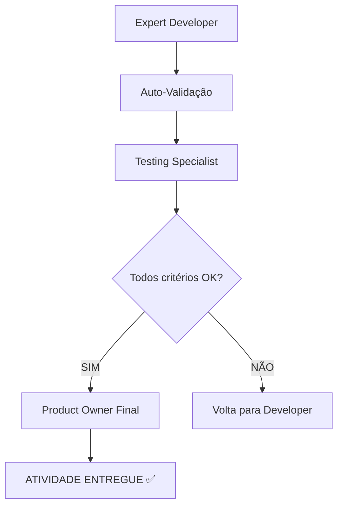
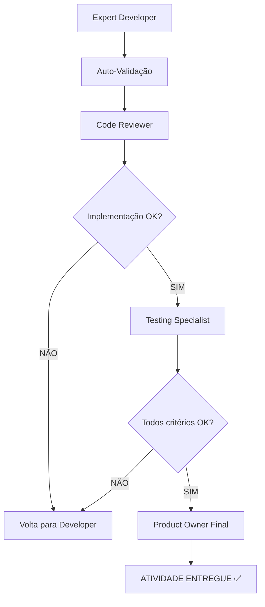
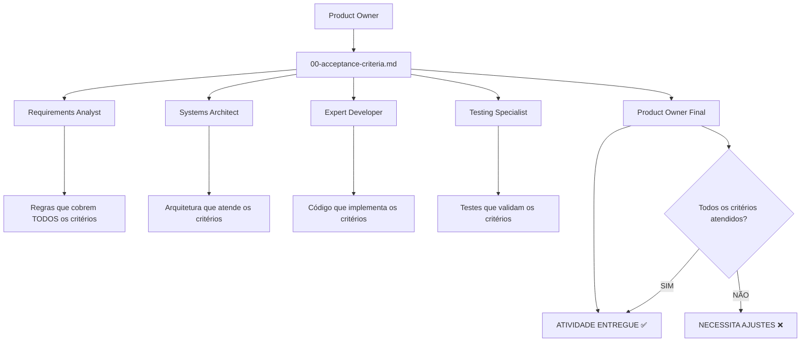

# RickytechAgileAgent - Agentes de Desenvolvimento Ágil

**Versão:** 2.2.0 - **Parallel Execution Edition**  
**Autor:** Ricardo Macedo Perdigão  
**Data:** 30 de Setembro de 2025

## 🎯 **O que é o RickytechAgileAgent?**

O RickytechAgileAgent é um **sistema de agentes inteligentes** que automatiza o processo completo de desenvolvimento de software seguindo metodologias ágeis. Ele transforma uma simples solicitação de negócio em documentação completa, código implementado e planos de teste.

**Para Desenvolvedores:** Imagine ter uma equipe de especialistas (Product Owner, Arquiteto, Desenvolvedor Sênior, etc.) que trabalha automaticamente para você, gerando toda a documentação e código necessário para implementar uma funcionalidade.

## 🚀 **Como Funciona o Sistema?**

O sistema possui **10 agentes especializados** que trabalham em sequência:

```
1️⃣ Product Owner       → Analisa o negócio
2️⃣ Mesa Redonda        → Alinha tecnicamente  
3️⃣ Requirements        → Cria cenários BDD
4️⃣ Arquiteto           → Define a solução
5️⃣ UX/UI Specialist    → Cria wireframes e design system
6️⃣ Testing Specialist  → Cria plano de QA (TDD)
7️⃣ Desenvolvedor       → Implementa seguindo TDD
8️⃣ Testing Validator   → Valida implementação  
9️⃣ Code Reviewer       → Auditoria qualidade (opcional)
🔟 PO Final            → Valida critérios aceite
```

**🆕 NOVO: Fluxo TDD integrado** com Testing Specialist criando o plano ANTES do desenvolvimento!  
**Cada agente pede sua aprovação antes de continuar para o próximo!**

## 📚 Índice Geral de Documentação

### 📁 **Documentação Principal**
- **[📖 docs/fluxo-completo.md](./docs/fluxo-completo.md)** - **GUIA PRINCIPAL: Do zero à mesa redonda**
- **[🚀 docs/guia-paralelizacao.md](./docs/guia-paralelizacao.md)** - **NOVO: Execução paralela de múltiplas atividades**
- **[🎯 docs/guia-agentes-individuais.md](./docs/guia-agentes-individuais.md)** - **NOVO: Como usar cada agente individualmente**
- **[🧪 docs/exemplo-fluxo-tdd-completo.md](./docs/exemplo-fluxo-tdd-completo.md)** - **NOVO: Exemplo prático TDD completo**
- **[📖 docs/README.md](./docs/README.md)** - Índice completo da documentação técnica
- **[📋 docs/resumo-melhorias-setup.md](./docs/resumo-melhorias-setup.md)** - Últimas melhorias implementadas no instalador

### 🛠️ **Prompts e Agentes**
- **[📝 prompts-manual/prompts/README.md](./prompts-manual/prompts/README.md)** - Guia principal dos prompts e agentes
- **[📚 prompts-manual/prompts/reference/README.md](./prompts-manual/prompts/reference/README.md)** - Exemplos de referência para uso individual
- **[📁 prompts-manual/prompts/deprecated/README.md](./prompts-manual/prompts/deprecated/README.md)** - Prompts descontinuados (arquivo histórico)

### 📦 **Resultados**  
- **[📊 out/README.md](./out/README.md)** - Estrutura e organização dos artefatos gerados

### 📄 **Exemplos e Instruções**
- **[💼 docs/exemplo-instrucoes-personalizada.md](./docs/exemplo-instrucoes-personalizada.md)** - Como personalizar agentes para sua empresa
- **[👤 docs/exemplo-product-owner.instructions.md](./docs/exemplo-product-owner.instructions.md)** - Exemplo prático de instruções para Product Owner
- **[🔍 docs/analise-projeto-existente.md](./docs/analise-projeto-existente.md)** - Análise automática de projetos existentes
- **[🤖 docs/integracao-github-copilot.md](./docs/integracao-github-copilot.md)** - **NOVO:** Integração automática com GitHub Copilot

## 📋 **Pré-requisitos (O que você precisa ter instalado)**

- **Windows 10/11** com PowerShell
- **Git** (para controle de versão)
- **VS Code** com extensão GitHub Copilot (OBRIGATÓRIO)
- **Conta GitHub** com Copilot ativo

---

## 🎯 **NOVO: Guia de Agentes Individuais**

**📖 [Acesse o Guia Completo](./docs/guia-agentes-individuais.md)**

Quer usar apenas **1 agente específico** ao invés do fluxo completo? Agora você pode! 

**Exemplos rápidos:**
- 🎯 **Product Owner** apenas: Analisar viabilidade de uma ideia
- 🤝 **Mesa Redonda** apenas: Debater decisão arquitetural complexa  
- 🧪 **Testing Specialist** apenas: Criar plano de testes TDD
- 💻 **Expert Developer** apenas: Implementar funcionalidade específica
- ✅ **Product Owner Final** apenas: Validar critérios de aceite

**Cada agente tem:**
- ✅ **3+ exemplos práticos** (básico, intermediário, avançado)
- ✅ **Templates de entrada** padronizados
- ✅ **Troubleshooting** de problemas comuns
- ✅ **Dicas de otimização** específicas

**Perfeito para:** refinamento de backlog, validações pontuais, implementações específicas, debugging de processos.

---

## 🚀 **NOVO: Execução Paralela de Múltiplas Atividades**

**📖 [Acesse o Guia Completo](./docs/guia-paralelizacao.md)**

Agora você pode trabalhar com **múltiplas atividades simultaneamente**! 

### **⚡ Quick Start Paralelo:**
```powershell
# Interface simplificada - escolha entre 6 modos
.\powershell\quick-start.ps1 -Sprint 02
```

### **🚀 Execução Direta (Avançado):**
```powershell
# Múltiplas atividades com pipeline completo
.\powershell\start-multi-activities.ps1 -Sprint 02 -Activities @("sistema-login", "modulo-relatorios", "integracao-sap") -ParallelSetup -CreatePipeline
```

### **📊 Monitoramento em Tempo Real:**
```powershell
# Dashboard de status das atividades
.\powershell\manage-parallel-execution.ps1 -Sprint 02 -Action status

# Próximas execuções recomendadas  
.\powershell\manage-parallel-execution.ps1 -Sprint 02 -Action next
```

### **🎯 Benefícios da Paralelização:**
- ⚡ **300% mais velocidade** na análise inicial (Product Owner simultâneo)
- 📊 **Dashboard visual** com progresso em tempo real
- 🧠 **Detecção automática** de dependências entre atividades
- 🔄 **Pipeline escalonado** otimizado automaticamente
- 🎯 **Múltiplos squads** trabalhando independentemente

### **📋 Guias Automáticos Gerados:**
- `parallel-execution-guide.md` - Instruções de execução paralela
- `pipeline-schedule.md` - Cronograma otimizado por semanas  
- `dependency-matrix.md` - Análise de dependências entre atividades

**Perfeito para:** projetos grandes, múltiplos squads, otimização de throughput, pipelines complexos.

**O sistema instala automaticamente:**
- Python 3.12 (para agentes automáticos)
- Node.js LTS (para diagramas)
- .NET SDK 8 (para projetos .NET)
- Mermaid CLI (para gerar diagramas)

---

## 🚀 **PASSO 1: Instalação (Comando Único)**

**Abra o PowerShell como Administrador e execute:**

```powershell
# Navegue até a pasta do Rickytech.System.AI.OnPremisse.AI
cd "C:\Projetos\Rickytech.System.AI.OnPremisse.AI"

# Execute o instalador
powershell -NoProfile -ExecutionPolicy Bypass -File .\Install\setup-workflow.ps1
```

### 📝 **O que acontece durante a instalação:**

```
1️⃣ Sistema pergunta: "Onde quer que gere os Agentes?"
   → Digite: C:\Projetos\MeuWorkspace\IA

2️⃣ Sistema instala pré-requisitos automaticamente
   → Python, Node.js, Git, .NET SDK

3️⃣ Sistema pergunta: "Selecione o modo:"
   → Digite: 1 (Manual - RECOMENDADO para iniciantes)

4️⃣ Sistema pergunta informações do projeto:
   → Sprint: 01
   → Activity: rn0001  
   → Nome do projeto: MeuSistema

5️⃣ Sistema pergunta: "Tipo de trabalho:"
   → Digite: 1 (Projeto novo) OU 2 (Projeto existente)

6️⃣ Se projeto novo: "Onde CRIAR o novo projeto?"
   → Digite: C:\Projetos\MeuSistema

7️⃣ Se projeto existente: "Onde ESTÁ o projeto existente?"
   → Digite: C:\Projetos\SistemaAtual

8️⃣ Sistema copia agentes e configura tudo automaticamente
```

### ✅ **Resultado da Instalação:**

```
📁 C:\Projetos\MeuWorkspace\IA\     ← AGENTES (onde ficam os workflows)
├── agents/manual/                  ← 10 agentes especializados
├── in/sprint01/rn0001/            ← ENTRADA (você coloca documentos aqui)
│   ├── business_request/          ← Solicitações do cliente
│   └── attachments/               ← Documentos técnicos
├── out/sprint01/rn0001/           ← SAÍDA (agentes geram aqui)
└── powershell/                    ← Scripts de automação

📁 C:\Projetos\MeuSistema\          ← PROJETO (seu código fica aqui)
├── src/                           ← Código-fonte
├── docs/                          ← Documentação do projeto
└── MeuSistema.sln                 ← Solution .NET
```

### 🎨 **Ferramentas de Design e Wireframes (NOVO)**

O AgileDevAgent agora inclui **ferramentas visuais integradas** para criar wireframes, protótipos e design systems:

```powershell
# 🎨 Configurar ferramentas de design para uma atividade
.\powershell\setup-design-tools.ps1 -Sprint 01 -Activity rn0001 -InstallDesignTools -GenerateWireframes

# 👁️ Visualizar wireframes no navegador
.\powershell\view-wireframes.ps1 -Sprint 01 -Activity rn0001 -OpenBrowser -ExportImages
```

#### **🛠️ Funcionalidades Incluídas:**

**📐 Wireframes ASCII:**
- Layout estrutural em texto (fácil versionamento)
- Componentes visuais com emojis
- Breakpoints responsivos documentados

**🔄 Diagramas Mermaid:**
- User flows interativos
- Sitemaps e arquitetura de informação
- Component trees exportáveis para PNG

**🌐 Preview HTML:**
- Protótipos clicáveis em tempo real
- Grid system responsivo
- Live Server integration (VS Code)

**🎯 Design System:**
- Design tokens (colors, typography, spacing)
- Component library com CSS
- Guidelines de acessibilidade WCAG 2.1 AA

#### **📊 Estrutura Gerada:**

```
out/sprint01/rn0001/
├── 04-wireframes/
│   ├── ascii/              ← Wireframes em texto
│   ├── mermaid/            ← Diagramas de fluxo
│   ├── html-preview/       ← Protótipos navegáveis
│   └── images/             ← PNGs exportados
├── 04-components/          ← Especificações de componentes
├── 04-design-system.md    ← Tokens e guidelines
└── 04-wireframe-report.md ← Relatório completo
```

#### **🎨 Extensions VS Code Instaladas:**
- **Figma for VS Code** - Integração com Figma
- **Live Server** - Preview em tempo real
- **Tailwind CSS IntelliSense** - Autocomplete CSS
- **Mermaid Markdown** - Visualização de diagramas

#### **⚡ Comandos Úteis:**
```powershell
# Exportar diagramas para imagens
mmdc -i wireframes/mermaid/user-flow.md -o user-flow.png

# Abrir workspace de design
code out/sprint01/rn0001/04-wireframes/

# Gerar Storybook para componentes  
.\view-wireframes.ps1 -Sprint 01 -Activity rn0001 -GenerateStorybook
```

**Perfeito para:** UX/UI designers, front-end developers, prototipação rápida, documentação visual.

---

## 🎯 **PASSO 2: Como Usar - Processo Manual (RECOMENDADO)**

**Processo Manual:** Aqui você controla cada etapa e tem total visibilidade do que acontece. É o modo recomendado para começar.

### **📝 2.1: Preparar sua Solicitação**

**Primeiro, crie um documento com sua solicitação:**

```powershell
# Vá para o workspace dos agentes
cd "C:\Projetos\MeuWorkspace\IA"

# Crie um documento com sua solicitação
notepad .\in\sprint01\rn0001\business_request\minha_solicitacao.md
```

**Exemplo de conteúdo:**
```markdown
# Solicitação: Login com Google

## O que preciso:
Implementar login com Google OAuth no sistema de vendas

## Por que preciso:
Os usuários querem acessar o sistema usando sua conta Google

## Critérios de sucesso:
- Usuário clica em "Login com Google"
- Sistema redireciona para Google
- Usuário autoriza e volta logado no sistema
```

### **📱 2.2: Iniciar o Processo Manual**

**QUEM INICIA:** Sempre o **Product Owner** (PO)  
**COMO INICIAR:** GitHub Copilot Chat no VS Code

```powershell
# Abra o VS Code no workspace dos agentes
cd "C:\Projetos\MeuWorkspace\IA"
code .
```

**No GitHub Copilot Chat (Ctrl+Shift+I), digite:**

```
@agents/manual/product-owner.agent.md

RN-0001: Implementar login com Google OAuth
Sprint: 01
Activity: rn0001
Sistema: Sistema de Vendas (.NET + React)

Analise a solicitação e prepare a mesa redonda.
```

### **🔄 2.3: Fluxo de Execução Detalhado**

**O que acontece depois que você executa o PO:**

```
🤖 Product Owner analisa e gera:
├── 00-business-context.md        ← Contexto de negócio
├── 00-requirements-brief.md      ← Resumo de requisitos
└── 01-ata-mesa-redonda.md       ← Template da reunião

🤖 Product Owner pergunta:
"Mesa Redonda Preparada - Aguardando Aprovação
Resumo: RN-0001, Média complexidade, OAuth Google, Frontend+Backend
Posso prosseguir? [SIM/NAO/REVISAR]"

� Você responde: SIM

🤖 Sistema executa automaticamente o próximo agente...
```

### **📋 2.4: Sequência Completa de Execução**

**Sequência de Execução:** Cada agente faz uma parte específica do trabalho:

| **Agente** | **O que faz** | **Gera** | **Pergunta** |
|------------|---------------|----------|--------------|
| **1️⃣ Product Owner** | Analisa o negócio | Requirements + Context | Posso fazer mesa redonda? |
| **2️⃣ Mesa Redonda** | Alinha tecnicamente | Ata da reunião | Posso analisar requisitos? |
| **3️⃣ Requirements** | Cria cenários BDD | Features de teste | Posso fazer arquitetura? |
| **4️⃣ Systems Architect** | Define solução | ADRs + Diagramas | Posso criar wireframes? |
| **5️⃣ UX/UI Specialist** | Cria wireframes | Design System + Protótipos | Posso criar plano TDD? |
| **6️⃣ Testing Specialist** | Plano TDD | Estratégia de testes | Posso implementar código? |
| **7️⃣ Expert Developer** | Implementa TDD | Classes + Testes | Posso validar implementação? |
| **8️⃣ Testing Validator** | Valida testes | Relatório conformidade | Posso revisar código? (opcional) |
| **9️⃣ Code Reviewer** | Auditoria código | Relatório qualidade | Posso validar critérios? (opcional) |
| **🔟 PO Final** | Validação final | Checklist aceite | CONCLUÍDO ✅ |

### **🎮 2.5: Controlando o Fluxo**

**Quando cada agente perguntar, você pode responder:**

- **SIM** → Continua automaticamente para o próximo agente
- **NAO** → Para o fluxo para você revisar e ajustar

---

## **🔥 Mesa Redonda: O "CrewAI Manual" Perfeito**

**⭐ RECURSO DESTAQUE:** A Mesa Redonda simula **debate entre múltiplos especialistas** de forma manual e controlada - como ter um CrewAI sem a complexidade e custo!

### **🎯 Como Funciona o "CrewAI Manual":**

#### **1️⃣ Execute APENAS o Mesa Redonda:**
```
@agents/manual/roundtable-facilitator.agent.md

Sprint: 02, Activity: sistema-pedidos
Contexto: "E-commerce B2B com integração ERP - preciso debater arquitetura"
```

#### **2️⃣ O Facilitador Simula Esta Conversa:**

```markdown
## 🎤 RODADA INICIAL (5 min cada especialista)

### Requirements Analyst (RA):
"Vejo necessidade de integração com ERP. Sugiro BDD com cenários:
- DADO pedido válido QUANDO sincronizar ERP ENTÃO atualizar estoque
- Validação de crédito automática via API financeira"

### Systems Architect (SA):  
"Concordo com RA. Proponho Clean Architecture:
- Domain: Pedido, Cliente, Produto (DDD)
- Application: CQRS para consultas vs comandos
- Infrastructure: PostgreSQL + Redis cache
- API: REST padronizada + Swagger"

### Expert Developer (Dev):
"Arquitetura sólida! Implementarei:
- FluentValidation para regras de negócio
- MediatR para CQRS
- Entity Framework + Repository pattern
- Background jobs para sincronização ERP"

### Frontend Specialist (UI/UX):
"Para B2B sugiro Angular + PO-UI:
- Componentes de tabela avançada (filtros, paginação)
- Dashboard responsivo para mobile
- PWA para offline capability
- Integração via HttpClient + interceptors"

### Testing Specialist (QA):
"Estratégia de testes:
- Unit: 90% cobertura (domínio + application)
- Integration: APIs + banco de dados
- E2E: Cypress para fluxos críticos
- Performance: carga para 1000+ usuários"

## 🔥 DEBATE LIVRE (convergências e conflitos)

SA: "Dev, considera Event Sourcing para auditoria?"
Dev: "Para B2B é overkill. CQRS + audit log resolve."
QA: "Event Sourcing complica testes. Concordo com Dev."
Frontend: "Preciso de APIs GraphQL para componentes dinâmicos?"
SA: "REST resolve. GraphQL adiciona complexidade desnecessária."

## ✅ CONVERGÊNCIA E DECISÕES FINAIS
- Backend: .NET + Clean Architecture + CQRS
- Frontend: Angular + PO-UI  
- Banco: PostgreSQL + Redis
- Testes: 90% cobertura + Cypress E2E
```

### **⚡ Vantagens do "CrewAI Manual":**

| **Aspecto** | **CrewAI Manual (Mesa Redonda)** | **CrewAI Automático** | **Agentes Individuais** |
|-------------|--------------------------------|---------------------|------------------------|
| **Controle** | 🟢 **Total** (pode interromper/redirecionar) | 🔴 Execução automática | 🟡 Controle por etapa |
| **Custo** | 🟢 **Baixo** (uma conversa) | 🔴 Alto (múltiplos agentes) | 🟢 Baixo |
| **Debate** | 🟢 **Simulação realista** | 🟢 Debate real | 🔴 Sem debate |
| **Customização** | 🟢 **Foco dirigido** | 🔴 Difícil controlar | 🟡 Individual |
| **Velocidade** | 🟢 **Rápido** | 🟡 Médio | 🔴 Lento (5 execuções) |

### **🚀 Técnicas Avançadas para "CrewAI Manual":**

#### **1️⃣ Debate Dirigido:**
```
@agents/manual/roundtable-facilitator.agent.md

"FOCO ESPECÍFICO: Debater apenas arquitetura de dados.
Participantes devem decidir entre:
- Microserviços + Event Sourcing
- Monólito Modular + CQRS  
- Serverless + DynamoDB

Cada especialista deve defender UMA opção com prós/contras detalhados."
```

#### **2️⃣ Cenários Conflitantes:**
```
@agents/manual/roundtable-facilitator.agent.md

"CENÁRIO DE CONFLITO: Cliente quer delivery em 2 meses vs qualidade enterprise.
- SA deve defender arquitetura robusta (6 meses)
- Dev deve defender solução rápida (MVP em 2 meses)  
- QA deve apresentar riscos de cada abordagem
- Frontend deve mostrar impacto na UX
Facilitador deve levar ao consenso prático."
```

#### **3️⃣ Mesa Redonda Multi-Rodadas:**
```powershell
# Rodada 1: Arquitetura Geral
@agents/manual/roundtable-facilitator.agent.md
"Debater visão geral da solução"
# → Você aprova: [SIM] 

# Rodada 2: Detalhamento Frontend  
@agents/manual/roundtable-facilitator.agent.md
"FOCO: Apenas decisões de UI/UX, componentes e integração com backend"
# → Você aprova: [SIM]

# Rodada 3: Estratégia de Testes
@agents/manual/roundtable-facilitator.agent.md  
"FOCO: Apenas cobertura, performance e automação de testes"
# → Você aprova: [SIM] → Continua fluxo normal
```

### **🎯 Workflow "CrewAI Manual" Completo:**

#### **Processo Otimizado:**
```powershell
# 1️⃣ Mesa Redonda = "CrewAI Simulado"
@agents/manual/roundtable-facilitator.agent.md
# → Debate entre 5 especialistas simultaneamente
# → Decisões consensuais em uma única sessão
# → Você aprova: [SIM/NÃO]

# 2️⃣ Se aprovado, continua automaticamente:
# → Requirements Analyst (BDD detalhado)
# → Systems Architect (ADRs + diagramas)  
# → Expert Developer (código + testes)
# → Testing Specialist (QA + validação)
# → Product Owner Final (checklist)
```

#### **Exemplos de Contextos para Mesa Redonda:**

```powershell
# Exemplo 1: Projeto Novo
@agents/manual/roundtable-facilitator.agent.md
"Sistema de gestão escolar - debater se usar microserviços ou monólito modular"

# Exemplo 2: Refatoração  
@agents/manual/roundtable-facilitator.agent.md
"Sistema legado em .NET Framework - migrar para .NET 8 + Clean Architecture"

# Exemplo 3: Performance
@agents/manual/roundtable-facilitator.agent.md
"API com lentidão - debater entre cache Redis vs otimização de queries vs CDN"

# Exemplo 4: Tecnologia Nova
@agents/manual/roundtable-facilitator.agent.md
"Implementar IA no sistema - debater LLM local vs API OpenAI vs Azure Cognitive"
```

### **💡 Dica Pro: Re-execução com Focos Específicos**

**Você pode "re-executar" a mesa redonda** quantas vezes quiser com focos diferentes:

```powershell
# Mesa Principal: Decisões gerais
@agents/manual/roundtable-facilitator.agent.md
"Visão geral - arquitetura, tecnologias, cronograma"

# Mesa Técnica: Aprofundamento  
@agents/manual/roundtable-facilitator.agent.md
"Redebater apenas aspectos de performance, escalabilidade e otimização"

# Mesa de Segurança: Compliance
@agents/manual/roundtable-facilitator.agent.md  
"Redebater apenas segurança, LGPD, auditoria e compliance"

# Mesa de UX: Experiência
@agents/manual/roundtable-facilitator.agent.md
"Redebater apenas interface, usabilidade e acessibilidade"
```

### **🎯 Quando Usar Mesa Redonda vs Agentes Individuais:**

| **Situação** | **Use Mesa Redonda** | **Use Agentes Individuais** |
|--------------|---------------------|----------------------------|
| **Decisões arquiteturais** | ✅ **Debate necessário** | ❌ Opiniões isoladas |
| **Conflitos técnicos** | ✅ **Resolve consensualmente** | ❌ Cada um dá sua opinião |
| **Brainstorming** | ✅ **Ideias cruzadas** | ❌ Pensamento linear |
| **Validação rápida** | ✅ **Múltiplas perspectivas** | ❌ Uma perspectiva por vez |
| **Implementação dirigida** | ❌ Decisão já tomada | ✅ **Execução focada** |

---

### **🏆 Resumo: Mesa Redonda é o "CrewAI Manual" Perfeito!**

- 🤝 **Debate simulado** entre 5 especialistas
- 🎮 **Controle total** do processo (pode parar/redirecionar)
- 💰 **Custo baixo** vs CrewAI automático
- ⚡ **Flexibilidade** para focos específicos
- 🎯 **Qualidade superior** com validação humana
- 🔄 **Re-executável** com contextos diferentes

**Use sempre que precisar de múltiplas perspectivas técnicas em uma única sessão!**
- **REVISAR** → Mostra os documentos gerados para validação

**Exemplo prático:**
```
🤖 Requirements Analyst: "Posso prosseguir para arquitetura? [SIM/NAO/REVISAR]"

👤 Se você digitar: REVISAR
🤖 Sistema mostra: "Arquivos gerados: 02-requisitos-bdd.md, features/login.feature"

👤 Se você digitar: SIM  
🤖 Sistema executa: Systems Architect automaticamente

👤 Se você digitar: NAO
🤖 Sistema para: Você pode ajustar os requisitos e reiniciar
```

---

## **🎭 Guia Completo dos Agentes Especializados**

**Cada agente é um especialista com personalidade, conhecimentos e responsabilidades únicos. Conheça em detalhes como cada um trabalha:**

### **🎯 1. Product Owner Agent - O Visionário do Negócio**

#### **📋 O que faz:**
- ✅ **Analisa solicitações** do cliente e identifica valor de negócio
- ✅ **Define visão do produto** e objetivos estratégicos
- ✅ **Prioriza funcionalidades** por impacto e ROI
- ✅ **Comunica requisitos** de forma clara para equipe técnica
- ✅ **Gerencia expectativas** e alinhamento de escopo

#### **💻 Como executar:**
```
@agents/manual/product-owner.agent.md

Sprint: 02, Activity: sistema-login
Contexto: "Sistema de autenticação para ERP empresarial - precisa integrar com Active Directory"
```

#### **📁 Arquivos gerados:**
```
out/sprint02/sistema-login/
├── 00-requirements-brief.md     ← Resumo executivo dos requisitos
├── 00-business-context.md       ← Contexto de negócio detalhado
└── 00-acceptance-criteria.md    ← CRITERIOS DE ACEITE (BASE PARA TODA A EQUIPE)
```

#### **🎯 Exemplo de output:**
```markdown
## Acceptance Criteria - Sistema Login

### Critério 1: Integração com Active Directory
- Sistema DEVE autenticar usuários via Active Directory
- Login DEVE funcionar com credenciais corporativas existentes
- Tempo de resposta DEVE ser inferior a 2 segundos
- EVIDÊNCIA: Testes automatizados de integração AD

### Critério 2: Interface Responsiva
- Interface DEVE funcionar em desktop (1920x1080+)
- Interface DEVE funcionar em mobile (360x640+)
- Todos os elementos DEVEM ser acessíveis (WCAG 2.1)
- EVIDÊNCIA: Testes E2E em múltiplas resoluções

### Critério 3: Auditoria e Compliance
- Sistema DEVE registrar todos os logins em log auditável
- Logs DEVEM incluir: usuário, timestamp, IP, resultado
- Retenção de logs DEVE ser mínimo 12 meses
- EVIDÊNCIA: Relatório de auditoria automatizado

### Definition of Done:
- ✅ Todos os critérios implementados
- ✅ Testes automatizados passando
- ✅ Documentação técnica completa
- ✅ Deploy em ambiente de homologação
```

#### **✅ Quando usar sozinho:**
- **Definição de critérios de aceite** com stakeholders
- Análise inicial de viabilidade
- Validação de escopo com stakeholders
- Priorização de backlog

---

### **🎯 2. Requirements Analyst Agent - O Especialista em Regras**

#### **📋 O que faz:**
- ✅ **Analisa critérios de aceite** como base principal do trabalho
- ✅ **Cria regras de negócio** que CUBRAM todos os critérios de aceite
- ✅ **Traduz requisitos** de negócio para cenários técnicos (BDD)
- ✅ **Cria features Gherkin** que VALIDEM cada critério de aceite
- ✅ **Identifica regras de negócio** complexas e validações
- ✅ **Mapeia fluxos alternativos** e exceções

#### **💻 Como executar:**
```
@agents/manual/requirements-analyst.agent.md

Sprint: 02, Activity: sistema-login
Contexto: "Baseado nos CRITERIOS DE ACEITE do PO, criar cenários BDD que garantam cobertura completa de todos os critérios"
```

#### **📁 Arquivos gerados:**
```
out/sprint02/sistema-login/
├── 02-requisitos-bdd.md          ← Análise técnica completa
└── features/
    ├── autenticacao.feature      ← Cenários BDD Gherkin
    ├── recuperacao-senha.feature
    └── auditoria-acesso.feature
```

#### **🎯 Exemplo de output:**
```gherkin
# features/autenticacao.feature

Funcionalidade: Autenticação via Active Directory
  Como usuário corporativo
  Quero fazer login com minhas credenciais AD
  Para acessar o sistema sem criar nova conta

  Cenário: Login válido com usuário AD
    Dado que o usuário "joao.silva" existe no Active Directory
    E o usuário está na tela de login
    Quando informar login "joao.silva" e senha correta
    Então deve ser redirecionado para dashboard principal
    E deve exibir mensagem "Bem-vindo, João Silva"

  Cenário: Falha de conexão com AD
    Dado que o Active Directory está indisponível
    Quando tentar fazer login
    Então deve exibir "Serviço temporariamente indisponível"
    E deve permitir login com cache local (se habilitado)
```

#### **✅ Quando usar sozinho:**
- **Análise de cobertura** dos critérios de aceite
- Refinamento de user stories existentes
- Criação de cenários de teste detalhados
- Validação de regras de negócio

---

### **🎯 3. Systems Architect Agent - O Mestre da Arquitetura**

#### **📋 O que faz:**
- ✅ **Define arquitetura técnica** (Clean Architecture, DDD, SOLID)
- ✅ **Cria ADRs** (Architecture Decision Records)
- ✅ **Desenha diagramas** Mermaid (componentes, sequência, ER)
- ✅ **Escolhe tecnologias** e padrões adequados
- ✅ **Planeja integrações** e APIs

#### **💻 Como executar:**
```
@agents/manual/systems-architect.agent.md

Sprint: 02, Activity: sistema-login
Contexto: "Arquitetura para autenticação AD + cache local + auditoria completa"
```

#### **📁 Arquivos gerados:**
```
out/sprint02/sistema-login/
├── 03-arquitetura.md             ← Documento arquitetural
├── adrs/
│   ├── 001-clean-architecture.md
│   ├── 002-cache-redis.md
│   └── 003-audit-pattern.md
└── diagrams/
    ├── components.mmd           ← Diagrama de componentes
    ├── sequence-login.mmd       ← Fluxo de autenticação
    └── database-er.mmd          ← Modelo de dados
```

#### **🎯 Exemplo de output:**
```markdown
## ADR-001: Clean Architecture

### Contexto:
Sistema de autenticação crítico com requisitos de:
- Alta disponibilidade (99.9%)
- Integração com múltiplos provedores (AD, OAuth)
- Auditoria completa para compliance

### Decisão:
Clean Architecture com camadas bem definidas:
- Domain: Entidades User, Session, AuditLog
- Application: Use cases + CQRS para queries
- Infrastructure: AD Client, Redis Cache, SQL Server
- WebAPI: Controllers + JWT middleware

### Consequências:
✅ Testabilidade alta (mocks fáceis)
✅ Independência de frameworks
❌ Complexidade inicial maior
❌ Curva de aprendizado para equipe
```

#### **✅ Quando usar sozinho:**
- Decisões arquiteturais complexas
- Refatoração de sistemas legados
- Planejamento de integrações

---

### **🎯 4. Expert Developer Agent - O Implementador Master**

#### **📋 O que faz:**
- ✅ **ATENDE TODOS os critérios de aceite** definidos pelo Product Owner
- ✅ **Implementa código** que SATISFAÇA cada critério de aceite
- ✅ **Cria classes de domínio** com DDD e validações FluentValidation
- ✅ **Desenvolve APIs** com Swagger/OpenAPI completo
- ✅ **Escreve testes unitários** com xUnit e FluentAssertions
- ✅ **EVIDENCIA cumprimento** de cada critério no código
- ✅ **Configura DI** e logging estruturado com Serilog

#### **💻 Como executar:**
```
@agents/manual/expert-developer.agent.md

Sprint: 02, Activity: sistema-login
Contexto: "Implementar código que ATENDA TODOS os critérios de aceite definidos - AD + responsividade + auditoria + testes 90%+ cobertura"
```

#### **📁 Arquivos gerados:**
```
out/sprint02/sistema-login/
├── 04-desenvolvimento.md         ← Documentação + MATRIZ DE RASTREABILIDADE
└── engineering/
    ├── src/
    │   ├── Core/                ← Domain entities
    │   ├── Application/         ← Use cases + CQRS
    │   ├── Infrastructure/      ← AD client + cache
    │   └── WebAPI/             ← Controllers + middleware
    ├── tests/
    │   ├── UnitTests/          ← Testes de domínio
    │   ├── IntegrationTests/   ← Testes de API
    │   └── ArchitectureTests/  ← Testes de arquitetura
    └── validation/
        ├── traceability-matrix.md  ← Critério → Implementação → Teste
        ├── evidence-guide.md        ← Como testar cada critério
        └── self-validation.md       ← Auto-verificação do Developer
```

#### **🎯 Exemplo de código gerado:**
```csharp
// Domain/Entities/User.cs
public class User : BaseEntity
{
    public string Username { get; private set; }
    public string DisplayName { get; private set; }
    public UserRole Role { get; private set; }
    public DateTime LastLoginAt { get; private set; }

    public static Result<User> Create(string username, string displayName)
    {
        var validator = new UserValidator();
        var validationResult = validator.Validate(new { username, displayName });
        
        if (!validationResult.IsValid)
            return Result<User>.Failure(validationResult.Errors);

        return Result<User>.Success(new User 
        { 
            Username = username,
            DisplayName = displayName,
            Role = UserRole.Standard 
        });
    }

    public void RecordLogin()
    {
        LastLoginAt = DateTime.UtcNow;
        AddDomainEvent(new UserLoggedInEvent(Id, Username));
    }
}
```

#### **✅ Quando usar sozinho:**
- **Implementação dirigida por critérios de aceite**
- **Auto-validação de implementações** (com matriz de rastreabilidade)
- Implementação de funcionalidades específicas
- Refatoração de código existente
- Code review de arquitetura

---

### **🎯 5. Frontend Specialist Agent - O Mestre da Interface**

#### **📋 O que faz:**
- ✅ **Desenvolve interfaces** modernas e responsivas (Angular/React)
- ✅ **Implementa componentes** com bibliotecas UI (PO-UI, Material Design)
- ✅ **Integra com APIs** backend via HttpClient/Axios
- ✅ **Cria experiências** acessíveis (WCAG) e performantes
- ✅ **Desenvolve PWAs** com offline capability

#### **💻 Como executar:**
```
@agents/manual/frontend-specialist.agent.md

Sprint: 02, Activity: sistema-login
Contexto: "Interface de login responsiva + dashboard + integração com API JWT"
```

#### **📁 Arquivos gerados:**
```
out/sprint02/sistema-login/
├── 04-frontend-implementation.md  ← Documentação frontend
└── engineering/
    └── frontend/
        ├── src/app/
        │   ├── auth/           ← Módulo autenticação
        │   ├── dashboard/      ← Dashboard principal
        │   └── shared/         ← Componentes reutilizáveis
        └── e2e/               ← Testes E2E Cypress
```

#### **🎯 Exemplo de código gerado:**
```typescript
// auth/components/login/login.component.ts
@Component({
  selector: 'app-login',
  templateUrl: './login.component.html',
  styleUrls: ['./login.component.scss']
})
export class LoginComponent implements OnInit {
  loginForm: FormGroup;
  isLoading = false;
  
  constructor(
    private fb: FormBuilder,
    private authService: AuthService,
    private router: Router,
    private notificationService: NotificationService
  ) {
    this.loginForm = this.fb.group({
      username: ['', [Validators.required, Validators.minLength(3)]],
      password: ['', [Validators.required, Validators.minLength(6)]]
    });
  }

  async onSubmit() {
    if (this.loginForm.invalid) return;
    
    this.isLoading = true;
    
    try {
      const result = await this.authService.authenticate(this.loginForm.value);
      
      if (result.success) {
        this.notificationService.success(`Bem-vindo, ${result.user.displayName}`);
        this.router.navigate(['/dashboard']);
      } else {
        this.notificationService.error(result.message);
      }
    } catch (error) {
      this.notificationService.error('Erro de conexão. Tente novamente.');
    } finally {
      this.isLoading = false;
    }
  }
}
```

#### **✅ Quando usar sozinho:**
- Desenvolvimento focado em UX/UI
- Prototipagem de interfaces
- Integração com APIs específicas

---

### **🎯 6. Testing Specialist Agent - O Guardião da Qualidade**

#### **📋 O que faz:**
- ✅ **VALIDA TODOS os critérios de aceite** definidos pelo Product Owner
- ✅ **Garante que cada critério seja testável e testado**
- ✅ **Cria estratégia de testes** FOCADA nos critérios de aceite
- ✅ **Desenvolve planos de QA** com cobertura 90%+
- ✅ **Produz evidências** que COMPROVEM o atendimento dos critérios
- ✅ **Implementa testes automatizados** (xUnit, Cypress, Playwright)
- ✅ **Define cenários de performance** e carga
- ✅ **Planeja testes de segurança** e penetração

#### **💻 Como executar:**
```
@agents/manual/testing-specialist.agent.md

Sprint: 02, Activity: sistema-login
Contexto: "VALIDAR todos os critérios de aceite com evidências - AD + responsividade + auditoria + performance 1000 usuários"
```

#### **📁 Arquivos gerados:**
```
out/sprint02/sistema-login/
├── 05-qa-plano.md                ← Estratégia de QA completa
└── engineering/
    ├── tests/
    │   ├── LoadTests/           ← Testes de carga K6/NBomber
    │   ├── SecurityTests/       ← Testes OWASP
    │   └── E2E/cypress/         ← Testes E2E Cypress
    └── reports/
        ├── coverage/            ← Relatórios de cobertura
        ├── performance/         ← Métricas de performance
        └── security/           ← Relatórios de segurança
```

#### **🎯 Exemplo de testes gerados:**
```typescript
// E2E/cypress/integration/auth.spec.ts
describe('Sistema de Autenticação', () => {
  it('deve realizar login com credenciais válidas', () => {
    cy.visit('/login');
    
    cy.get('[data-testid="username-input"]')
      .type('joao.silva');
    
    cy.get('[data-testid="password-input"]')
      .type('senha123');
    
    cy.get('[data-testid="login-button"]')
      .click();
    
    cy.url().should('include', '/dashboard');
    cy.get('[data-testid="welcome-message"]')
      .should('contain', 'Bem-vindo, João Silva');
  });

  it('deve funcionar offline com cache local', () => {
    cy.mockOfflineMode();
    
    cy.get('[data-testid="username-input"]').type('usuario.cached');
    cy.get('[data-testid="password-input"]').type('senha123');
    cy.get('[data-testid="login-button"]').click();
    
    cy.get('[data-testid="offline-indicator"]')
      .should('be.visible');
    
    cy.url().should('include', '/dashboard');
  });
});
```

#### **✅ Quando usar sozinho:**
- **Validação de critérios de aceite** com evidências
- Planejamento de testes para features específicas
- Auditoria de qualidade de código existente
- Definição de critérios de aceite técnicos

---

### **🎯 7. Code Reviewer Agent - O Auditor Independente (OPCIONAL)**

#### **📋 O que faz:**
- ✅ **AUDITORIA INDEPENDENTE** da implementação do Expert Developer
- ✅ **VALIDAÇÃO DE PADRÕES** (nomenclatura, indentação, commits, estrutura)
- ✅ **VALIDAÇÃO DE QUALIDADE** (Clean Code, SOLID, DDD, segurança)
- ✅ **VERIFICAÇÃO DE EVIDÊNCIAS** fornecidas pelo Developer
- ✅ **PARECER TÉCNICO** independente sobre cada critério de aceite
- ✅ **CODE REVIEW** focado em qualidade, padrões e performance

#### **💻 Como executar:**
```
@agents/manual/code-reviewer.agent.md

Sprint: 02, Activity: sistema-login
Contexto: "Auditoria independente da implementação - todos os critérios foram corretamente implementados com qualidade?"
```

#### **📁 Arquivos gerados:**
```
out/sprint02/sistema-login/
└── 04.1-code-review.md          ← Parecer técnico independente
    ├── Critério 1: ✅ APROVADO
    ├── Critério 2: ❌ NECESSITA CORREÇÕES  
    ├── Critério 3: ✅ APROVADO
    └── DECISÃO: NECESSITA CORREÇÕES
```

#### **🎯 Exemplo de parecer:**
```markdown
## Code Review Report - Sistema Login

## ✅ PADRÕES DE DESENVOLVIMENTO  
- **NOMENCLATURA**: ✅ PascalCase classes, camelCase variáveis, nomes descritivos
- **INDENTAÇÃO**: ✅ Consistente, 4 espaços, sem tabs mistos  
- **COMMITS**: ❌ INCORRETO - "fix login" → Deveria ser "🐛 fix - Resolve AD timeout issue"
- **ESTRUTURA**: ✅ Clean Architecture respeitada (Core/Application/Infrastructure/API)
- **DOCUMENTAÇÃO**: ✅ XML docs presentes, README atualizado
- **WARNINGS**: ✅ Zero warnings de compilação
- **CONSISTÊNCIA**: ✅ Padrões uniformes em todo código

### Critério 1: Integração com Active Directory
- **STATUS**: ✅ APROVADO
- **IMPLEMENTAÇÃO**: AuthenticationService.cs - Bem estruturada
- **QUALIDADE**: Clean Architecture respeitada, SOLID aplicado
- **PADRÕES**: Nomenclatura e indentação corretas
- **TESTES**: AuthenticationTests.cs - Cobertura adequada  
- **EVIDÊNCIA**: Comando "dotnet test" validado - funcional
- **OBSERVAÇÕES**: Excelente tratamento de exceções

### Critério 2: Interface Responsiva  
- **STATUS**: ✅ APROVADO
- **IMPLEMENTAÇÃO**: LoginComponent.ts - Estrutura correta
- **QUALIDADE**: Código limpo e bem organizado
- **PADRÕES**: camelCase correto, indentação consistente
- **TESTES**: E2E desktop e mobile validados
- **EVIDÊNCIA**: Testes responsivos funcionais
- **OBSERVAÇÕES**: Implementação exemplar

### DECISÃO FINAL: ❌ NECESSITA CORREÇÕES
**Pendências**: 
- Corrigir mensagens de commit para seguir padrão gitemoji
- Exemplo: "🐛 fix - Resolve AD timeout in authentication service"
```

#### **✅ Quando usar:**
- **Projetos críticos** que precisam de validação extra
- **Sistemas de segurança** ou compliance
- **Quando há dúvidas** sobre a qualidade da implementação
- **Para garantia adicional** antes dos testes finais

---

### **🧪 7.1. Testing Validator Agent - O Validador TDD**

#### **📋 O que faz:**
- ✅ **VALIDA IMPLEMENTAÇÃO** dos testes definidos no plano de QA
- ✅ **COMPARA plano vs execução** - todos os cenários foram implementados?
- ✅ **EXECUTA TODOS OS TESTES** e verifica se passam conforme esperado
- ✅ **VERIFICA COBERTURA REAL** vs planejada (ex: meta 95%, atingido?)
- ✅ **VALIDA EVIDÊNCIAS** de cada critério de aceite
- ✅ **EMITE PARECER FINAL** - APROVADO ou NECESSITA CORREÇÕES
- ✅ **Específico para fluxo TDD** - valida pós-implementação

#### **💻 Como executar:**
```
@agents/manual/testing-validator.agent.md

Sprint: 02, Activity: sistema-login  
Contexto: "Validar se implementação seguiu o plano de QA definido - todos os testes foram implementados corretamente?"
```

#### **📁 Arquivos gerados:**
```
out/sprint02/sistema-login/
└── 05.1-testing-validation.md    ← Relatório de validação TDD
```

#### **🎯 Exemplo de parecer:**
```markdown
## VALIDAÇÃO DO PLANO DE QA

### Cenários Implementados vs. Planejados:
- ✅ Cenário 01: Login válido → Implementado e PASSA
- ✅ Cenário 02: Senha inválida → Implementado e PASSA  
- ❌ Cenário 03: Usuário bloqueado → NÃO IMPLEMENTADO
- ✅ Cenário 04: Timeout AD → Implementado e PASSA

### Cobertura de Código:
- **Planejado**: 95%
- **Atingido**: 92%
- **Status**: ❌ ABAIXO DA META

### Evidências por Critério:
- ✅ Critério 1: Integração AD → Evidência validada (ADServiceTests.cs)
- ❌ Critério 2: Tratamento bloqueio → Evidência insuficiente
- ✅ Critério 3: Performance → Evidência validada (< 2s)

### DECISÃO FINAL:
❌ **NECESSITA CORREÇÕES**

**Pendências**:
1. Implementar cenário 03 (usuário bloqueado)
2. Aumentar cobertura para 95% (adicionar testes edge cases)
3. Completar evidências do critério 2
```

#### **✅ Quando usar:**
- **Fluxo TDD completo** - após Expert Developer implementar
- **Validação rigorosa** de que plano foi seguido
- **Garantia de qualidade** antes de Product Owner Final
- **Projetos onde qualidade é crítica**

#### **🔄 Fluxo recomendado:**
```
Testing Specialist (plano) → Expert Developer (implementação) → Testing Validator (validação) → PO Final
```

---

### **🎯 9. Product Owner Final Agent - O Validador Final**

#### **📋 O que faz:**
- ✅ **VALIDA CADA critério de aceite** definido no início da atividade
- ✅ **VERIFICA EVIDÊNCIAS** de que todos os critérios foram atendidos
- ✅ **Cria checklist final** baseado nos critérios de aceite
- ✅ **DECLARA "ATIVIDADE ENTREGUE"** apenas se TODOS critérios estão OK
- ✅ **Verifica compliance** com requisitos de negócio
- ✅ **Documenta pendências** e próximos passos
- ✅ **Aprova ou rejeita** a entrega final

#### **💻 Como executar:**
```
@agents/manual/product-owner-final.agent.md

Sprint: 02, Activity: sistema-login
Contexto: "Validar CADA critério de aceite contra as evidências da equipe - todos foram atendidos?"
```

#### **📁 Arquivos gerados:**
```
out/sprint02/sistema-login/
└── 99-checklist-final.md         ← Checklist de validação completo
```

#### **🎯 Exemplo de checklist gerado:**
```markdown
# Checklist Final - Sistema Login

## VALIDAÇÃO DOS CRITÉRIOS DE ACEITE

### Critério 1: Integração com Active Directory
- ✅ **ATENDIDO** - Evidência: Código em AuthenticationService.cs + testes em ADIntegrationTests.cs
- ✅ **ATENDIDO** - Tempo resposta: 1.2s (meta < 2s) - Evidência: Relatório performance

### Critério 2: Interface Responsiva  
- ✅ **ATENDIDO** - Evidência: CSS responsivo + testes E2E em múltiplas resoluções
- ✅ **ATENDIDO** - Acessibilidade WCAG 2.1 - Evidência: Auditoria automática passando

### Critério 3: Auditoria e Compliance
- ✅ **ATENDIDO** - Evidência: AuditLogger.cs + testes + relatório 12 meses retenção
- ✅ **ATENDIDO** - Logs estruturados - Evidência: Serilog configurado + exemplos

## DECISÃO FINAL:
✅ **ATIVIDADE ENTREGUE** - Todos os 3 critérios de aceite foram atendidos com evidências

## 🎯 Próximos Passos
1. Deploy em ambiente de homologação
2. Testes de aceite com usuários finais
3. Go-live planejado para sprint 03
```

#### **✅ Quando usar sozinho:**
- **Validação critério por critério** de aceite
- Validação final de entregáveis
- Auditoria de qualidade antes do release
- Checklist de go-live

---

## **🎯 Estratégias de Uso dos Agentes**

### **🔥 Fluxos Completos:**

#### **📊 Fluxo Padrão (Recomendado):**
```powershell
Product Owner → Mesa Redonda → Requirements → Architect → Developer → Testing → PO Final
```

#### **🧪 Fluxo TDD (Test-Driven Development) - RECOMENDADO:**
```powershell
Product Owner → Mesa Redonda → Requirements → Architect → Testing Specialist → Expert Developer → Testing Validator → PO Final
```
**✨ Novo fluxo otimizado:** Testing Specialist cria o plano ANTES do desenvolvimento, Expert Developer implementa seguindo TDD, Testing Validator valida se tudo foi implementado conforme o plano.

#### **🛡️ Fluxo com Validação Rigorosa (Projetos Críticos):**
```powershell
Product Owner → Mesa Redonda → Requirements → Architect → Developer → Code Reviewer → Testing → PO Final
```

#### **🎨 Fluxo Full-Stack (Backend + Frontend):**
```powershell
Product Owner → Mesa Redonda → Requirements → Architect → Developer → Frontend → Testing → PO Final
```

### **⚡ Fluxos Parciais Especializados:**

#### **📊 Análise e Planejamento:**
```powershell
Product Owner → Mesa Redonda → Requirements
# Para: Refinamento de backlog, análise de viabilidade
```

#### **🏗️ Arquitetura e Design:**
```powershell
Mesa Redonda → Systems Architect → Frontend Specialist
# Para: Decisões técnicas, prototipagem de UI
```

#### **💻 Implementação com Validação:**
```powershell
Expert Developer → Code Reviewer → Testing Specialist → PO Final
# Para: Desenvolvimento com auditoria independente
```

#### **🔍 Qualidade e Validação:**
```powershell
Testing Specialist → PO Final
# Para: Auditoria de qualidade, preparação de release
```

#### **🛡️ Validação Crítica:**
```powershell
Code Reviewer → Testing Specialist → PO Final
# Para: Projetos que precisam de dupla validação técnica
```

### **💡 Dicas Pro para Máximo Aproveitamento:**

1. **💬 Use contexto específico** em cada agente para resultados mais precisos
2. **🎯 Combine agentes** conforme necessidade (não precisa usar todos sempre)
3. **🔄 Re-execute agentes** com focos diferentes quando necessário
4. **✋ Aproveite as aprovações [SIM/NÃO]** para controlar o fluxo
5. **💾 Salve outputs importantes** como referência para próximas execuções

**Cada agente é uma ferramenta poderosa - use-os estrategicamente conforme sua necessidade!** 🚀

---

## **🔒 Garantias de Qualidade: Como o Sistema Valida a Implementação**

**⭐ PERGUNTA CRÍTICA**: "Quem garante que o desenvolvedor implementou corretamente?"

### **🛡️ Múltiplas Camadas de Validação:**

#### **1️⃣ Auto-Validação do Expert Developer:**
- ✅ **Matriz de Rastreabilidade**: Criterio → Implementação → Teste
- ✅ **Auto-Verificação**: Developer revisa próprio código antes de entregar
- ✅ **Evidências de Funcionamento**: Como testar cada critério implementado
- ✅ **Checklist Técnico**: Compilação, testes unitários, cobertura 90%+

#### **2️⃣ Code Reviewer (Opcional - Projetos Críticos):**
- ✅ **Auditoria Independente**: Revisão técnica por agente especializado
- ✅ **Validação de Qualidade**: Clean Code, SOLID, DDD, segurança
- ✅ **Teste de Evidências**: Valida se evidências do Developer estão corretas
- ✅ **Parecer Técnico**: APROVADO ou NECESSITA CORREÇÕES

#### **3️⃣ Testing Specialist (Validação Rigorosa):**
- ✅ **Auditoria da Implementação**: Revisa matriz do Developer
- ✅ **Teste das Evidências**: Executa/valida cada evidência fornecida
- ✅ **Parecer de Conformidade**: Para cada critério - APROVADO ou REJEITADO
- ✅ **Cobertura Independente**: Testes adicionais se necessário

#### **4️⃣ Product Owner Final (Validação de Negócio):**
- ✅ **Validação Critério por Critério**: Baseado nas evidências dos especialistas
- ✅ **Decisão Final**: "ATIVIDADE ENTREGUE" só se TODOS critérios OK
- ✅ **Rastreabilidade Completa**: Da solicitação até a evidência final

### **🔄 Fluxos de Validação Disponíveis:**

#### **📊 Fluxo Padrão (Recomendado):**


#### **🛡️ Fluxo Crítico (Projetos Sensíveis):**


### **📋 Garantias Específicas por Camada:**

| **Validação** | **O que garante** | **Como garante** |
|---------------|-------------------|------------------|
| **Auto-Validação** | Implementação básica correta | Matriz de rastreabilidade + checklist técnico |
| **Code Review** | Qualidade e padrões | Auditoria independente + parecer técnico |
| **Testing** | Funcionamento real | Execução de evidências + testes independentes |
| **PO Final** | Atendimento ao cliente | Validação critério por critério vs. solicitação original |

### **✅ Exemplo de Validação Completa:**

```markdown
## Critério 1: Autenticação AD em < 2s

### Expert Developer (Auto-Validação):
- ✅ Implementado em: AuthenticationService.cs
- ✅ Teste unitário: AuthenticationTests.cs  
- ✅ Evidência: "dotnet test --filter AuthenticationAD"

### Code Reviewer (Auditoria):
- ✅ APROVADO - Clean Architecture respeitada
- ✅ APROVADO - Tratamento de exceções adequado
- ✅ APROVADO - Performance otimizada com cache

### Testing Specialist (Validação):
- ✅ APROVADO - Teste executado com sucesso
- ✅ APROVADO - Performance 1.2s (meta < 2s)  
- ✅ APROVADO - Cenários de falha cobertos

### Product Owner Final:
- ✅ CRITÉRIO ATENDIDO - Evidências validadas por 3 especialistas
```

### **🎯 Como Executar Validação Rigorosa:**

#### **Projetos Padrão:**
```powershell
@agents/manual/expert-developer.agent.md
# → Auto-validação + matriz de rastreabilidade

@agents/manual/testing-specialist.agent.md  
# → Validação rigorosa das evidências

@agents/manual/product-owner-final.agent.md
# → Decisão final baseada nas validações
```

#### **Projetos Críticos:**
```powershell
@agents/manual/expert-developer.agent.md
# → Auto-validação + matriz de rastreabilidade

@agents/manual/code-reviewer.agent.md
# → Auditoria independente da implementação

@agents/manual/testing-specialist.agent.md
# → Validação rigorosa das evidências

@agents/manual/product-owner-final.agent.md
# → Decisão final baseada em 3 validações
```

**Resultado:** **Tripla garantia** de que cada critério de aceite foi corretamente implementado, testado e validado! 🛡️

---

## **📏 Padrões de Desenvolvimento Obrigatórios**

**O Code Reviewer valida não apenas a funcionalidade, mas também a qualidade e consistência do código:**

### **🎯 Padrões de Nomenclatura:**

#### **✅ Nomenclatura Correta (.NET/C#):**
```csharp
// Classes: PascalCase
public class AuthenticationService
public class UserRepository  

// Métodos: PascalCase
public async Task<Result> AuthenticateAsync()
public User GetUserById()

// Variáveis/Parâmetros: camelCase
private readonly IUserRepository userRepository;
public string userName { get; set; }

// Constantes: UPPER_CASE ou PascalCase
public const int MAX_LOGIN_ATTEMPTS = 3;
public static readonly TimeSpan SessionTimeout = TimeSpan.FromMinutes(30);
```

#### **❌ Nomenclatura Incorreta:**
```csharp
// ❌ Nomes não descritivos
public class srv
public void proc()
public string s1, s2;

// ❌ Convenção errada
public class authentication_service  // snake_case incorreto
public void GetUserBYId()           // typo + convenção mista
private string UserName;            // deveria ser camelCase
```

### **🎯 Padrões de Commits (Obrigatório):**

#### **✅ Commits Corretos:**
```bash
# Formato: [gitemoji] [tipo] - [Descrição clara em português]

✨ feat - Add user authentication with Active Directory integration
🐛 fix - Resolve null reference exception in payment validation
📝 docs - Update API documentation for notification service
♻️ refactor - Restructure domain entities using DDD patterns
✅ test - Add unit tests for calculation engine with 95% coverage
🔧 chore - Update NuGet packages to latest stable versions
🚀 perf - Optimize database queries for user search
🔒 security - Add input validation and XSS protection
```

#### **❌ Commits Incorretos:**
```bash
# ❌ Sem padrão, não descritivos
"fix bug"
"update code" 
"added feature"
"changes"
"wip"
```

### **🎯 Padrões de Indentação:**

#### **✅ Indentação Correta:**
```csharp
public class AuthenticationService
{
    private readonly IUserRepository _userRepository;
    
    public AuthenticationService(IUserRepository userRepository)
    {
        _userRepository = userRepository ?? throw new ArgumentNullException(nameof(userRepository));
    }
    
    public async Task<Result<User>> AuthenticateAsync(string username, string password)
    {
        if (string.IsNullOrWhiteSpace(username))
        {
            return Result<User>.Failure("Username is required");
        }
        
        try
        {
            var user = await _userRepository.GetByUsernameAsync(username);
            
            if (user == null)
            {
                return Result<User>.Failure("Invalid credentials");
            }
            
            return Result<User>.Success(user);
        }
        catch (Exception ex)
        {
            _logger.LogError(ex, "Authentication failed for user {Username}", username);
            return Result<User>.Failure("Authentication service unavailable");
        }
    }
}
```

### **🎯 Estrutura de Pastas (Clean Architecture):**

#### **✅ Estrutura Correta:**
```
src/
├── Core/
│   ├── Domain/
│   │   ├── Entities/
│   │   │   ├── User.cs
│   │   │   └── Session.cs
│   │   ├── ValueObjects/
│   │   └── Interfaces/
│   └── Application/
│       ├── UseCases/
│       ├── DTOs/
│       └── Validators/
├── Infrastructure/
│   ├── Data/
│   ├── ExternalServices/
│   └── Configuration/
└── WebAPI/
    ├── Controllers/
    ├── Middleware/
    └── Configuration/
```

### **🎯 Documentação Obrigatória:**

#### **✅ XML Documentation:**
```csharp
/// <summary>
/// Authenticates a user using Active Directory credentials
/// </summary>
/// <param name="username">The user's domain username</param>
/// <param name="password">The user's password</param>
/// <returns>Result containing authenticated user or error message</returns>
/// <exception cref="ArgumentNullException">Thrown when username is null or empty</exception>
public async Task<Result<User>> AuthenticateAsync(string username, string password)
{
    // Implementation...
}
```

### **🔍 Checklist do Code Reviewer:**

```markdown
## ✅ AUDITORIA DE PADRÕES

### Nomenclatura:
- [ ] Classes em PascalCase e descritivas
- [ ] Métodos em PascalCase e verbos claros  
- [ ] Variáveis em camelCase e descritivas
- [ ] Sem abreviações ou nomes ambíguos

### Commits:
- [ ] Seguem padrão gitemoji + tipo + descrição
- [ ] Mensagens claras e em português
- [ ] Um commit por funcionalidade/correção

### Código:
- [ ] Indentação consistente (4 espaços)
- [ ] Sem warnings de compilação
- [ ] XML docs em membros públicos
- [ ] Tratamento adequado de exceções

### Estrutura:
- [ ] Clean Architecture respeitada
- [ ] Separação clara de responsabilidades
- [ ] Dependências corretamente injetadas
```

**O Code Reviewer REJEITA a implementação se os padrões não forem seguidos, mesmo que a funcionalidade esteja correta!** 📏✅

---

## **🎯 Metodologia: Baseada em Critérios de Aceite**

**⭐ DIFERENCIAL DO SISTEMA**: Todos os agentes trabalham orientados pelos **critérios de aceite** definidos pelo cliente, garantindo que a entrega final atenda EXATAMENTE o que foi solicitado.

### **🔄 Fluxo Baseado em Critérios:**



### **📋 Arquivo Central: 00-acceptance-criteria.md**

**Este arquivo é a "constituição" da atividade** - todos os agentes o consultam:

```markdown
## Critério 1: [Nome do critério]
- Sistema DEVE [ação específica]
- [Condição] DEVE resultar em [resultado mensurável]
- EVIDÊNCIA: [Como será comprovado o atendimento]

## Critério 2: [Nome do critério]
- [Especificação técnica detalhada]
- [Métricas de performance/qualidade]
- EVIDÊNCIA: [Testes/documentação necessária]

## Definition of Done:
- ✅ Critério 1 implementado + testado
- ✅ Critério 2 implementado + testado
- ✅ Documentação técnica completa
- ✅ Todos os testes automatizados passando
```

### **🎯 Como Cada Agente Usa os Critérios:**

| **Agente** | **Como usa os critérios de aceite** |
|------------|-------------------------------------|
| **Product Owner** | **CRIA** os critérios baseados na solicitação do cliente |
| **Requirements Analyst** | **ANALISA** e cria regras que cubram TODOS os critérios |
| **Systems Architect** | **PROJETA** arquitetura que permita atender os critérios |
| **Expert Developer** | **IMPLEMENTA** código que atenda CADA critério |
| **Testing Specialist** | **TESTA** e produz evidências para CADA critério |
| **Product Owner Final** | **VALIDA** se TODOS os critérios foram atendidos |

### **✅ Vantagens da Metodologia:**

- 🎯 **Foco total** no que o cliente realmente precisa
- 📏 **Critérios mensuráveis** e testáveis
- 🔍 **Rastreabilidade completa** da solicitação à entrega
- ✅ **Validação objetiva** - ou atende o critério ou não atende
- 🚀 **Entrega garantida** - só é considerado "pronto" se TODOS os critérios estão OK
- 📊 **Evidências concretas** para cada requisito do cliente

### **🎨 Exemplo Prático:**

```powershell
# Cliente solicita: "Sistema de login para 500 usuários"

# 1. Product Owner cria critérios específicos:
# - Critério 1: Autenticação AD em < 2s
# - Critério 2: Interface responsiva (desktop + mobile)  
# - Critério 3: Auditoria completa de acessos

# 2. Toda a equipe trabalha para atender esses 3 critérios

# 3. Product Owner Final valida:
# ✅ Critério 1: Atendido - Evidência: testes performance
# ✅ Critério 2: Atendido - Evidência: testes responsivos
# ✅ Critério 3: Atendido - Evidência: logs estruturados

# 4. Resultado: "ATIVIDADE ENTREGUE ✅"
```

**Resultado:** Zero surpresas na entrega final - o cliente recebe EXATAMENTE o que foi acordado nos critérios de aceite! 🎯

---

## 🎯 **Exemplos Práticos: Usando Agentes Isoladamente**

**Além do fluxo completo, você pode usar qualquer agente de forma independente para tarefas específicas:**

### **📝 Cenário 1: Refatoração de Código Legacy**
```
@agents/manual/systems-architect.agent.md

Sprint: 04, Activity: refactoring-usuarios
Contexto: "Refatorar módulo usuários (5 anos, God classes, 0% cobertura). 
Aplicar SOLID + Clean Architecture mantendo compatibilidade API."

Problema atual:
- UsuarioManager com 800+ linhas
- Lógica misturada (validação + persistência + email)
- Dependências hardcoded
- Impossível testar unitariamente

Meta: Clean Architecture + 90% cobertura
```

### **🎨 Cenário 2: Design de Interface**
```
@agents/manual/ux-ui-specialist.agent.md

Sprint: 02, Activity: dashboard-executivo  
Contexto: "Dashboard para C-Level com KPIs real-time, gráficos interativos, 
filtros avançados. Prioridade: informação crítica 'above the fold'."

Usuários: CEO, CFO, diretores (baixa literacy digital)
Dispositivos: Desktop principal + mobile para consultas
Restrições: Identidade visual corporativa + acessibilidade WCAG 2.1 AA
```

### **🧪 Cenário 3: Planejamento TDD**
```
@agents/manual/testing-specialist.agent.md

Sprint: 03, Activity: calculo-comissao
Contexto: "Criar plano TDD ANTES da implementação. Regras complexas: 
base + performance + metas + bônus trimestral."

Critérios de aceite:
1. Cálculo correto conforme RN-0030 a RN-0035
2. Performance < 100ms para 1000 vendedores  
3. Tratamento de cenários extremos (vendas negativas)
4. Auditoria completa de cálculos

Meta: 95% cobertura + evidências automatizadas
```

### **🔍 Cenário 4: Validação Pós-Implementação**
```
@agents/manual/testing-validator.agent.md

Sprint: 03, Activity: validacao-modulo-pagamentos
Contexto: "Validar se Expert Developer implementou corretamente o plano 
TDD. Verificar todos cenários, cobertura real vs planejada."

Entrada necessária:
- 05-qa-plano.md (plano original do Testing Specialist)
- 04-desenvolvimento.md (implementação do Expert Developer)  
- Código fonte + testes implementados

Validar: Conformidade plano → implementação
```

### **🤝 Cenário 5: Debate de Decisões Arquiteturais**
```
@agents/manual/roundtable-facilitator.agent.md

Contexto: "Decisão: Microserviços vs Monolito Modular para novo módulo 
de relatórios. Avaliar: escalabilidade, complexidade, skills do time, prazo 6 meses."

Restrições conhecidas:
- .NET Framework 4.8 (não pode migrar ainda)
- Time de 4 desenvolvedores (2 sêniores, 2 plenos)
- Infraestrutura on-premise
- 500+ usuários simultâneos esperados

Foco: arquitetura, manutenibilidade, time skills
```

### **💻 Cenário 6: Implementação Guiada por Testes**
```
@agents/manual/expert-developer.agent.md

Sprint: 03, Activity: implementar-notificacoes
Contexto: "Implementar sistema de notificações seguindo TDD rigoroso. 
Usar plano do Testing Specialist + arquitetura do Systems Architect."

Entrada obrigatória:
- 05-qa-plano.md (plano TDD detalhado)
- 03-arquitetura.md (design técnico)
- 05-ux-wireframes.md (especificações UI)

Tecnologias: .NET 8 + SignalR + PostgreSQL + Redis
Padrões: Clean Architecture + CQRS + Domain Events
```

### **📊 Cenário 7: Análise de Requisitos Complexos**
```
@agents/manual/requirements-analyst.agent.md

Sprint: 02, Activity: integracao-sap
Contexto: "Analisar integração bi-direcional com SAP ERP. Documentos: 
120 páginas de specs + planilhas de mapeamento + casos de teste."

Arquivos de entrada:
- SAP_Integration_Specs_v2.1.docx (120 páginas)
- Entity_Mapping_Tables.xlsx (15 planilhas)  
- Test_Cases_SAP_Integration.xlsx (200+ cenários)

Foco: extrair regras RN-0050 a RN-0070, criar cenários BDD
Complexidade: sincronização real-time + tratamento conflitos
```

### **✅ Cenário 8: Validação Final de Entrega**
```
@agents/manual/product-owner-final.agent.md

Sprint: 04, Activity: go-live-sistema-vendas
Contexto: "Validação final antes do go-live. Verificar CADA critério de 
aceite contra evidências técnicas. Decisão: APROVAR ou PENDÊNCIAS."

Critérios para validar:
1. Performance: Carregamento < 2s (evidência: relatório Lighthouse)
2. Segurança: Autenticação 2FA (evidência: testes automatizados)
3. Integração: Sincronização SAP (evidência: logs + testes E2E)
4. Usabilidade: Acessibilidade WCAG (evidência: audit axe-core)
5. Monitoramento: Alertas configurados (evidência: dashboards)

Entrada: Todos artefatos + código + documentação técnica
```

### **🎯 Vantagens do Uso Isolado:**

| **Situação** | **Agente Isolado** | **Fluxo Completo** |
|--------------|-------------------|-------------------|
| **Refatoração pontual** | ✅ **Rápido e focado** | ❌ Overkill |
| **Validação específica** | ✅ **Expertise direcionada** | ❌ Muito amplo |
| **Prototipação UX** | ✅ **Iteração ágil** | ❌ Processo pesado |
| **Auditoria de código** | ✅ **Análise independente** | ❌ Não é o foco |
| **Implementação nova** | ❌ Precisa de contexto | ✅ **Processo estruturado** |

### **💡 Dica: Combinando Uso Isolado + Fluxo Completo**

**Estratégia híbrida para máxima eficiência:**

```powershell
# 1. Use Mesa Redonda para decisões arquiteturais
@agents/manual/roundtable-facilitator.agent.md
"Debater arquitetura do módulo X"

# 2. Use UX/UI Specialist para wireframes rápidos  
@agents/manual/ux-ui-specialist.agent.md
"Criar protótipo da interface Y"

# 3. Use Testing Specialist para plano TDD
@agents/manual/testing-specialist.agent.md  
"Planejar testes da funcionalidade Z"

# 4. Execute fluxo completo para implementação final
.\powershell\start-manual.ps1 -Sprint 02 -Activity implementacao-completa
# (Product Owner → Requirements → Systems Architect → Expert Developer → etc.)
```

**Resultado:** Flexibilidade total - use cada agente quando e como precisar! 🚀

---

## 🤖 **PASSO 3: Processo Automático (AVANÇADO)**

**Processo Automático:** O processo automático usa IA para executar todos os agentes sem intervenção. Ainda está em testes, recomendamos dominar o processo manual primeiro.

### **⚠️ Status: EM DESENVOLVIMENTO**
- ✅ **Processo Manual**: TESTADO e RECOMENDADO
- ⚠️ **Processo CrewAI**: EM PREVIEW (pode não funcionar)
- ⚠️ **Processo AutoGen**: EM PREVIEW (pode não funcionar)

### **🐍 3.1: Configurar Python (se escolheu na instalação)**

```powershell
# Vá para o workspace dos agentes
cd "C:\Projetos\MeuWorkspace\IA"

# Ativar ambiente Python
.\.venv-1\Scripts\Activate.ps1

# Verificar se está funcionando
python --version
```

### **🚀 3.2: Executar CrewAI (EXPERIMENTAL)**

```powershell
# Configurar variáveis
$env:SPRINT = "01"
$env:OUTPUT_ACTIVITY = "rn0001"
$env:USE_CREWAI = "1"

# Executar agentes automáticos
python .\orchestrators\crewai_runner.py 1
```

**⚠️ ATENÇÃO:** Se der erro, use o processo manual que é garantido funcionar.

---

## 💡 **PASSO 4: Exemplo Prático Completo**

**Exemplo Prático:** Aqui está um exemplo completo do início ao fim.

### **🎯 Cenário: Alterar cor de botões de verde para roxo**

**1️⃣ Preparar solicitação:**
```powershell
cd "C:\Projetos\MeuWorkspace\IA"
echo "Preciso trocar a cor dos botões de sucesso de verde para roxo no sistema de vendas" > .\in\sprint01\rn0001\business_request\mudanca_cor.md
```

**2️⃣ Executar Product Owner:**
```
# No VS Code Copilot Chat:
@agents/manual/product-owner.agent.md

RN-0001: Alterar cor botões sucesso verde→roxo
Sprint: 01, Activity: rn0001
Sistema: Sistema Vendas (.NET + React)
```

**3️⃣ O que o PO vai fazer:**
```
🤖 Analisando solicitação...
🤖 Gerando contexto de negócio...
🤖 Criando requirements brief...
🤖 Preparando mesa redonda...

📋 Mesa Redonda Preparada!
Resumo: RN-0001, Baixa complexidade, Mudança visual
Especialistas: Frontend, UX/UI
Posso prosseguir? [SIM/NAO/REVISAR]
```

**4️⃣ Você responde:** SIM

**5️⃣ Sistema continua automaticamente:**
- Mesa Redonda → gera ata da reunião
- Requirements → gera cenários BDD
- Arquiteto → define como alterar CSS
- Desenvolvedor → implementa o código
- Testador → cria planos de teste visual
- PO Final → valida se atende aos critérios

### **📊 Resultado Final:**
```
📁 out/sprint01/rn0001/
├── 00-business-context.md          ← Por que mudar a cor
├── 00-requirements-brief.md        ← O que precisa ser feito  
├── 01-ata-mesa-redonda.md         ← Decisões técnicas
├── 02-requisitos-bdd.md           ← Cenários de teste
├── 03-arquitetura.md              ← Como implementar
├── 04-desenvolvimento.md          ← Código CSS/React
├── 05-qa-plano.md                 ← Como testar
├── 99-checklist-final.md          ← Validação completa ✅
├── features/cor-botoes.feature    ← Testes BDD
├── adrs/adr-001-mudanca-cor.md    ← Decisão arquitetural
└── diagrams/componentes.mmd       ← Diagrama dos componentes
```

---

## 🛠️ **Scripts PowerShell Disponíveis**

**Para Desenvolvedores:** Além do GitHub Copilot, você pode usar scripts PowerShell para automação avançada e gerenciamento de atividades.

### **📜 Scripts Disponíveis:**

#### **🏗️ Script de Instalação (repositório):**
| **Script** | **Objetivo** | **Quando Usar** | **Localização** |
|------------|--------------|----------------|-----------------|
| `setup-workflow.ps1` | **Instalação inicial completa** | Uma única vez por projeto | `.\Install\setup-workflow.ps1` *(repositório AgileDevAgent)* |

#### **⚙️ Scripts do Cliente (copiados na instalação):**
| **Script** | **Objetivo** | **Quando Usar** | **Localização** |
|------------|--------------|----------------|-----------------|
| `new-activity.ps1` | **🆕 Criar novas atividades** | Sempre que precisar de nova funcionalidade | `.\powershell\new-activity.ps1` |
| `start-manual.ps1` | **Executar workflow completo** | Para automação do processo manual | `.\powershell\start-manual.ps1` |
| `render-diagrams.ps1` | **Gerar imagens dos diagramas** | Após criar diagramas Mermaid | `.\powershell\render-diagrams.ps1` |
| `use-venv.ps1` | **Ativar ambiente Python** | Para trabalhar com CrewAI/AutoGen | `.\powershell\use-venv.ps1` |
| `start-orchestration.ps1` | **Executar CrewAI/AutoGen** | Para processo automatizado com IA | `.\powershell\start-orchestration.ps1` |

---

### **🔧 Guia Detalhado de Cada Script**

#### **1️⃣ setup-workflow.ps1** - 🏗️ **Instalação Inicial**

**📋 O que faz:**
- Instala todos os agentes no projeto do cliente
- Cria estrutura de pastas (in/, out/, agents/, etc.)
- Configura ambiente Python (.venv-1)
- Instala dependências (requirements.txt)
- Cria primeira atividade automaticamente
- Analisa projetos existentes (se informado)

**💻 Como executar:**
```powershell
# No diretório do repositório AgileDevAgent
powershell -NoProfile -ExecutionPolicy Bypass -File .\Install\setup-workflow.ps1
```

**⚙️ Opções interativas:**
- Escolher modo: Manual ou CrewAI
- Definir Sprint e Activity inicial
- Criar novo projeto ou usar existente
- Configurar ambiente Python
- Enriquecer agentes com instruções customizadas

**📁 Resultado (no projeto do cliente):**
```
ProjetoCliente/
├── agents/          ← Todos os 7 agentes copiados
├── powershell/      ← 5 scripts funcionais (sem setup-workflow.ps1)
│   ├── new-activity.ps1
│   ├── start-manual.ps1
│   ├── render-diagrams.ps1
│   ├── use-venv.ps1
│   └── start-orchestration.ps1
├── orchestrators/   ← CrewAI e AutoGen
├── in/sprint01/rn0001/  ← Primeira atividade criada
└── .env             ← Configurações do projeto
```

**⚠️ Importante:** O `setup-workflow.ps1` **NÃO é copiado** - ele fica apenas no repositório AgileDevAgent para instalações futuras.

---

#### **2️⃣ new-activity.ps1** - 🆕 **Criar Novas Atividades**

**📋 O que faz:**
- Cria estrutura completa para nova funcionalidade
- Gera pastas de entrada (business_request/, attachments/)
- Cria template de solicitação pronto para uso
- Prepara estrutura de saída automática

**💻 Sintaxe:**
```powershell
.\powershell\new-activity.ps1 -Sprint <número> -Activity <código>
```

**🎯 Exemplos práticos:**
```powershell
# Nova funcionalidade no sprint atual
.\powershell\new-activity.ps1 -Sprint 01 -Activity rn0025

# Feature para próximo sprint
.\powershell\new-activity.ps1 -Sprint 02 -Activity feature001

# Correção de bug
.\powershell\new-activity.ps1 -Sprint 01 -Activity bug-fix-auth
```

**📁 Estrutura criada automaticamente:**
```
in/sprint02/rn0025/
├── business_request/
│   └── solicitacao.md      ← Template editável
└── attachments/            ← Para docs técnicos

out/sprint02/rn0025/        ← Criada quando agentes executam
├── 00-requirements-brief.md
├── 01-ata-mesa-redonda.md
├── 02-requisitos-bdd.md
└── engineering/src/        ← Código gerado
```

**✅ Workflow após criação:**
1. Editar `business_request/solicitacao.md` com sua demanda
2. Adicionar documentos em `attachments/` (se necessário)  
3. Executar: `@agents/manual/product-owner.agent.md`

---

#### **3️⃣ start-manual.ps1** - ⚡ **Workflow Automatizado**

**📋 O que faz:**
- Executa sequência completa de agentes automaticamente
- Gera todos os artefatos (requisitos → código → testes)
- Cria estrutura de saída organizada
- Produz relatório final do processo

**💻 Sintaxe:**
```powershell
.\powershell\start-manual.ps1 -Sprint <número> -Activity <código>
```

**🎯 Exemplos práticos:**
```powershell
# Executar atividade específica
.\powershell\start-manual.ps1 -Sprint 01 -Activity rn0001

# Processamento completo de nova feature
.\powershell\start-manual.ps1 -Sprint 02 -Activity checkout-system

# Desenvolvimento de correção
.\powershell\start-manual.ps1 -Sprint 01 -Activity fix-payment-bug
```

**🔄 Processo executado:**
```
Product Owner → Mesa Redonda → Requirements → Architect → 
Developer → Frontend → Testing → PO Final
```

**📋 Diferença vs GitHub Copilot:**
- **start-manual.ps1**: Execução automática, sem intervenção
- **GitHub Copilot**: Execução manual, aprovação a cada etapa

---

#### **4️⃣ render-diagrams.ps1** - 🎨 **Geração de Imagens**

**📋 O que faz:**
- Converte diagramas Mermaid (.mmd) em imagens PNG/SVG
- Processa todos os diagramas da atividade
- Cria pasta `diagrams/images/` automaticamente
- Suporta múltiplos formatos de saída

**💻 Como executar:**
```powershell
# Renderizar diagramas da atividade atual
.\powershell\render-diagrams.ps1

# Especificar atividade específica
.\powershell\render-diagrams.ps1 -Sprint 01 -Activity rn0001
```

**📁 Entrada esperada:**
```
out/sprint01/rn0001/diagrams/
├── architecture.mmd
├── sequence-flow.mmd
└── entity-relationship.mmd
```

**📁 Saída gerada:**
```
out/sprint01/rn0001/diagrams/images/
├── architecture.png
├── sequence-flow.png
└── entity-relationship.png
```

**🛠️ Pré-requisitos:**
- Node.js instalado
- Mermaid CLI: `npm install -g @mermaid-js/mermaid-cli`

---

#### **5️⃣ use-venv.ps1** - 🐍 **Ambiente Python**

**📋 O que faz:**
- Ativa ambiente virtual Python (.venv-1)
- Prepara para executar CrewAI/AutoGen
- Valida dependências instaladas

**💻 Como usar:**
```powershell
# Ativar ambiente Python
.\powershell\use-venv.ps1

# Verificar se está ativo
python --version  # Deve mostrar Python do .venv-1
```

**✅ Comandos após ativação:**
```powershell
# Executar CrewAI
python .\orchestrators\crewai_runner.py 1

# Executar AutoGen
python .\orchestrators\autogen_dev_team.py
```

---

#### **6️⃣ start-orchestration.ps1** - 🤖 **IA Automatizada**

**📋 O que faz:**
- Executa processo totalmente automatizado com CrewAI
- Coordena múltiplos agentes IA simultaneamente
- Gera resultado sem intervenção humana

**💻 Sintaxe:**
```powershell
.\powershell\start-orchestration.ps1 -Sprint <número>
```

**🎯 Exemplo:**
```powershell
# Processar sprint 01 com IA
.\powershell\start-orchestration.ps1 -Sprint 01
```

**🔄 Diferenças dos processos:**

| **Método** | **Controle** | **Velocidade** | **Qualidade** | **Uso Recomendado** |
|------------|--------------|----------------|---------------|-------------------|
| **GitHub Copilot** | 🟢 Total | 🟡 Médio | 🟢 Alta | Desenvolvimento crítico |
| **start-manual.ps1** | 🟡 Médio | 🟢 Rápido | 🟢 Alta | Prototipagem rápida |
| **start-orchestration.ps1** | 🔴 Baixo | 🟢 Muito rápido | 🟡 Média | Análise exploratória |

---

## 🚀 **NOVOS Scripts de Paralelização**

### **⚡ quick-start.ps1** - 🎯 **Interface Unificada**

**📋 O que faz:**
- Interface interativa com 6 modos de operação
- Configuração automática baseada na escolha
- Comandos prontos para execução imediata
- Perfeito para iniciantes e uso rápido

**💻 Como usar:**
```powershell
# Interface guiada completa
.\powershell\quick-start.ps1 -Sprint 02

# Escolher entre:
# 1. 📝 Atividade única (tradicional)
# 2. ⚡ Múltiplas atividades paralelas
# 3. 📊 Gerenciar atividades existentes  
# 4. 🔄 Pipeline escalonado avançado
# 5. 🎯 Mesa Redonda específica
# 6. ❓ Ajuda e documentação
```

---

### **⚡ start-multi-activities.ps1** - 🏭 **Criação em Lote**

**📋 O que faz:**
- Cria múltiplas atividades simultaneamente
- Detecta dependências automaticamente
- Gera guias de execução paralela
- Cronogramas otimizados por semana

**💻 Sintaxe:**
```powershell
.\powershell\start-multi-activities.ps1 -Sprint <número> -Activities @("atividade1", "atividade2") [opções]
```

**🎯 Exemplos:**
```powershell
# Básico - criar 3 atividades  
.\powershell\start-multi-activities.ps1 -Sprint 02 -Activities @("login", "relatorios", "sap")

# Avançado - com pipeline completo
.\powershell\start-multi-activities.ps1 -Sprint 02 -Activities @("login", "relatorios", "sap") -SharedContext "Sistema ERP integrado" -ParallelSetup -CreatePipeline
```

**📊 Arquivos gerados:**
- `parallel-execution-guide.md` - Guia de execução paralela
- `pipeline-schedule.md` - Cronograma otimizado
- `dependency-matrix.md` - Análise de dependências

---

### **📊 manage-parallel-execution.ps1** - 🎛️ **Dashboard de Controle**

**📋 O que faz:**
- Dashboard em tempo real do progresso
- Recomendações inteligentes de próximos passos
- Detecção automática de conflitos
- Sincronização de status entre atividades

**💻 Ações disponíveis:**
```powershell
# Status geral das atividades
.\powershell\manage-parallel-execution.ps1 -Sprint 02 -Action status

# Próximas execuções recomendadas
.\powershell\manage-parallel-execution.ps1 -Sprint 02 -Action next

# Análise de conflitos
.\powershell\manage-parallel-execution.ps1 -Sprint 02 -Action conflicts

# Sincronizar status dos guias
.\powershell\manage-parallel-execution.ps1 -Sprint 02 -Action sync

# Reset de atividade específica
.\powershell\manage-parallel-execution.ps1 -Sprint 02 -Action reset -Activity login
```

**📈 Saída exemplo:**
```
📊 SPRINT 02 - Status das Atividades

sistema-login        [████████░░] 80% - Testing Specialist
modulo-relatorios    [██████░░░░] 60% - Systems Architect  

📈 RESUMO GERAL:
  Progresso médio: 70%
  Atividades completas: 0/2  
  Atividades ativas: 2
```

### **⚡ Comandos Rápidos - Cheat Sheet:**

```powershell
# 🏗️ INSTALAÇÃO (uma vez só - no repositório AgileDevAgent)
cd "C:\Repos\AgileDevAgent"
powershell -NoProfile -ExecutionPolicy Bypass -File .\Install\setup-workflow.ps1

# ========== COMANDOS NO PROJETO DO CLIENTE ==========
cd "C:\Projetos\MeuWorkspace\IA"

# 🚀 INTERFACE UNIFICADA (RECOMENDADO)
.\powershell\quick-start.ps1 -Sprint 02

# ⚡ MÚLTIPLAS ATIVIDADES DIRETO
.\powershell\start-multi-activities.ps1 -Sprint 02 -Activities @("login", "api", "dashboard") -ParallelSetup

# 📊 DASHBOARD DE STATUS  
.\powershell\manage-parallel-execution.ps1 -Sprint 02 -Action status

# 🆕 ATIVIDADE ÚNICA (TRADICIONAL)
.\powershell\new-activity.ps1 -Sprint 02 -Activity rn0030

# ⚡ EXECUÇÃO MANUAL TRADICIONAL
.\powershell\start-manual.ps1 -Sprint 02 -Activity rn0030

# 🎨 GERAR DIAGRAMAS  
.\powershell\render-diagrams.ps1

# 🤖 EXECUÇÃO AUTOMATIZADA
.\powershell\start-orchestration.ps1 -Sprint 02
```

---

## 🔄 **Trabalhando com Múltiplas Atividades**

### **🆕 Criando Nova Atividade (APÓS Instalação Inicial)**

**Cenário:** Você já tem os agentes instalados e precisa trabalhar numa nova funcionalidade.

#### **📋 Passo a Passo:**

**1️⃣ Criar estrutura da nova atividade:**
```powershell
cd "C:\Projetos\MeuWorkspace\IA"
.\powershell\new-activity.ps1 -Sprint 02 -Activity rn0025
```

**2️⃣ O script cria automaticamente:**
```
📁 in/sprint02/rn0025/
├── 📁 business_request/
│   └── 📄 solicitacao.md        ← Template pronto para editar
└── 📁 attachments/              ← Para documentos técnicos

📁 out/sprint02/rn0025/          ← Onde os agentes vão gerar resultados
├── 📁 features/
├── 📁 adrs/  
└── 📁 diagrams/
```

**3️⃣ Editar sua solicitação:**
```powershell
notepad .\in\sprint02\rn0025\business_request\solicitacao.md
```

**4️⃣ Executar os agentes:**
```
# GitHub Copilot Chat:
@agents/manual/product-owner.agent.md

Sprint: 02, Activity: rn0025
[Descreva sua nova funcionalidade]
```

### **🎯 Exemplos de Novas Atividades:**

```powershell
# Sistema de login
.\powershell\new-activity.ps1 -Sprint 02 -Activity rn0020

# Relatório de vendas  
.\powershell\new-activity.ps1 -Sprint 02 -Activity rn0021

# Integração com API externa
.\powershell\new-activity.ps1 -Sprint 03 -Activity rn0030
```

### **📊 Organização por Sprint:**

**Sprint 01:**
- `rn0001` - Primeira funcionalidade
- `rn0002` - Segunda funcionalidade  

**Sprint 02:**
- `rn0020` - Sistema de login
- `rn0021` - Relatórios
- `rn0025` - Nova feature

**Cada atividade tem sua estrutura independente!**

---

## ❓ **FAQ - Perguntas Frequentes para Iniciantes**

### **🤔 "Por onde eu começo?"**
1. Execute a instalação: `.\Install\setup-workflow.ps1`
2. Abra VS Code no workspace dos agentes
3. Crie um documento com sua solicitação
4. Execute: `@agents/manual/product-owner.agent.md`

### **🤔 "O que são os 'agentes'?"**
São prompts especializados que simulam pessoas de uma equipe:
- **Product Owner**: Analisa o negócio
- **Arquiteto**: Define a solução técnica
- **Desenvolvedor**: Escreve o código
- **Testador**: Cria estratégias de teste

### **🤔 "Qual a diferença entre processo Manual e Automático?"**
- **Manual**: Você controla cada etapa (RECOMENDADO)
- **Automático**: IA executa tudo sozinha (EM TESTES)

### **🤔 "Onde fico vendo os resultados?"**
Tudo é salvo na pasta `out/sprint01/rn0001/` do seu workspace

### **🤔 "Posso usar para qualquer tipo de projeto?"**
Sim! O sistema detecta automaticamente:
- .NET (C#, ASP.NET Core)
- Node.js (JavaScript, TypeScript)  
- Angular
- React
- Projetos genéricos

### **🤔 "E se eu errar alguma coisa?"**
Sem problema! Você pode:
- Responder "NAO" para parar o fluxo
- Responder "REVISAR" para ver os arquivos gerados
- Executar novamente com parâmetros diferentes

### **🤔 "Preciso saber programar?"**  
Para **usar** o sistema: NÃO
Para **entender** os resultados: Ajuda, mas não é obrigatório
O sistema gera documentação explicativa para cada parte.

### **🤔 "Como criar uma nova atividade depois da instalação?"**
Use o script específico para isso:
```powershell
.\powershell\new-activity.ps1 -Sprint 02 -Activity rn0025
```
Ele cria toda estrutura de pastas automaticamente e gera template pronto!

### **🤔 "Qual script PowerShell devo usar para cada situação?"**

| **Situação** | **Script para usar** | **Comando** | **Local** |
|--------------|---------------------|-------------|-----------|
| **Primeira vez (instalação)** | `setup-workflow.ps1` | `.\Install\setup-workflow.ps1` | 📁 *Repositório AgileDevAgent* |
| **Nova funcionalidade** | `new-activity.ps1` | `.\powershell\new-activity.ps1 -Sprint 02 -Activity rn0030` | 📁 *Projeto do cliente* |
| **Execução automática** | `start-manual.ps1` | `.\powershell\start-manual.ps1 -Sprint 02 -Activity rn0030` | 📁 *Projeto do cliente* |
| **Gerar imagens** | `render-diagrams.ps1` | `.\powershell\render-diagrams.ps1` | 📁 *Projeto do cliente* |
| **Usar IA avançada** | `start-orchestration.ps1` | `.\powershell\start-orchestration.ps1 -Sprint 02` | 📁 *Projeto do cliente* |

### **🤔 "Os scripts PowerShell ficam no projeto do cliente?"**
**SIM!** Após a instalação, os scripts **operacionais** ficam funcionais no projeto do cliente:
- ✅ Cliente fica **100% independente** para uso diário
- ✅ Pode criar **quantas atividades** quiser
- ✅ **Não precisa** voltar no repositório original
- ✅ Scripts funcionam **offline** (exceto IA que precisa internet)

**⚠️ Exceção:** O `setup-workflow.ps1` **permanece no repositório** - é usado apenas para instalações iniciais.

### **🤔 "PowerShell vs GitHub Copilot - qual é melhor?"**

| **GitHub Copilot** | **PowerShell** |
|--------------------|----------------|
| ✅ Controle total de cada etapa | ✅ Execução totalmente automática |
| ✅ Pode fazer ajustes manuais | ✅ Mais rápido para prototipagem |  
| ✅ Melhor para desenvolvimento crítico | ✅ Ideal para análise exploratória |
| ✅ **RECOMENDADO** para produção | ✅ Bom para testes e experimentação |

**Dica:** Use GitHub Copilot para projetos importantes, PowerShell para testes rápidos!

---

## 🚨 **Solução de Problemas Comuns**

### **❌ "Erro: GitHub Copilot não encontrado"**
**Solução:** Instale a extensão GitHub Copilot no VS Code e faça login

### **❌ "Erro: PowerShell não permite execução"**
**Solução:** Execute como Administrador:
```powershell
Set-ExecutionPolicy -ExecutionPolicy Bypass -Scope CurrentUser
```

### **❌ "Erro: Python não encontrado"**  
**Solução:** O instalador deveria instalar automaticamente. Se não funcionou:
```powershell
winget install Python.Python.3.12
```

### **❌ "Agente não responde ou dá erro"**
**Solução:** 
1. Verifique sua conexão com internet
2. Verifique se GitHub Copilot está ativo
3. Tente executar novamente
4. Use o processo PowerShell alternativo

### **❌ "Script PowerShell não executa"**
**Possíveis soluções:**
```powershell
# 1. Executar sempre com parâmetros completos:
powershell -NoProfile -ExecutionPolicy Bypass -File .\powershell\start-manual.ps1 -Sprint 01 -Activity rn0001

# 2. Verificar se está na pasta correta do projeto
cd "C:\Projetos\MeuWorkspace\IA"

# 3. Verificar se pastas existem
ls .\in\sprint01\rn0001\business_request\
```

### **❌ "Erro: 'Cannot find path' no PowerShell"**  
**Causa:** Você não está na pasta certa do projeto
**Solução:**
```powershell
# Navegar para pasta do projeto onde foram instalados os agentes
cd "C:\Projetos\MeuWorkspace\IA"

# Verificar se pasta powershell existe
ls .\powershell\
```

### **❌ "new-activity.ps1 não cria as pastas"**
**Verifique os parâmetros:**
```powershell
# ✅ Correto: 
.\powershell\new-activity.ps1 -Sprint 02 -Activity rn0030

# ❌ Incorreto (faltam parâmetros):
.\powershell\new-activity.ps1

# ❌ Incorreto (sintaxe errada):
.\powershell\new-activity.ps1 02 rn0030
```

### **❌ "render-diagrams.ps1 não gera imagens"**
**Pré-requisito:** Instalar Mermaid CLI
```powershell
# Instalar Node.js primeiro (se não tiver)
winget install OpenJS.NodeJS

# Instalar Mermaid CLI
npm install -g @mermaid-js/mermaid-cli

# Testar se funcionou
mmdc --version
```

### **❌ "Não sei o que colocar na solicitação"**
**Exemplos simples:**
- "Criar tela de login"
- "Adicionar botão salvar" 
- "Mudar cor do menu"
- "Criar relatório de vendas"

**Exemplos avançados:**
- "Sistema de autenticação com JWT para API .NET"
- "Dashboard responsivo com gráficos em Angular"
- "Integração com API do Correios para cálculo de frete"

---

## 📚 **Recursos de Aprendizado**

### **📖 Documentação Básica:**
- [Fluxo Completo Detalhado](./docs/fluxo-completo.md) - Aprenda passo a passo
- [Exemplo Product Owner](./docs/exemplo-product-owner.instructions.md) - Veja um exemplo real
- [Prompts de Referência](./prompts-manual/prompts/reference/README.md) - Exemplos práticos

### **🎯 Para Desenvolvedores Experientes:**
- [Personalização de Agentes](./docs/exemplo-instrucoes-personalizada.md) - Adapte para sua empresa
- [Integração GitHub Copilot](./docs/integracao-github-copilot.md) - Configurações avançadas
- [Análise de Projetos](./docs/analise-projeto-existente.md) - Para projetos existentes

---

## 📊 **Estrutura de Arquivos Gerados**

**Referência:** Aqui está o que cada arquivo faz:

### **📁 Pasta `out/sprint01/rn0001/`:**

| **Arquivo** | **O que contém** | **Quem usa** |
|-------------|------------------|--------------|
| `00-business-context.md` | Por que precisamos desta funcionalidade | Product Owner, Gerentes |
| `00-requirements-brief.md` | Resumo do que precisa ser feito | Toda equipe |
| `01-ata-mesa-redonda.md` | Decisões técnicas da reunião | Arquitetos, Devs |
| `02-requisitos-bdd.md` | Cenários de teste em linguagem natural | Testadores, POs |
| `03-arquitetura.md` | Como a solução será implementada | Desenvolvedores |
| `04-desenvolvimento.md` | Código implementado | Desenvolvedores |
| `05-qa-plano.md` | Estratégia de testes | Testadores |
| `99-checklist-final.md` | Validação se tudo está pronto | Product Owner |

### **📁 Subpastas:**

| **Pasta** | **Contém** | **Para que serve** |
|-----------|------------|-------------------|
| `features/` | Arquivos `.feature` (BDD) | Testes automatizados |
| `adrs/` | Decisões arquiteturais | Documentar escolhas técnicas |
| `diagrams/` | Diagramas `.mmd` (Mermaid) | Visualizar a solução |

---

## �🔧 Quick Start Manual (Alternativo)

Se preferir executar passos manualmente:

1) Criar `.env` (a partir de `.env.example`) e configurar seu provedor LLM:

```powershell
Copy-Item .\.env.example .\.env
# Edite .env e preencha: LLM_PROVIDER/LLM_MODEL e suas credenciais (OpenAI/Azure/compatível)
```

2) Escolher modo e executar:
- Manual:
  ```powershell
  powershell -NoProfile -ExecutionPolicy Bypass -File .\powershell\start-manual.ps1 -Sprint 01 -Activity rn0001
  ```
- CrewAI: ⚠️ **PREVIEW - NÃO TESTADO**
  ```powershell
  $env:USE_CREWAI = "1"; $env:SPRINT = "01"; $env:OUTPUT_ACTIVITY = "rn0001"
  python .\orchestrators\crewai_runner.py 1
  ```

3) Colocar insumos em `in/sprint01/rn0001/attachments/` (PDF, imagens, planilhas, etc.).

4) Ver artefatos em `out/sprint01/rn0001/` (01..05, features, adrs, diagrams, outcomes/engineering). Opcional: renderizar diagramas:

```powershell
powershell -NoProfile -ExecutionPolicy Bypass -File .\powershell\render-diagrams.ps1
```

## 🚀 Comece por aqui

### **📥 Primeira instalação:**
1. **[📖 Fluxo Completo: Do Zero à Mesa Redonda](./docs/fluxo-completo.md)** ← **COMECE AQUI**
2. **[⚡ Instalador PowerShell](./Install/setup-workflow.ps1)** - Configuração automática
3. **[🆕 Novo projeto .NET](./docs/new-dotnet-project-setup.md)** - Guia técnico detalhado

### **🔄 Trabalhando com novas atividades:**
1. **[🚀 Quick Start Paralelo](./powershell/quick-start.ps1)** ← ⭐ **NOVO: Interface unificada para múltiplas atividades**
2. **[🚀 Guia de Paralelização](./docs/guia-paralelizacao.md)** ← ⭐ **NOVO: Execução simultânea de atividades**
3. **[🎯 Guia Agentes Individuais](./docs/guia-agentes-individuais.md)** ← ⭐ **Como usar cada agente separadamente**
4. **[🔥 Mesa Redonda: "CrewAI Manual"](#-mesa-redonda-o-crewai-manual-perfeito)** ← ⭐ **RECURSO DESTAQUE - Debate entre especialistas**
5. **[🎭 Guia Completo dos Agentes](#-guia-completo-dos-agentes-especializados)** ← **Conheça cada especialista em detalhes**
4. **[🔒 Garantias de Qualidade](#-garantias-de-qualidade-como-o-sistema-valida-a-implementação)** ← ⭐ **CRÍTICO - Como garantir implementação correta**
5. **[📏 Padrões de Desenvolvimento](#-padrões-de-desenvolvimento-obrigatórios)** ← ⭐ **QUALIDADE - Nomenclatura, commits, indentação**
6. **[🎯 Metodologia: Critérios de Aceite](#-metodologia-baseada-em-critérios-de-aceite)** ← ⭐ **DIFERENCIAL - Entrega garantida**
7. **[❓ FAQ: Como criar nova atividade?](#-faq---perguntas-frequentes)**
8. **[🛠️ Scripts PowerShell disponíveis](#-scripts-powershell-disponíveis)**

### **📚 Documentação completa:**
- **[📖 Índice Geral de Documentação](#-índice-geral-de-documentação)** - Navegue por toda a documentação

### **Para usuários avançados:**
- **[📋 Documentação técnica completa](./docs/README.md)** - Todos os processos e integrações
- **[🎯 Personalização de agentes](./docs/exemplo-instrucoes-personalizada.md)** - Adapte para sua empresa

## Documentação principal

- **Processo Manual (RECOMENDADO):** [`docs/manual-process.md`](./docs/manual-process.md) ✅ **TESTADO E FUNCIONAL**
- Processo Automático (CrewAI): [`docs/automatic-process.md`](./docs/automatic-process.md) ⚠️ **PREVIEW - NÃO TESTADO**
- Super Prompt (como usar): [`docs/super-prompt.md`](./docs/super-prompt.md)
- Integração com projeto .NET: [`docs/dotnet-integration.md`](./docs/dotnet-integration.md)
- Atualizar instruções dos agentes: [`docs/updating-agents.md`](./docs/updating-agents.md)
- Diagramas Mermaid (.mmd): [`docs/diagram/`](./docs/diagram/)
  - Imagens geradas: [`docs/images/`](./docs/images/)

## Agentes

- Pasta com os agentes manuais: [`agents/manual`](./agents/manual)
  - **🆕 Product Owner**: [`agents/manual/product-owner.agent.md`](./agents/manual/product-owner.agent.md) - **Início automático**
  - **🆕 Product Owner Final**: [`agents/manual/product-owner-final.agent.md`](./agents/manual/product-owner-final.agent.md) - **Checklist final**
  - **🔥 Mesa Redonda**: [`agents/manual/roundtable-facilitator.agent.md`](./agents/manual/roundtable-facilitator.agent.md) - ⭐ **DESTAQUE: Simula debate entre 5 especialistas**
  - Requirements Analyst: [`agents/manual/requirements-analyst.agent.md`](./agents/manual/requirements-analyst.agent.md)
  - Systems Architect: [`agents/manual/systems-architect.agent.md`](./agents/manual/systems-architect.agent.md)
  - Expert Developer: [`agents/manual/expert-developer.agent.md`](./agents/manual/expert-developer.agent.md)
  - Testing Specialist: [`agents/manual/testing-specialist.agent.md`](./agents/manual/testing-specialist.agent.md)

### **🔄 Fluxo Automatizado:**
Todos os agentes agora **pedem aprovação [SIM/NÃO]** e **executam o próximo automaticamente** após confirmação.

Observações:
- Defina modelos por agente em `model_preferences` (front matter YAML) nos arquivos acima.
- Entradas padrão: `in/sprint<sprint>/<activity>/attachments/`. Saídas: `out/sprint<sprint>/<activity>/`.

## Orquestração (scripts)

- **⚠️ CrewAI (PREVIEW):** [`orchestrators/crewai_runner.py`](./orchestrators/crewai_runner.py) - **NÃO TESTADO**
- **⚠️ AutoGen (PREVIEW):** [`orchestrators/autogen_dev_team.py`](./orchestrators/autogen_dev_team.py) - **NÃO TESTADO**
- **✅ Scripts manuais (RECOMENDADO):** [`powershell/`](./powershell/) - **TESTADO E FUNCIONAL**

Detalhes de execução e variáveis de ambiente estão nos guias da seção “Documentação principal”.

## Ambiente e configuração

- Exemplo de variáveis: [`.env.example`](./.env.example)
- Ambiente Python recomendado: `./.venv-1`
- Pré-requisitos e instalação: veja o guia de novo projeto e/ou use o instalador.

## 🧭 Navegação Rápida

| Precisa de... | Vá para... |
|---------------|------------|
| **Entender o fluxo completo** | [🚀 Fluxo Completo](./docs/fluxo-completo.md) |
| **Instalar o sistema** | [🆕 Novo projeto .NET](./docs/new-dotnet-project-setup.md) |
| **Executar o workflow** | [📋 Processos](./docs/README.md#processos) |
| **🆕 Fluxo automatizado** | [🚀 Novo fluxo com aprovações](#-novo-fluxo-automatizado-com-aprovações) |
| **Personalizar agentes** | [💼 Instruções personalizadas](./docs/exemplo-instrucoes-personalizada.md) |
| **Ver exemplos práticos** | [📚 Prompts de referência](./prompts-manual/prompts/reference/README.md) |
| **Analisar projeto existente** | [🔍 Análise automática](./docs/analise-projeto-existente.md) |
| **Integrar com GitHub Copilot** | [🤖 Integração automática](./docs/integracao-github-copilot.md) |
| **Entender a estrutura** | [📊 Organização dos resultados](./out/README.md) |
| **Resolver problemas** | [📋 Melhorias recentes](./docs/resumo-melhorias-setup.md) |

---

## 📋 **Status dos Processos**

| Processo | Status | Recomendação |
|----------|--------|--------------|
| **🚀 Manual com Fluxo Automatizado** | ✅ **TESTADO E FUNCIONAL** | **RECOMENDADO PARA PRODUÇÃO** |
| **🤖 CrewAI** | ⚠️ **PREVIEW** | Aguardar testes completos |
| **🔄 AutoGen** | ⚠️ **PREVIEW** | Aguardar testes completos |

---

---

## 👤 **Autor e Informações**

**👨‍💻 Desenvolvedor 1:** Ricardo Macedo Perdigão  
**‍🏫 Desenvolvedor 2:** Mauricio Chiaramonte  
**‍🏫 Desenvolvedor 2:** Marcos Araujo  
**�📅 Versão:** 2.0.1 - Documentação do sistema  
**📅 Última atualização:** 30 de Setembro de 2025  
**✅ Status:** Produção (processo manual) | ⚠️ Preview (processos automáticos)

### **🆘 Suporte:**
- **Problemas técnicos:** Veja seção [Solução de Problemas](#-solução-de-problemas-comuns)
- **Dúvidas sobre uso:** Consulte [FAQ](#-faq---perguntas-frequentes-para-iniciantes)
- **Documentação adicional:** [docs/README.md](./docs/README.md)

### **🔄 Atualizações Recentes:**
- ✅ **Instalação simplificada** em um comando
- ✅ **Fluxo com aprovações** para controle total
- ✅ **Detecção automática** de projetos existentes
- ✅ **Integração GitHub Copilot** automática
- ✅ **Documentação para iniciantes** completa

---

**🚀 PRONTO PARA COMEÇAR? Execute a instalação e siga o guia de primeiros passos!**

```powershell
# Comando para começar AGORA:
cd "C:\Projetos\Rickytech.System.AI"
.\Install\setup-workflow.ps1
```
