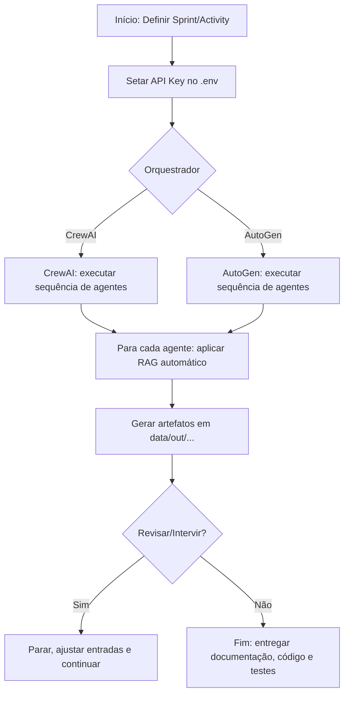
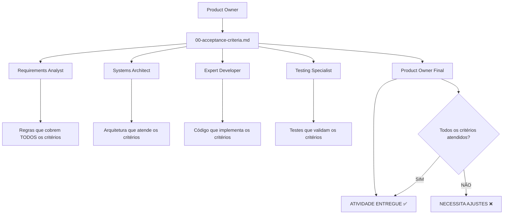

## 🗂️ Índice (guia prático)

1) [Prefácio](#prefacio)
2) [Pré-requisitos](#pre-requisitos)
3) [Fluxo Completo (docs)](./docs/fluxo-completo.md)
4) [Instalação ou Como criar nova atividade](#instalacao)
5) [Orquestração e Scripts (visão geral)](#orquestracao)
  - [🔄 Fluxo Automatizado (após instalação)](#fluxo-automatizado)
6) [Modo Automático (CrewAI + AutoGen)](#modo-automatico)
  - [Fluxo do modo automático (diagrama)](#fluxo-automatico)
7) [Modo Manual (recomendado)](#modo-manual)
  - [Passagem de bastão entre agentes](#passagem-bastao)
  - [O que cada agente gera e por quê](#o-que-cada-agente-gera)
  - [RAG explicado de forma simples](#rag-simples)
  - [Vantagens do modo manual](#vantagens-modo-manual)
8) [Enriquecimento do Agente (sempre aditivo) + RAG](#enriquecimento)
9) [Fluxos de desenvolvimento (workflowPatterns)](#fluxos)
10) [Exemplos de prompts por fluxo](#exemplos-prompts)
11) [Prompts e responsabilidades de cada agente](#agentes)
  - [🎯 Exemplos Práticos: Usando Agentes Isoladamente](#agentes-isolados)
12) [Scripts PowerShell: o que são e por que existem](#scripts)
   - [Paralelismo](#paralelismo)
13) [Onde o código é gerado](#onde-codigo)
14) [📊 Estrutura de Arquivos Gerados](#estrutura)
15) [Como os agentes garantem a qualidade](#qualidade)
16) [Padrão de commits](#commits)
17) [Evitar code smells (SonarQube)](#sonarqube)
18) [FAQ](#faq)
19) [Solução de problemas](#solucao-problemas)
20) [Recursos de aprendizado](#recursos)
21) [Links úteis (todos os .md)](#links)
22) [Autor e atualizações recentes](#autor)

---

<a id="prefacio"></a>
## 🧭 Prefácio

Este repositório organiza um “time de agentes” trabalhando em sequência para transformar uma solicitação de negócio em documentação, arquitetura, código e testes. Ele foi pensado para equipes .NET 6.0 com Frontend Angular e Node.js >= 20.3, mantendo simplicidade no uso e rastreabilidade completa dos artefatos.

• Público-alvo: desenvolvedores, QAs, POs e arquitetos.
• Valores: transparência, TDD, documentação viva, e automação pragmática.
• Resultado: pastas data/in e data/out com evidências auditáveis e um ciclo previsível.

---
<a id="pre-requisitos"></a>
## Pré-requisitos

Checklist de ambiente para uso do WorkflowAgentsAI (instalação e execução):

- Windows 10/11
- Windows PowerShell 5.1+ (execute como Administrador para instalar dependências)
- Git instalado e configurado (usuário e e‑mail)
- Editor: VS Code OU Visual Studio (é necessário ter um dos dois)
- OBRIGATÓRIO: GitHub Copilot Chat OU ChatGPT‑Codex disponível para conduzir os agentes
- Python 3.12 (recomendado) — o instalador pode auxiliar na configuração
- Node.js >= 20.3 (LTS recomendado) — necessário para utilitários/diagramas
- .NET SDK 6.0+ (8.0 suportado) — obrigatório apenas se for gerar/compilar projetos .NET
- Mermaid CLI (opcional) — para exportar diagramas a partir de arquivos Mermaid
- Acesso à internet para baixar dependências (pip/npm) na primeira execução

Para o modo automático (CrewAI/AutoGen):
- É necessário possuir e informar uma API key de um provedor LLM compatível (OpenAI, Azure OpenAI, etc.)
- Defina a chave via `.env` quando solicitado pelo instalador ou configure como variável de ambiente

Observação: muitos itens acima podem ser instalados/validados automaticamente pelo instalador. Ainda assim, execute o PowerShell em modo Administrador para evitar problemas de permissão.


<a id="instalacao"></a>
## 🧩 Instalação ou Como criar nova atividade

Você pode usar o instalador para preparar o ambiente e/ou criar novas atividades. Antes de começar, confira os [Pré-requisitos](#pre-requisitos). Abaixo está um guia rápido, no padrão enterprise, com comandos prontos para copiar.

### 🔐 Abrir PowerShell como Administrador
1) Clique Iniciar e digite “PowerShell”
2) Botão direito em “Windows PowerShell” → Executar como administrador

### ⚙️ Executar o instalador (preparar ambiente)
- Navegue até a raiz do repositório e execute:

```powershell
cd "C:\Projetos\WorkflowAgentsAI"
powershell -NoProfile -ExecutionPolicy Bypass -File .\Install\setup-workflow.ps1
```

O instalador pode: validar pré-requisitos, configurar pastas data/in e data/out, e opcionalmente criar/abrir um projeto de destino.

## 🆕 Criar uma nova atividade (sem sair do PowerShell)
Use o script de criação para organizar automaticamente a estrutura em `data/in` e `data/out`.

🎯 Exemplos de Novas Atividades:

```powershell
# Sistema de login
.\scripts\powershell\new-activity.ps1 -Sprint 02 -Activity rn0020

# Relatório de vendas
.\scripts\powershell\new-activity.ps1 -Sprint 02 -Activity rn0021

# Integração com API externa
.\scripts\powershell\new-activity.ps1 -Sprint 03 -Activity rn0030
```

Isso criará:
- `data/in/sprint02/rn0020/business_request/` e `attachments/` para insumos
- `data/out/sprint02/rn0020/` para os artefatos gerados pelos agentes

## 🔄 Trabalhando com Múltiplas Atividades
Quando precisar criar e gerenciar várias atividades em paralelo:

- Criação em lote: `scripts/powershell/start-multi-activities.ps1`
- Dashboard e recomendações: `scripts/powershell/manage-parallel-execution.ps1`
- Interface unificada: `scripts/powershell/quick-start.ps1`

Exemplos (PowerShell):
```powershell
.# Criar múltiplas atividades com pipeline sugerido
./scripts/powershell/start-multi-activities.ps1 -Sprint 02 -Activities @("login","relatorios","sap") -ParallelSetup -CreatePipeline

.# Acompanhar status e próximos passos
./scripts/powershell/manage-parallel-execution.ps1 -Sprint 02 -Action status
./scripts/powershell/manage-parallel-execution.ps1 -Sprint 02 -Action next
```

## ✨ Enriquecer um agente (instruções adicionais)
Você pode enriquecer o comportamento dos agentes com arquivos de instruções adicionais. Duas formas:

1) Via instalador (recomendado): informe a pasta que contém arquivos `*.instructions.md` para cada agente. O instalador injeta de forma idempotente no final de `agents/manual/*.agent.md`.
2) Manual: crie arquivos como `product-owner.instructions.md`, `requirements-analyst.instructions.md` etc., e mantenha-os versionados. Na execução, copie o conteúdo como “contexto adicional” no chat do Copilot.

Padrão de nomes aceitos (exemplos):
- `product-owner.instructions.md`
- `requirements-analyst.instructions.md`
- `systems-architect.instructions.md`
- `testing-specialist.instructions.md`
- `expert-developer.instructions.md`
- `frontend-specialist.instructions.md`
- `testing-validator.instructions.md`

Observação:
- O enriquecimento é sempre aditivo; não substitui os prompts de sistema dos agentes.
- Consulte o guia: `docs/exemplo-instrucoes-personalizada.md`.
- Hook automático pós-etapa: `scripts/powershell/enrich-after-step.ps1` (executa ingestão/consulta no serviço RAG e salva um bundle de auditoria em `data/out/.../enrichment/`).

## 🧠 RAG — Como funciona (essencial)
Quer que os agentes consultem automaticamente o conhecimento do seu projeto? O fluxo de RAG é simples, local e não altera o prompts.system.

- Fontes: `docs/`, `agents/manual/*.agent.md`, `data/out/sprint{}/activity{}/`
- Momento: ao finalizar cada etapa, o hook ingere conteúdo; o próximo agente recebe contexto enriquecido
- Injeção: adicionamos uma mensagem `developer` com “CONTEXTO ENRIQUECIDO” após o `system`

Exemplo (PowerShell):
```powershell
powershell -NoProfile -ExecutionPolicy Bypass -File scripts/powershell/enrich-after-step.ps1 -AgentId expert-developer -Sprint 01 -Activity rn0001 -RagEndpoint http://127.0.0.1:8088 -TopK 8 -Rerank
```

Arquivos importantes:
- `scripts/powershell/enrich-after-step.ps1` → chama `/ingest` e gera `_last-<agent>.json`
- `agents/manual/<agent>.enrichment.yaml` → fontes/filtros por agente (quando aplicável)
- `docs/enrichment-auto-run.md` → como plugar o hook no seu orquestrador (opcional)

Benefícios: mantém `prompts.system` intocado; funciona offline; contexto sempre fresco.

Explicando de uma forma simples, é um “leitor inteligente” dos seus arquivos. Quando você passa para o próximo agente:
- O sistema lê os documentos mais relevantes (entrada e saídas anteriores).
- Resumo do que importa é ACRESCENTADO como uma ajuda extra ao agente.
- Nada é substituído; o agente mantém suas instruções originais e recebe contexto adicional.

Vantagens práticas: menos esquecimento de detalhes, decisões mais consistentes e respostas mais assertivas.

---

<a id="orquestracao"></a>
## 🧭 Orquestração e Scripts (visão geral)

- Manual guiado (recomendado): `scripts/powershell/start-manual.ps1`
- Automação avançada (preview): `scripts/powershell/start-orchestration.ps1`
- Paralelização: `scripts/powershell/quick-start.ps1`, `start-multi-activities.ps1`, `manage-parallel-execution.ps1`
- Utilidades: `render-diagrams.ps1`, `use-venv.ps1`, `validate-encoding.ps1`, `scan-encoding.ps1`, `validate-output-package.ps1`, `setup-design-tools.ps1`, `view-wireframes.ps1`, `enrich-after-step.ps1`

<a id="fluxo-automatizado"></a>
### 🔄 Fluxo Automatizado (após instalação)
Após cada etapa, os agentes pedem aprovação [SIM/NAO/REVISAR]. Confirmando [SIM], o próximo agente executa automaticamente, carregando o contexto enriquecido (RAG) quando configurado.

---

<a id="modo-automatico"></a>
## 🤖 Modo Automático (CrewAI + AutoGen)

No modo automático, os agentes são orquestrados por ferramentas como CrewAI ou AutoGen.
Requisitos: é necessário informar uma API key do provedor de IA compatível (ex.: OpenAI, Azure OpenAI, etc.).

Características:
- Execução ponta-a-ponta com mínima intervenção.
- Usa as mesmas pastas de entrada/saída do modo manual.
- Pode ser pausado para revisão a cada grande etapa (configurável).

<a id="fluxo-automatico"></a>
### 🗺️ Fluxo do modo automático (diagrama)



Observação: sem uma API key válida, o modo automático não é habilitado.

---

<a id="modo-manual"></a>
## 🧑‍✈️ Modo Manual (recomendado)

No modo manual, você aprova cada etapa, vê as saídas e controla a passagem para o próximo agente. É ideal para times que valorizam clareza, auditoria e aprendizado do processo.

<a id="passagem-bastao"></a>
### 🔁 Passagem de bastão entre agentes

Use este fluxo quando quiser controle total e aprovação etapa a etapa.

```powershell

```

Como funciona na prática:
- Você inicia com o Product Owner.
- Ao finalizar cada agente, o PowerShell pergunta se deve passar ao próximo.
- Você responde com: SIM / NAO / REVISAR.
- Ao prosseguir, o próximo agente recebe automaticamente as saídas anteriores.

Perguntas interativas exibidas pelo PowerShell (modo manual):
- Confirmar Sprint/Activity detectados? [SIM/NAO/ALTERAR]
- Executar Mesa Redonda após Product Owner? [SIM/NAO]
- Injetar enriquecimento (RAG/dev-messages) antes do agente atual? [SIM/NAO]
- Abrir arquivos gerados pelo agente atual? [SIM/NAO]
- Prosseguir para o próximo agente? [SIM/NAO/REVISAR]
- Renderizar diagramas Mermaid agora (se houver .mmd)? [SIM/NAO]
- Consolidar relatório final da atividade? [SIM/NAO]
- Abrir a pasta de saída data/out/sprintXX/activityYY? [SIM/NAO]

Perguntas interativas exibidas durante a Instalação (setup-workflow.ps1):
- Selecionar modo de execução: “Selecione o modo: 1) Manual 2) Automático (CrewAI)” e “Digite 1 ou 2” (padrão: 1)
- Onde quer que gere os Agentes? (ex.: C:\Projetos\MeuProjeto)
- Qual o número da sprint? (ex.: 01)
- Qual a activity? (ex.: rn0001)
- Qual o nome do projeto? (ex.: CalculationEngine, SistemaVendas)
- Tipo de trabalho: (1) Projeto novo ou (2) Implementação em projeto existente?
- [se 1 = Projeto novo] Onde CRIAR o novo projeto? (ex.: C:\Projetos\MeuNovoSistema)
- [se 2 = Projeto existente] Onde ESTÁ o projeto existente? (ex.: C:\Projetos\MeuSistema)
- Copiar opcional 'prompts-manual'? (s/n) [quando disponível]
- Copiar opcional 'docs'? (s/n) [quando disponível]
- Deseja copiar um template de super-prompt para o projeto? (s/n)
- [se já existe] Arquivo super-prompt.md já existe; sobrescrever? (s/n)
- Criar estrutura básica do projeto agora? (s/n)
- [se sim] Tipo de projeto: (1) .NET, (2) Node.js, (3) Angular, (4) React, (5) Genérico
- Criar .venv-1 e instalar requirements agora? (s/n)
- Deseja enriquecer os agentes com instruções personalizadas? (s/n)
- [se sim] Informe a pasta com arquivos *.instructions.md|txt (ex.: C:\temp\newInstruction)
- Executar o fluxo manual automaticamente agora? (s/n)
- [se habilitada a análise de projetos] Selecionar projeto PRINCIPAL para análise detalhada (1-N)
- [se habilitada a análise de projetos] Incluir análise superficial dos outros projetos no contexto? (s/n)

<a id="o-que-cada-agente-gera"></a>
### 📄 O que cada agente gera e por quê

- Product Owner → `00-requirements-brief.md`, `00-business-context.md` — Alinhar escopo e critérios de aceite.
- Roundtable Facilitator → `01-ata-mesa-redonda.md` (notas/decisões) — Alinhamento técnico entre especialistas.
- Requirements Analyst → `02-requisitos-bdd.md` + `.feature` — Regras de negócio legíveis por todos.
- Systems Architect → `03-arquitetura.md`, ADRs, diagramas — Desenho da solução sustentável.
- Testing Specialist → `05-qa-plano.md` — TDD definido antes do código.
- Expert Developer → `04-desenvolvimento.md` + implementação — Código seguindo o plano de testes.
- Frontend Specialist → Componentes/temas (Angular/PO-UI/Material) — UI consistente e acessível.
- UX/UI Specialist → Wireframes, design system — Experiência de uso padronizada.
- Testing Validator → `05.1-testing-validation.md` — Compara plano vs. implementação.
- Code Reviewer → Checklist e comentários — Qualidade e segurança.
- Product Owner Final → `99-checklist-final.md` — Confirmação de pronto (DoD).

<a id="vantagens-modo-manual"></a>
### ✅ Vantagens do modo manual

<a id="agentes-isolados"></a>
### 🎯 Exemplos Práticos: Usando Agentes Isoladamente
Além do fluxo completo, você pode usar qualquer agente de forma independente para tarefas específicas. Abaixo, cenários no padrão enterprise:

📝 Cenário 1: Refatoração de Código Legacy
```
@agents/manual/systems-architect.agent.md

Sprint: 04, Activity: refactoring-usuarios
Contexto: "Refatorar módulo usuários (5 anos, God classes, 0% cobertura).
Aplicar SOLID + Clean Architecture mantendo compatibilidade API."

Problema atual:
- UsuarioManager com 800+ linhas
- Lógica misturada (validação + persistência + email)
- Dependências hardcoded
- Impossível testar unitariamente

Meta: Clean Architecture + 90% cobertura
```

🎨 Cenário 2: Design de Interface
```
@agents/manual/ux-ui-specialist.agent.md

Sprint: 02, Activity: dashboard-executivo
Contexto: "Dashboard para C-Level com KPIs real-time, gráficos interativos,
filtros avançados. Prioridade: informação crítica 'above the fold'."

Usuários: CEO, CFO, diretores (baixa literacy digital)
Dispositivos: Desktop principal + mobile para consultas
Restrições: Identidade visual corporativa + acessibilidade WCAG 2.1 AA
```

🧪 Cenário 3: Planejamento TDD
```
@agents/manual/testing-specialist.agent.md

Sprint: 03, Activity: calculo-comissao
Contexto: "Criar plano TDD ANTES da implementação. Regras complexas:
base + performance + metas + bônus trimestral."

Critérios de aceite:
1. Cálculo correto conforme RN-0030 a RN-0035
2. Performance < 100ms para 1000 vendedores
3. Tratamento de cenários extremos (vendas negativas)
4. Auditoria completa de cálculos

Meta: 95% cobertura + evidências automatizadas
```

🔍 Cenário 4: Validação Pós-Implementação
```
@agents/manual/testing-validator.agent.md

Sprint: 03, Activity: validacao-modulo-pagamentos
Contexto: "Validar se Expert Developer implementou corretamente o plano
TDD. Verificar todos cenários, cobertura real vs planejada."

Entrada necessária:
- 05-qa-plano.md (plano original do Testing Specialist)
- 04-desenvolvimento.md (implementação do Expert Developer)
- Código fonte + testes implementados

Validar: Conformidade plano → implementação
```

🤝 Cenário 5: Debate de Decisões Arquiteturais
```
@agents/manual/roundtable-facilitator.agent.md

Contexto: "Decisão: Microserviços vs Monolito Modular para novo módulo
de relatórios. Avaliar: escalabilidade, complexidade, skills do time, prazo 6 meses."

Restrições conhecidas:
- .NET Framework 4.8 (não pode migrar ainda)
- Time de 4 desenvolvedores (2 sêniores, 2 plenos)
- Infraestrutura on-premise
- 500+ usuários simultâneos esperados

Foco: arquitetura, manutenibilidade, time skills
```

💻 Cenário 6: Implementação Guiada por Testes
```
@agents/manual/expert-developer.agent.md

Sprint: 03, Activity: implementar-notificacoes
Contexto: "Implementar sistema de notificações seguindo TDD rigoroso.
Usar plano do Testing Specialist + arquitetura do Systems Architect."

Entrada obrigatória:
- 05-qa-plano.md (plano TDD detalhado)
- 03-arquitetura.md (design técnico)
- 05-ux-wireframes.md (especificações UI)

Tecnologias: .NET 8 + SignalR + PostgreSQL + Redis
Padrões: Clean Architecture + CQRS + Domain Events
```

📊 Cenário 7: Análise de Requisitos Complexos
```
@agents/manual/requirements-analyst.agent.md

Sprint: 02, Activity: integracao-sap
Contexto: "Analisar integração bi-direcional com SAP ERP. Documentos:
120 páginas de specs + planilhas de mapeamento + casos de teste."

Arquivos de entrada:
- SAP_Integration_Specs_v2.1.docx (120 páginas)
- Entity_Mapping_Tables.xlsx (15 planilhas)
- Test_Cases_SAP_Integration.xlsx (200+ cenários)

Foco: extrair regras RN-0050 a RN-0070, criar cenários BDD
Complexidade: sincronização real-time + tratamento conflitos
```

✅ Cenário 8: Validação Final de Entrega
```
@agents/manual/product-owner-final.agent.md

Sprint: 04, Activity: go-live-sistema-vendas
Contexto: "Validação final antes do go-live. Verificar CADA critério de
aceite contra evidências técnicas. Decisão: APROVAR ou PENDÊNCIAS."

Critérios para validar:
1. Performance: Carregamento < 2s (evidência: relatório Lighthouse)
2. Segurança: Autenticação 2FA (evidência: testes automatizados)
3. Integração: Sincronização SAP (evidência: logs + testes E2E)
4. Usabilidade: Acessibilidade WCAG (evidência: audit axe-core)
5. Monitoramento: Alertas configurados (evidência: dashboards)

Entrada: Todos artefatos + código + documentação técnica
```

- Controle total e aprovações por etapa.
- Transparência: você vê exatamente o que cada agente produziu.
- Aprendizado: entendimento profundo do processo e do domínio.
- Ajustes finos: alterar a direção cedo evita retrabalho caro no fim.

### 💰 Custos x Benefícios: Automático vs Manual

| Modo | Custo (tempo/config) | Benefícios | Quando usar | Requisitos |
|---|---|---|---|---|
| Automático (CrewAI/AutoGen) | Médio/Alto (API key, orquestração) | Rapidez, baixo atrito operacional | Backlog grande e claro; tarefas repetitivas | API key válida; configuração orquestrador |
| Manual (recomendado) | Baixo/Médio | Clareza, controle, qualidade e auditoria | Descoberta, escopo incerto, requisitos críticos | Aprovação humana por etapa |

---

## ➕ Enriquecimento do Agente (sempre aditivo)

O enriquecimento não substitui as instruções do agente. Sempre adicionamos informação útil (documentos resumidos, fatos relevantes) como uma “camada extra” de orientação.
Isso é feito via YAML por agente e um hook pós-etapa que executa automaticamente o RAG quando você avança de fase.

---

## 🧭 Fluxos de desenvolvimento (workflowPatterns)

Conforme `agents.index.json`:

- newFeatureTDD: product-owner → requirements-analyst → systems-architect → testing-specialist → expert-developer → testing-validator → product-owner-final
- newFeature: product-owner → requirements-analyst → systems-architect → expert-developer → frontend-specialist → testing-specialist
- frontendFeature: product-owner → requirements-analyst → frontend-specialist → testing-specialist
- bugfixTDD: testing-specialist → expert-developer → testing-validator
- bugfix: expert-developer → testing-specialist
- refactoring: systems-architect → expert-developer → testing-specialist
- uiRefactoring: frontend-specialist → testing-specialist
- documentation: requirements-analyst

---

## 🗣️ Exemplos de prompts por fluxo

- newFeatureTDD: “Iniciar fluxo newFeatureTDD para RN-0001 (Sprint 01 / Activity rn0001). Projeto .NET 6 + Angular. Gere o plano TDD e siga a sequência.”
- newFeature: “Iniciar fluxo newFeature para RN-0002 (Sprint 02 / Activity rn0002). Crie arquitetura, implemente backend e frontend, depois testes.”
- frontendFeature: “Fluxo frontendFeature para a tela de pedidos. Gerar componentes Angular com PO-UI e testes.”
- bugfixTDD: “Fluxo bugfixTDD: reproduzir bug X, planejar testes, corrigir e validar.”
- bugfix: “Fluxo bugfix: corrigir exceção no serviço Y e cobrir com testes.”
- refactoring: “Fluxo refactoring: extrair value objects e ajustar DI.”
- uiRefactoring: “Fluxo uiRefactoring: padronizar botões e tipografia no Angular Material.”
- documentation: “Fluxo documentation: atualizar RN-0010 com novas regras tributárias.”

---

## 🧩 Prompts e responsabilidades de cada agente

- Product Owner: “Analise esta solicitação e produza 00-requirements-brief.md e 00-business-context.md com critérios de aceite.”
- Roundtable Facilitator: “Organize a mesa redonda e registre decisões e pendências.”
- Requirements Analyst: “Converter anexos .docx/.xlsx em 02-requisitos-bdd.md e .feature.”
- Systems Architect: “Definir 03-arquitetura.md com ADRs e diagramas.”
- Testing Specialist: “Criar 05-qa-plano.md garantindo 90%+ cobertura.”
- Expert Developer: “Implementar conforme TDD e documentar em 04-desenvolvimento.md.”
- Frontend Specialist: “Criar componentes e temas Angular (PO-UI/Material) com acessibilidade.”
- UX/UI Specialist: “Gerar wireframes e design system com guidelines.”
- Testing Validator: “Comparar plano vs. execução e emitir 05.1-testing-validation.md.”
- Code Reviewer: “Auditar qualidade, segurança e alinhamento arquitetural.”
- Product Owner Final: “Consolidar evidências e checklist final de aprovação.”

---

## 🧰 Scripts PowerShell: o que são e por que existem

- Install/setup-workflow.ps1: instala pré-requisitos, prepara ambiente e copia estrutura.
- scripts/powershell/start-manual.ps1: inicia execução manual guiada.
- scripts/powershell/enrich-after-step.ps1: hook pós-etapa; injeta RAG e gera bundle de enriquecimento.
- scripts/powershell/new-activity.ps1: cria estrutura de pastas para nova atividade.
- scripts/powershell/start-multi-activities.ps1: executar várias atividades em paralelo.
- scripts/powershell/manage-parallel-execution.ps1: acompanha status e próximas execuções.
- scripts/powershell/render-diagrams.ps1: exporta Mermaid para imagens.
- scripts/powershell/scan-encoding.ps1 e validate-encoding.ps1: valida encodings.
- scripts/powershell/validate-output-package.ps1: verifica pacote de saída.
- scripts/powershell/use-venv.ps1: ativa ambiente Python local.
- scripts/powershell/setup-design-tools.ps1 e view-wireframes.ps1: suporte a wireframes e visualização.
- scripts/powershell/start-orchestration.ps1: inicia orquestração automática (se configurada).

### 🧵 Paralelismo

Permite rodar várias atividades ao mesmo tempo, respeitando dependências.
Benefícios: ganho de throughput, melhor ocupação do time, feedback mais rápido.
Guia completo: `docs/guia-paralelizacao.md`.

---

## 📦 Onde o código é gerado

- Projeto novo: a estrutura é criada onde você indicar, com solução .NET 6.0 e/ou frontend Angular conforme sua escolha.
- Projeto existente: se você escolher “implementar em código existente”, as alterações são feitas diretamente no repositório selecionado. Evidências permanecem em `data/out/...` no workspace dos agentes.

---

<a id="estrutura"></a>
## 📊 Estrutura de Arquivos Gerados

Estrutura canônica sob `data/out/sprint<sprint>/<activity>/` para auditoria e navegação:

```
data/out/sprint01/rn0001/
├── 00-business-context.md         # Contexto de negócio e stakeholders
├── 00-requirements-brief.md       # Objetivos e escopo resumidos
├── 01-ata-mesa-redonda.md         # Decisões e pendências (se houver)
├── 02-requisitos-bdd.md           # Regras + cenários BDD consolidados
├── 03-arquitetura.md              # Visão técnica, camadas, integrações
├── 04-desenvolvimento.md          # Notas técnicas, matriz e evidências
├── 05-qa-plano.md                 # Estratégia TDD, datasets, cobertura
├── 05.1-testing-validation.md     # Validação da implementação vs plano
├── 99-checklist-final.md          # Aprovação final do PO
├── features/                      # .feature (Gherkin) por cenário
├── adrs/                          # Architecture Decision Records
├── diagrams/                      # .mmd e imagens exportadas
├── enrichment/                    # _last-<agent>.json (RAG pós-etapa)
├── engineering/                   # Código e testes gerados (quando houver)
└── reports/                       # Cobertura, performance, segurança
```

Resumo rápido dos principais artefatos:

| Item | Descrição | Quem usa |
|------|-----------|----------|
| 00-business-context.md | Por que fazer; contexto e stakeholders | PO, Liderança |
| 00-requirements-brief.md | O que fazer; escopo e metas | Todos |
| 01-ata-mesa-redonda.md | Decisões técnicas e pendências | Arq, Dev |
| 02-requisitos-bdd.md | Regras e cenários legíveis | QA, PO |
| 03-arquitetura.md | Desenho técnico da solução | Arq, Dev |
| 04-desenvolvimento.md | Implementação e evidências | Dev |
| 05-qa-plano.md | Estratégia de testes (TDD) | QA |
| 05.1-testing-validation.md | Auditoria de implementação | QA, PO Final |
| 99-checklist-final.md | DoD e aprovação final | PO Final |
| features/ | Cenários Gherkin | QA, Dev |
| adrs/ | Decisões arquiteturais | Arq, Dev |
| diagrams/ | Diagramas da solução | Todos |
| enrichment/ | Bundle de contexto RAG | Próximo agente |
| engineering/ | Código/testes gerados | Dev |
| reports/ | Cobertura/performance | QA, Liderança |

Observações:
- Pode variar conforme o fluxo e agentes executados.
- Para detalhes e convenções, veja `data/out/README.md`.

---

## 🛡️ Como os agentes garantem a qualidade

- TDD: plano de QA antes do código; validação após implementação.
- Cobertura: meta 90%+ em módulos críticos.
- Arquitetura: Clean Architecture, DDD, SOLID.
- Validação: checklists, code review, validações automáticas e logs estruturados.
- Observabilidade: preferência por Serilog e práticas de diagnóstico.

---

## 🧾 Padrão de commits

Formato: `[emoji-code] tipo - descrição curta`

Exemplos:
- :sparkles: feature - nova funcionalidade
- :bug: fix - correção de bug
- :memo: docs - documentação
- :white_check_mark: tests - testes
- :recycle: refactor - refatoração
- :wrench: chore - tarefas/configuração

---

## 🧼 Evitar code smells (SonarQube)

- Manter funções pequenas e coesas; evitar duplicação.
- Tratar exceções corretamente; não suprimir erros relevantes.
- Escrever testes determinísticos e nomeados claramente.
- Aplicar regras de lint e padrões de nomenclatura.
- Documentar intenções e decisões (ADRs).

---

<!-- FAQ/Recursos/Links/Autor consolidados ao final; bloco duplicado removido -->
/// <summary>
/// Authenticates a user using Active Directory credentials
/// </summary>
/// <param name="username">The user's domain username</param>
/// <param name="password">The user's password</param>
/// <returns>Result containing authenticated user or error message</returns>
/// <exception cref="ArgumentNullException">Thrown when username is null or empty</exception>
public async Task<Result<User>> AuthenticateAsync(string username, string password)
{
    // Implementation...
}
```

### **🔍 Checklist do Code Reviewer:**

```markdown
## ✅ AUDITORIA DE PADRÕES

### Nomenclatura:
- [ ] Classes em PascalCase e descritivas
- [ ] Métodos em PascalCase e verbos claros
- [ ] Variáveis em camelCase e descritivas
- [ ] Sem abreviações ou nomes ambíguos

### Commits:
- [ ] Seguem padrão gitemoji + tipo + descrição
- [ ] Mensagens claras e em português
- [ ] Um commit por funcionalidade/correção

### Código:
- [ ] Indentação consistente (4 espaços)
- [ ] Sem warnings de compilação
- [ ] XML docs em membros públicos
- [ ] Tratamento adequado de exceções

### Estrutura:
- [ ] Clean Architecture respeitada
- [ ] Separação clara de responsabilidades
- [ ] Dependências corretamente injetadas
```

**O Code Reviewer REJEITA a implementação se os padrões não forem seguidos, mesmo que a funcionalidade esteja correta!** 📏✅

---

## **🎯 Metodologia: Baseada em Critérios de Aceite**

**⭐ DIFERENCIAL DO SISTEMA**: Todos os agentes trabalham orientados pelos **critérios de aceite** definidos pelo cliente, garantindo que a entrega final atenda EXATAMENTE o que foi solicitado.

### **🔄 Fluxo Baseado em Critérios:**



### **📋 Arquivo Central: 00-acceptance-criteria.md**

**Este arquivo é a "constituição" da atividade** - todos os agentes o consultam:

```markdown
## Critério 1: [Nome do critério]
- Sistema DEVE [ação específica]
- [Condição] DEVE resultar em [resultado mensurável]
- EVIDÊNCIA: [Como será comprovado o atendimento]

## Critério 2: [Nome do critério]
- [Especificação técnica detalhada]
- [Métricas de performance/qualidade]
- EVIDÊNCIA: [Testes/documentação necessária]

## Definition of Done:
- ✅ Critério 1 implementado + testado
- ✅ Critério 2 implementado + testado
- ✅ Documentação técnica completa
- ✅ Todos os testes automatizados passando
```

### **🎯 Como Cada Agente Usa os Critérios:**

| **Agente** | **Como usa os critérios de aceite** |
|------------|-------------------------------------|
| **Product Owner** | **CRIA** os critérios baseados na solicitação do cliente |
| **Requirements Analyst** | **ANALISA** e cria regras que cubram TODOS os critérios |
| **Systems Architect** | **PROJETA** arquitetura que permita atender os critérios |
| **Expert Developer** | **IMPLEMENTA** código que atenda CADA critério |
| **Testing Specialist** | **TESTA** e produz evidências para CADA critério |
| **Product Owner Final** | **VALIDA** se TODOS os critérios foram atendidos |

### **✅ Vantagens da Metodologia:**

- 🎯 **Foco total** no que o cliente realmente precisa
- 📏 **Critérios mensuráveis** e testáveis
- 🔍 **Rastreabilidade completa** da solicitação à entrega
- ✅ **Validação objetiva** - ou atende o critério ou não atende
- 🚀 **Entrega garantida** - só é considerado "pronto" se TODOS os critérios estão OK
- 📊 **Evidências concretas** para cada requisito do cliente

### **🎨 Exemplo Prático:**

```powershell
# Cliente solicita: "Sistema de login para 500 usuários"

# 1. Product Owner cria critérios específicos:
# - Critério 1: Autenticação AD em < 2s
# - Critério 2: Interface responsiva (desktop + mobile)
# - Critério 3: Auditoria completa de acessos

# 2. Toda a equipe trabalha para atender esses 3 critérios

# 3. Product Owner Final valida:
# ✅ Critério 1: Atendido - Evidência: testes performance
# ✅ Critério 2: Atendido - Evidência: testes responsivos
# ✅ Critério 3: Atendido - Evidência: logs estruturados

# 4. Resultado: "ATIVIDADE ENTREGUE ✅"
```

**Resultado:** Zero surpresas na entrega final - o cliente recebe EXATAMENTE o que foi acordado nos critérios de aceite! 🎯

---

## 🎯 **Exemplos Práticos: Usando Agentes Isoladamente**

**Além do fluxo completo, você pode usar qualquer agente de forma independente para tarefas específicas:**

### **📝 Cenário 1: Refatoração de Código Legacy**
```
@agents/manual/systems-architect.agent.md

Sprint: 04, Activity: refactoring-usuarios
Contexto: "Refatorar módulo usuários (5 anos, God classes, 0% cobertura).
Aplicar SOLID + Clean Architecture mantendo compatibilidade API."

Problema atual:
- UsuarioManager com 800+ linhas
- Lógica misturada (validação + persistência + email)
- Dependências hardcoded
- Impossível testar unitariamente

Meta: Clean Architecture + 90% cobertura
```

### **🎨 Cenário 2: Design de Interface**
```
@agents/manual/ux-ui-specialist.agent.md

Sprint: 02, Activity: dashboard-executivo
Contexto: "Dashboard para C-Level com KPIs real-time, gráficos interativos,
filtros avançados. Prioridade: informação crítica 'above the fold'."

Usuários: CEO, CFO, diretores (baixa literacy digital)
Dispositivos: Desktop principal + mobile para consultas
Restrições: Identidade visual corporativa + acessibilidade WCAG 2.1 AA
```

### **🧪 Cenário 3: Planejamento TDD**
```
@agents/manual/testing-specialist.agent.md

Sprint: 03, Activity: calculo-comissao
Contexto: "Criar plano TDD ANTES da implementação. Regras complexas:
base + performance + metas + bônus trimestral."

Critérios de aceite:
1. Cálculo correto conforme RN-0030 a RN-0035
2. Performance < 100ms para 1000 vendedores
3. Tratamento de cenários extremos (vendas negativas)
4. Auditoria completa de cálculos

Meta: 95% cobertura + evidências automatizadas
```

### **🔍 Cenário 4: Validação Pós-Implementação**
```
@agents/manual/testing-validator.agent.md

Sprint: 03, Activity: validacao-modulo-pagamentos
Contexto: "Validar se Expert Developer implementou corretamente o plano
TDD. Verificar todos cenários, cobertura real vs planejada."

Entrada necessária:
- 05-qa-plano.md (plano original do Testing Specialist)
- 04-desenvolvimento.md (implementação do Expert Developer)
- Código fonte + testes implementados

Validar: Conformidade plano → implementação
```

### **🤝 Cenário 5: Debate de Decisões Arquiteturais**
```
@agents/manual/roundtable-facilitator.agent.md

Contexto: "Decisão: Microserviços vs Monolito Modular para novo módulo
de relatórios. Avaliar: escalabilidade, complexidade, skills do time, prazo 6 meses."

Restrições conhecidas:
- .NET Framework 4.8 (não pode migrar ainda)
- Time de 4 desenvolvedores (2 sêniores, 2 plenos)
- Infraestrutura on-premise
- 500+ usuários simultâneos esperados

Foco: arquitetura, manutenibilidade, time skills
```

### **💻 Cenário 6: Implementação Guiada por Testes**
```
@agents/manual/expert-developer.agent.md

Sprint: 03, Activity: implementar-notificacoes
Contexto: "Implementar sistema de notificações seguindo TDD rigoroso.
Usar plano do Testing Specialist + arquitetura do Systems Architect."

Entrada obrigatória:
- 05-qa-plano.md (plano TDD detalhado)
- 03-arquitetura.md (design técnico)
- 05-ux-wireframes.md (especificações UI)

Tecnologias: .NET 8 + SignalR + PostgreSQL + Redis
Padrões: Clean Architecture + CQRS + Domain Events
```

### **📊 Cenário 7: Análise de Requisitos Complexos**
```
@agents/manual/requirements-analyst.agent.md

Sprint: 02, Activity: integracao-sap
Contexto: "Analisar integração bi-direcional com SAP ERP. Documentos:
120 páginas de specs + planilhas de mapeamento + casos de teste."

Arquivos de entrada:
- SAP_Integration_Specs_v2.1.docx (120 páginas)
- Entity_Mapping_Tables.xlsx (15 planilhas)
- Test_Cases_SAP_Integration.xlsx (200+ cenários)

Foco: extrair regras RN-0050 a RN-0070, criar cenários BDD
Complexidade: sincronização real-time + tratamento conflitos
```

### **✅ Cenário 8: Validação Final de Entrega**
```
@agents/manual/product-owner-final.agent.md

Sprint: 04, Activity: go-live-sistema-vendas
Contexto: "Validação final antes do go-live. Verificar CADA critério de
aceite contra evidências técnicas. Decisão: APROVAR ou PENDÊNCIAS."

Critérios para validar:
1. Performance: Carregamento < 2s (evidência: relatório Lighthouse)
2. Segurança: Autenticação 2FA (evidência: testes automatizados)
3. Integração: Sincronização SAP (evidência: logs + testes E2E)
4. Usabilidade: Acessibilidade WCAG (evidência: audit axe-core)
5. Monitoramento: Alertas configurados (evidência: dashboards)

Entrada: Todos artefatos + código + documentação técnica
```

### **🎯 Vantagens do Uso Isolado:**

| **Situação** | **Agente Isolado** | **Fluxo Completo** |
|--------------|-------------------|-------------------|
| **Refatoração pontual** | ✅ **Rápido e focado** | ❌ Overkill |
| **Validação específica** | ✅ **Expertise direcionada** | ❌ Muito amplo |
| **Prototipação UX** | ✅ **Iteração ágil** | ❌ Processo pesado |
| **Auditoria de código** | ✅ **Análise independente** | ❌ Não é o foco |
| **Implementação nova** | ❌ Precisa de contexto | ✅ **Processo estruturado** |

### **💡 Dica: Combinando Uso Isolado + Fluxo Completo**

**Estratégia híbrida para máxima eficiência:**

```powershell
# 1. Use Mesa Redonda para decisões arquiteturais
@agents/manual/roundtable-facilitator.agent.md
"Debater arquitetura do módulo X"

# 2. Use UX/UI Specialist para wireframes rápidos
@agents/manual/ux-ui-specialist.agent.md
"Criar protótipo da interface Y"

# 3. Use Testing Specialist para plano TDD
@agents/manual/testing-specialist.agent.md
"Planejar testes da funcionalidade Z"

# 4. Execute fluxo completo para implementação final
.\scripts\powershell\start-manual.ps1 -Sprint 02 -Activity implementacao-completa
# (Product Owner → Requirements → Systems Architect → Expert Developer → etc.)
```

**Resultado:** Flexibilidade total - use cada agente quando e como precisar! 🚀

---

## 🤖 **PASSO 3: Processo Automático (AVANÇADO)**

**Processo Automático:** O processo automático usa IA para executar todos os agentes sem intervenção. Ainda está em testes, recomendamos dominar o processo manual primeiro.

### **⚠️ Status: EM DESENVOLVIMENTO**
- ✅ **Processo Manual**: TESTADO e RECOMENDADO
- ⚠️ **Processo CrewAI**: EM PREVIEW (pode não funcionar)
- ⚠️ **Processo AutoGen**: EM PREVIEW (pode não funcionar)

### **🐍 3.1: Configurar Python (se escolheu na instalação)**

```powershell
# Vá para o workspace dos agentes
cd "C:\Projetos\MeuWorkspace\IA"

# Ativar ambiente Python
.\.venv-1\Scripts\Activate.ps1

# Verificar se está funcionando
python --version
```

### **🚀 3.2: Executar CrewAI (EXPERIMENTAL)**

```powershell
# Configurar variáveis
$env:SPRINT = "01"
$env:OUTPUT_ACTIVITY = "rn0001"
$env:USE_CREWAI = "1"

# Executar agentes automáticos
python .\orchestrators\crewai_runner.py 1
```

**⚠️ ATENÇÃO:** Se der erro, use o processo manual que é garantido funcionar.

---

## 💡 **PASSO 4: Exemplo Prático Completo**

**Exemplo Prático:** Aqui está um exemplo completo do início ao fim.

### **🎯 Cenário: Alterar cor de botões de verde para roxo**

**1️⃣ Preparar solicitação:**
```powershell
cd "C:\Projetos\MeuWorkspace\IA"
echo "Preciso trocar a cor dos botões de sucesso de verde para roxo no sistema de vendas" > .\data\in\sprint01\rn0001\business_request\mudanca_cor.md
```

**2️⃣ Executar Product Owner:**
```
# No VS Code Copilot Chat:
@agents/manual/product-owner.agent.md

RN-0001: Alterar cor botões sucesso verde→roxo
Sprint: 01, Activity: rn0001
Sistema: Sistema Vendas (.NET + React)
```

**3️⃣ O que o PO vai fazer:**
```
🤖 Analisando solicitação...
🤖 Gerando contexto de negócio...
🤖 Criando requirements brief...
🤖 Preparando mesa redonda...

📋 Mesa Redonda Preparada!
Resumo: RN-0001, Baixa complexidade, Mudança visual
Especialistas: Frontend, UX/UI
Posso prosseguir? [SIM/NAO/REVISAR]
```

**4️⃣ Você responde:** SIM

**5️⃣ Sistema continua automaticamente:**
- Mesa Redonda → gera ata da reunião
- Requirements → gera cenários BDD
- Arquiteto → define como alterar CSS
- Desenvolvedor → implementa o código
- Testador → cria planos de teste visual
- PO Final → valida se atende aos critérios

### **📊 Resultado Final:**
```
📁 data/out/sprint01/rn0001/
├── 00-business-context.md          ← Por que mudar a cor
├── 00-requirements-brief.md        ← O que precisa ser feito
├── 01-ata-mesa-redonda.md         ← Decisões técnicas
├── 02-requisitos-bdd.md           ← Cenários de teste
├── 03-arquitetura.md              ← Como implementar
├── 04-desenvolvimento.md          ← Código CSS/React
├── 05-qa-plano.md                 ← Como testar
├── 99-checklist-final.md          ← Validação completa ✅
├── features/cor-botoes.feature    ← Testes BDD
├── adrs/adr-001-mudanca-cor.md    ← Decisão arquitetural
└── diagrams/componentes.mmd       ← Diagrama dos componentes
```

---

## 🛠️ **Scripts PowerShell Disponíveis**

**Para Desenvolvedores:** Além do GitHub Copilot, você pode usar scripts PowerShell para automação avançada e gerenciamento de atividades.

### **📜 Scripts Disponíveis:**

#### **🏗️ Script de Instalação (repositório):**
| **Script** | **Objetivo** | **Quando Usar** | **Localização** |
|------------|--------------|----------------|-----------------|
| `setup-workflow.ps1` | **Instalação inicial completa** | Uma única vez por projeto | `.\Install\setup-workflow.ps1` *(repositório WorkFlowAI)* |

#### **⚙️ Scripts do Cliente (copiados na instalação):**
| **Script** | **Objetivo** | **Quando Usar** | **Localização** |
|------------|--------------|----------------|-----------------|
| `new-activity.ps1` | **🆕 Criar novas atividades** | Sempre que precisar de nova funcionalidade | `.\scripts\powershell\new-activity.ps1` |
| `start-manual.ps1` | **Executar workflow completo** | Para automação do processo manual | `.\scripts\powershell\start-manual.ps1` |
| `render-diagrams.ps1` | **Gerar imagens dos diagramas** | Após criar diagramas Mermaid | `.\scripts\powershell\render-diagrams.ps1` |
| `use-venv.ps1` | **Ativar ambiente Python** | Para trabalhar com CrewAI/AutoGen | `.\scripts\powershell\use-venv.ps1` |
| `start-orchestration.ps1` | **Executar CrewAI/AutoGen** | Para processo automatizado com IA | `.\scripts\powershell\start-orchestration.ps1` |

#### 🧭 Tabela: Qual script usar por situação

| Situação | Script para usar | Comando | Local |
|---------|------------------|---------|------|
| Primeira vez (instalação) | `setup-workflow.ps1` | `\.\Install\setup-workflow.ps1` | 📁 Repositório WorkFlowAI |
| Nova funcionalidade | `new-activity.ps1` | `\.\scripts\powershell\new-activity.ps1 -Sprint 02 -Activity rn0030` | 📁 Projeto do cliente |
| Execução automática do fluxo | `start-manual.ps1` | `\.\scripts\powershell\start-manual.ps1 -Sprint 02 -Activity rn0030` | 📁 Projeto do cliente |
| Gerar imagens de diagramas | `render-diagrams.ps1` | `\.\scripts\powershell\render-diagrams.ps1` | 📁 Projeto do cliente |
| Usar orquestração por IA | `start-orchestration.ps1` | `\.\scripts\powershell\start-orchestration.ps1 -Sprint 02` | 📁 Projeto do cliente |

---

### **🔧 Guia Detalhado de Cada Script (PowerShell)**

#### **1️⃣ setup-workflow.ps1** - 🏗️ **Instalação Inicial**

**📋 O que faz:**
- Instala todos os agentes no projeto do cliente
- Cria estrutura de pastas (data/in/, data/out/, agents/, etc.)
- Configura ambiente Python (.venv-1)
- Instala dependências (requirements.txt)
- Cria primeira atividade automaticamente
- Analisa projetos existentes (se informado)

**💻 Como executar:**
```powershell
# No diretório do repositório WorkFlowAI
powershell -NoProfile -ExecutionPolicy Bypass -File .\Install\setup-workflow.ps1
```

**⚙️ Opções interativas:**
- Escolher modo: Manual ou CrewAI
- Definir Sprint e Activity inicial
- Criar novo projeto ou usar existente
- Configurar ambiente Python
- Enriquecer agentes com instruções customizadas

**📁 Resultado (no projeto do cliente):**
```
ProjetoCliente/
├── agents/          ← Todos os 7 agentes copiados
├── scripts/powershell/      ← 5 scripts funcionais (sem setup-workflow.ps1)
│   ├── new-activity.ps1
│   ├── start-manual.ps1
│   ├── render-diagrams.ps1
│   ├── use-venv.ps1
│   └── start-orchestration.ps1
├── orchestrators/   ← CrewAI e AutoGen
├── data/in/sprint01/rn0001/  ← Primeira atividade criada
└── .env             ← Configurações do projeto
```

**⚠️ Importante:** O `setup-workflow.ps1` **NÃO é copiado** - ele fica apenas no repositório WorkFlowAI para instalações futuras.

---

#### **2️⃣ new-activity.ps1** - 🆕 **Criar Novas Atividades**

**📋 O que faz:**
- Cria estrutura completa para nova funcionalidade
- Gera pastas de entrada (business_request/, attachments/)
- Cria template de solicitação pronto para uso
- Prepara estrutura de saída automática

**💻 Sintaxe:**
```powershell
.\scripts\powershell\new-activity.ps1 -Sprint <número> -Activity <código>
```

**🎯 Exemplos práticos:**
```powershell
# Nova funcionalidade no sprint atual
.\scripts\powershell\new-activity.ps1 -Sprint 01 -Activity rn0025

# Feature para próximo sprint
.\scripts\powershell\new-activity.ps1 -Sprint 02 -Activity feature001

# Correção de bug
.\scripts\powershell\new-activity.ps1 -Sprint 01 -Activity bug-fix-auth
```

**📁 Estrutura criada automaticamente:**
```
data/in/sprint02/rn0025/
├── business_request/
│   └── solicitacao.md      ← Template editável
└── attachments/            ← Para docs técnicos

data/out/sprint02/rn0025/        ← Criada quando agentes executam
├── 00-requirements-brief.md
├── 01-ata-mesa-redonda.md
├── 02-requisitos-bdd.md
```

**✅ Workflow após criação:**
1. Editar `business_request/solicitacao.md` com sua demanda
2. Adicionar documentos em `attachments/` (se necessário)
3. Executar: `@agents/manual/product-owner.agent.md`

---

#### **3️⃣ start-manual.ps1** - ⚡ **Workflow Automatizado**

**📋 O que faz:**
- Executa sequência completa de agentes automaticamente
- Gera todos os artefatos (requisitos → código → testes)
- Cria estrutura de saída organizada
- Produz relatório final do processo

**💻 Sintaxe:**
```powershell
.\scripts\powershell\start-manual.ps1 -Sprint <número> -Activity <código>
```

**🎯 Exemplos práticos:**
```powershell
# Executar atividade específica
.\scripts\powershell\start-manual.ps1 -Sprint 01 -Activity rn0001

# Processamento completo de nova feature
.\scripts\powershell\start-manual.ps1 -Sprint 02 -Activity checkout-system

# Desenvolvimento de correção
.\scripts\powershell\start-manual.ps1 -Sprint 01 -Activity fix-payment-bug
```

**🔄 Processo executado:**
```
Product Owner → Mesa Redonda → Requirements → Architect →
Developer → Frontend → Testing → PO Final
```

**📋 Diferença vs GitHub Copilot:**
- **start-manual.ps1**: Execução automática, sem intervenção
- **GitHub Copilot**: Execução manual, aprovação a cada etapa

---

#### **4️⃣ render-diagrams.ps1** - 🎨 **Geração de Imagens**

**📋 O que faz:**
- Converte diagramas Mermaid (.mmd) em imagens PNG/SVG
- Processa todos os diagramas da atividade
- Cria pasta `diagrams/images/` automaticamente
- Suporta múltiplos formatos de saída

**💻 Como executar:**
```powershell
# Renderizar diagramas da atividade atual
.\scripts\powershell\render-diagrams.ps1

# Especificar atividade específica
.\scripts\powershell\render-diagrams.ps1 -Sprint 01 -Activity rn0001
```

**📁 Entrada esperada:**
```
data/out/sprint01/rn0001/diagrams/
├── architecture.mmd
├── sequence-flow.mmd
└── entity-relationship.mmd
```

**📁 Saída gerada:**
```
data/out/sprint01/rn0001/diagrams/images/
├── architecture.png
├── sequence-flow.png
└── entity-relationship.png
```

**🛠️ Pré-requisitos:**
- Node.js instalado
- Mermaid CLI: `npm install -g @mermaid-js/mermaid-cli`

---

#### **5️⃣ use-venv.ps1** - 🐍 **Ambiente Python**

**📋 O que faz:**
- Ativa ambiente virtual Python (.venv-1)
- Prepara para executar CrewAI/AutoGen
- Valida dependências instaladas

**💻 Como usar:**
```powershell
# Ativar ambiente Python
.\scripts\powershell\use-venv.ps1

# Verificar se está ativo
python --version  # Deve mostrar Python do .venv-1
```

**✅ Comandos após ativação:**
```powershell
# Executar CrewAI
python .\orchestrators\crewai_runner.py 1

# Executar AutoGen
python .\orchestrators\autogen_dev_team.py
```

---

#### **6️⃣ start-orchestration.ps1** - 🤖 **IA Automatizada**

**📋 O que faz:**
- Executa processo totalmente automatizado com CrewAI
- Coordena múltiplos agentes IA simultaneamente
- Gera resultado sem intervenção humana

**💻 Sintaxe:**
```powershell
.\scripts\powershell\start-orchestration.ps1 -Sprint <número>
```

**🎯 Exemplo:**
```powershell
# Processar sprint 01 com IA
.\scripts\powershell\start-orchestration.ps1 -Sprint 01
```

**🔄 Diferenças dos processos:**

| **Método** | **Controle** | **Velocidade** | **Qualidade** | **Uso Recomendado** |
|------------|--------------|----------------|---------------|-------------------|
| **GitHub Copilot** | 🟢 Total | 🟡 Médio | 🟢 Alta | Desenvolvimento crítico |
| **start-manual.ps1** | 🟡 Médio | 🟢 Rápido | 🟢 Alta | Prototipagem rápida |
| **start-orchestration.ps1** | 🔴 Baixo | 🟢 Muito rápido | 🟡 Média | Análise exploratória |

---

## 🚀 Scripts de Paralelização

### **⚡ quick-start.ps1** - 🎯 **Interface Unificada**

**📋 O que faz:**
- Interface interativa com 6 modos de operação
- Configuração automática baseada na escolha
- Comandos prontos para execução imediata
- Perfeito para iniciantes e uso rápido

**💻 Como usar:**
```powershell
# Interface guiada completa
.\scripts\powershell\quick-start.ps1 -Sprint 02

# Escolher entre:
# 1. 📝 Atividade única (tradicional)
# 2. ⚡ Múltiplas atividades paralelas
# 3. 📊 Gerenciar atividades existentes
# 4. 🔄 Pipeline escalonado avançado
# 5. 🎯 Mesa Redonda específica
# 6. ❓ Ajuda e documentação
```

---

### **⚡ start-multi-activities.ps1** - 🏭 **Criação em Lote**

**📋 O que faz:**
- Cria múltiplas atividades simultaneamente
- Detecta dependências automaticamente
- Gera guias de execução paralela
- Cronogramas otimizados por semana

**💻 Sintaxe:**
```powershell
.\scripts\powershell\start-multi-activities.ps1 -Sprint <número> -Activities @("atividade1", "atividade2") [opções]
```

**🎯 Exemplos:**
```powershell
# Básico - criar 3 atividades
.\scripts\powershell\start-multi-activities.ps1 -Sprint 02 -Activities @("login", "relatorios", "sap")

# Avançado - com pipeline completo
.\scripts\powershell\start-multi-activities.ps1 -Sprint 02 -Activities @("login", "relatorios", "sap") -SharedContext "Sistema ERP integrado" -ParallelSetup -CreatePipeline
```

**📊 Arquivos gerados:**
- `parallel-execution-guide.md` - Guia de execução paralela
- `pipeline-schedule.md` - Cronograma otimizado
- `dependency-matrix.md` - Análise de dependências

---

### **📊 manage-parallel-execution.ps1** - 🎛️ **Dashboard de Controle**

**📋 O que faz:**
- Dashboard em tempo real do progresso
- Recomendações inteligentes de próximos passos
- Detecção automática de conflitos
- Sincronização de status entre atividades

**💻 Ações disponíveis:**
```powershell
# Status geral das atividades
.\scripts\powershell\manage-parallel-execution.ps1 -Sprint 02 -Action status

# Próximas execuções recomendadas
.\scripts\powershell\manage-parallel-execution.ps1 -Sprint 02 -Action next

# Análise de conflitos
.\scripts\powershell\manage-parallel-execution.ps1 -Sprint 02 -Action conflicts

# Sincronizar status dos guias
.\scripts\powershell\manage-parallel-execution.ps1 -Sprint 02 -Action sync

# Reset de atividade específica
.\scripts\powershell\manage-parallel-execution.ps1 -Sprint 02 -Action reset -Activity login
```

**📈 Saída exemplo:**
```
📊 SPRINT 02 - Status das Atividades

sistema-login        [████████░░] 80% - Testing Specialist
modulo-relatorios    [██████░░░░] 60% - Systems Architect

📈 RESUMO GERAL:
  Progresso médio: 70%
  Atividades completas: 0/2
  Atividades ativas: 2
```

### **⚡ Comandos Rápidos - Cheat Sheet:**

```powershell
# 🏗️ INSTALAÇÃO (uma vez só - no repositório WorkFlowAI)
cd "C:\Repos\WorkFlowAI"
powershell -NoProfile -ExecutionPolicy Bypass -File .\Install\setup-workflow.ps1

# ========== COMANDOS NO PROJETO DO CLIENTE ==========
cd "C:\Projetos\MeuWorkspace\IA"

# 🚀 INTERFACE UNIFICADA (RECOMENDADO)
.\scripts\powershell\quick-start.ps1 -Sprint 02

# ⚡ MÚLTIPLAS ATIVIDADES DIRETO
.\scripts\powershell\start-multi-activities.ps1 -Sprint 02 -Activities @("login", "api", "dashboard") -ParallelSetup

# 📊 DASHBOARD DE STATUS
.\scripts\powershell\manage-parallel-execution.ps1 -Sprint 02 -Action status

# 🆕 ATIVIDADE ÚNICA (TRADICIONAL)
.\scripts\powershell\new-activity.ps1 -Sprint 02 -Activity rn0030

# ⚡ EXECUÇÃO MANUAL TRADICIONAL
.\scripts\powershell\start-manual.ps1 -Sprint 02 -Activity rn0030

# 🎨 GERAR DIAGRAMAS
.\scripts\powershell\render-diagrams.ps1

# 🤖 EXECUÇÃO AUTOMATIZADA
.\scripts\powershell\start-orchestration.ps1 -Sprint 02
```

---

<!-- Seção 'Trabalhando com Múltiplas Atividades' duplicada removida (mantida próxima à Instalação) -->

---

## ❓ **FAQ - Perguntas Frequentes para Iniciantes**

### **🤔 "Por onde eu começo?"**
1. Execute a instalação: `.\Install\setup-workflow.ps1`
2. Abra VS Code no workspace dos agentes
3. Crie um documento com sua solicitação
4. Execute: `@agents/manual/product-owner.agent.md`

### **🤔 "O que são os 'agentes'?"**
São prompts especializados que simulam pessoas de uma equipe:
- **Product Owner**: Analisa o negócio
- **Arquiteto**: Define a solução técnica
- **Desenvolvedor**: Escreve o código
- **Testador**: Cria estratégias de teste

### **🤔 "Qual a diferença entre processo Manual e Automático?"**
- **Manual**: Você controla cada etapa (RECOMENDADO)
- **Automático**: IA executa tudo sozinha (EM TESTES)

### **🤔 "Onde fico vendo os resultados?"**
Tudo é salvo na pasta `data/out/sprint01/rn0001/` do seu workspace

### **🤔 "Posso usar para qualquer tipo de projeto?"**
Sim! O sistema detecta automaticamente:
- .NET (C#, ASP.NET Core)
- Node.js (JavaScript, TypeScript)
- Angular
- React
- Projetos genéricos

### **🤔 "E se eu errar alguma coisa?"**
Sem problema! Você pode:
- Responder "NAO" para parar o fluxo
- Responder "REVISAR" para ver os arquivos gerados
- Executar novamente com parâmetros diferentes

### **🤔 "Preciso saber programar?"**
Para **usar** o sistema: NÃO
Para **entender** os resultados: Ajuda, mas não é obrigatório
O sistema gera documentação explicativa para cada parte.

<!-- Duplicata de 'Como criar nova atividade' removida. Essa orientação já aparece na seção de Instalação. -->

<!-- Tabela de mapeamento de scripts movida para a seção 'Scripts PowerShell Disponíveis' para evitar duplicação. -->

### **🤔 "Os scripts PowerShell ficam no projeto do cliente?"**
**SIM!** Após a instalação, os scripts **operacionais** ficam funcionais no projeto do cliente:
- ✅ Cliente fica **100% independente** para uso diário
- ✅ Pode criar **quantas atividades** quiser
- ✅ **Não precisa** voltar no repositório original
- ✅ Scripts funcionam **offline** (exceto IA que precisa internet)

**⚠️ Exceção:** O `setup-workflow.ps1` **permanece no repositório** - é usado apenas para instalações iniciais.

### **🤔 "PowerShell vs GitHub Copilot - qual é melhor?"**

| **GitHub Copilot** | **PowerShell** |
|--------------------|----------------|
| ✅ Controle total de cada etapa | ✅ Execução totalmente automática |
| ✅ Pode fazer ajustes manuais | ✅ Mais rápido para prototipagem |
| ✅ Melhor para desenvolvimento crítico | ✅ Ideal para análise exploratória |
| ✅ **RECOMENDADO** para produção | ✅ Bom para testes e experimentação |

**Dica:** Use GitHub Copilot para projetos importantes, PowerShell para testes rápidos!

---

## 🚨 **Solução de Problemas Comuns**

### **❌ "Erro: GitHub Copilot não encontrado"**
**Solução:** Instale a extensão GitHub Copilot no VS Code e faça login

### **❌ "Erro: PowerShell não permite execução"**
**Solução:** Execute como Administrador:
```powershell
Set-ExecutionPolicy -ExecutionPolicy Bypass -Scope CurrentUser
```

### **❌ "Erro: Python não encontrado"**
### **❌ "Erro: Python não encontrado"**
**Solução:** O instalador deveria instalar automaticamente. Se não funcionou:
```powershell
winget install Python.Python.3.12
```

### **❌ "Agente não responde ou dá erro"**
**Solução:**
**Solução:**
1. Verifique sua conexão com internet
2. Verifique se GitHub Copilot está ativo
3. Tente executar novamente
4. Use o processo PowerShell alternativo

### **❌ "Script PowerShell não executa"**
### **❌ "Enriquecimento não carregou nos agentes do cliente"**
Verifique:
- Você respondeu “s” em “Deseja enriquecer os agentes com instruções personalizadas? (s/n)”.
- A pasta informada existe e contém arquivos no formato esperado, por exemplo:
  - `product-owner.instructions.md` ou `product_owner.instructions.md`
  - `requirements-analyst.instructions.md` etc.
  - Alternativas gerais: `default.instructions.md` ou `all.instructions.md` (aplicadas a todos os papéis)
- Após a instalação, abra um arquivo de agente (ex.: `agents/manual/product-owner.agent.md`) e procure pelo bloco:
  - `### Custom Instructions (instalador)` — o conteúdo é inserido ao final do arquivo.
- Se você rodou o instalador novamente, o bloco é substituído idempotentemente. Se não atualizou, verifique permissões de escrita.

Se ainda falhar, rode novamente o instalador e observe o log “Atualizando agente <papel> com novas instruções...”.

**Possíveis soluções:**
```powershell
# 1. Executar sempre com parâmetros completos:
powershell -NoProfile -ExecutionPolicy Bypass -File .\scripts\powershell\start-manual.ps1 -Sprint 01 -Activity rn0001

# 2. Verificar se está na pasta correta do projeto
cd "C:\Projetos\MeuWorkspace\IA"

# 3. Verificar se pastas existem
ls .\data\in\sprint01\rn0001\business_request\
```

### **❌ "Erro: 'Cannot find path' no PowerShell"**
**Causa:** Você não está na pasta certa do projeto
**Solução:**
```powershell
# Navegar para pasta do projeto onde foram instalados os agentes
cd "C:\Projetos\MeuWorkspace\IA"

# Verificar se pasta powershell existe
ls .\scripts\powershell\
```

### **❌ "new-activity.ps1 não cria as pastas"**
**Verifique os parâmetros:**
```powershell
# ✅ Correto:
.\scripts\powershell\new-activity.ps1 -Sprint 02 -Activity rn0030

# ❌ Incorreto (faltam parâmetros):
.\scripts\powershell\new-activity.ps1

# ❌ Incorreto (sintaxe errada):
.\scripts\powershell\new-activity.ps1 02 rn0030
```

### **❌ "render-diagrams.ps1 não gera imagens"**
**Pré-requisito:** Instalar Mermaid CLI
```powershell
# Instalar Node.js primeiro (se não tiver)
winget install OpenJS.NodeJS

# Instalar Mermaid CLI
npm install -g @mermaid-js/mermaid-cli

# Testar se funcionou
mmdc --version
```

### **❌ "Não sei o que colocar na solicitação"**
**Exemplos simples:**
- "Criar tela de login"
- "Adicionar botão salvar"
- "Adicionar botão salvar"
- "Mudar cor do menu"
- "Criar relatório de vendas"

**Exemplos avançados:**
- "Sistema de autenticação com JWT para API .NET"
- "Dashboard responsivo com gráficos em Angular"
- "Integração com API do Correios para cálculo de frete"

**Exemplos avançados:**
- "Sistema de autenticação com JWT para API .NET"
- "Dashboard responsivo com gráficos em Angular"
- "Integração com API do Correios para cálculo de frete"

---

## 📚 **Recursos de Aprendizado**

### **📖 Documentação Básica:**
- [Fluxo Completo Detalhado](./docs/fluxo-completo.md) - Aprenda passo a passo
- [Exemplo Product Owner](./docs/exemplo-product-owner.instructions.md) - Veja um exemplo real
- [Prompts de Referência](./prompts-manual/prompts/reference/README.md) - Exemplos práticos

### **🎯 Para Desenvolvedores Experientes:**
- [Personalização de Agentes](./docs/exemplo-instrucoes-personalizada.md) - Adapte para sua empresa
- [Integração GitHub Copilot](./docs/integracao-github-copilot.md) - Configurações avançadas
- [Análise de Projetos](./docs/analise-projeto-existente.md) - Para projetos existentes

---

## 📊 **Estrutura de Arquivos Gerados**

**Referência:** Aqui está o que cada arquivo faz:

### **📁 Pasta `data/out/sprint01/rn0001/`:**

| **Arquivo** | **O que contém** | **Quem usa** |
|-------------|------------------|--------------|
| `00-business-context.md` | Por que precisamos desta funcionalidade | Product Owner, Gerentes |
| `00-requirements-brief.md` | Resumo do que precisa ser feito | Toda equipe |
| `01-ata-mesa-redonda.md` | Decisões técnicas da reunião | Arquitetos, Devs |
| `02-requisitos-bdd.md` | Cenários de teste em linguagem natural | Testadores, POs |
| `03-arquitetura.md` | Como a solução será implementada | Desenvolvedores |
| `04-desenvolvimento.md` | Código implementado | Desenvolvedores |
| `05-qa-plano.md` | Estratégia de testes | Testadores |
| `99-checklist-final.md` | Validação se tudo está pronto | Product Owner |

### **📁 Subpastas:**

| **Pasta** | **Contém** | **Para que serve** |
|-----------|------------|-------------------|
| `features/` | Arquivos `.feature` (BDD) | Testes automatizados |
| `adrs/` | Decisões arquiteturais | Documentar escolhas técnicas |
| `diagrams/` | Diagramas `.mmd` (Mermaid) | Visualizar a solução |

---

## 🔧 Quick Start Manual (Alternativo)

Se preferir executar passos manualmente:

1) Criar `.env` (a partir de `.env.example`) e configurar seu provedor LLM:

```powershell
Copy-Item .\.env.example .\.env
# Edite .env e preencha: LLM_PROVIDER/LLM_MODEL e suas credenciais (OpenAI/Azure/compatível)
```

2) Escolher modo e executar:
- Manual:
  ```powershell
  powershell -NoProfile -ExecutionPolicy Bypass -File .\scripts\powershell\start-manual.ps1 -Sprint 01 -Activity rn0001
  ```
- CrewAI: ⚠️ **PREVIEW - NÃO TESTADO**
  ```powershell
  $env:USE_CREWAI = "1"; $env:SPRINT = "01"; $env:OUTPUT_ACTIVITY = "rn0001"
  python .\orchestrators\crewai_runner.py 1
  ```

3) Colocar insumos em `data/in/sprint01/rn0001/attachments/` (PDF, imagens, planilhas, etc.).

4) Ver artefatos em `data/out/sprint01/rn0001/` (01..05, features, adrs, diagrams, outcomes/engineering). Opcional: renderizar diagramas:

```powershell
powershell -NoProfile -ExecutionPolicy Bypass -File .\scripts\powershell\render-diagrams.ps1
```

## 🚀 Comece por aqui

### **📥 Primeira instalação:**
1. **[📖 Fluxo Completo: Do Zero à Mesa Redonda](./docs/fluxo-completo.md)** ← **COMECE AQUI**
2. **[⚡ Instalador PowerShell](./Install/setup-workflow.ps1)** - Configuração automática
### **📥 Primeira instalação:**
1. **[📖 Fluxo Completo: Do Zero à Mesa Redonda](./docs/fluxo-completo.md)** ← **COMECE AQUI**
2. **[⚡ Instalador PowerShell](./Install/setup-workflow.ps1)** - Configuração automática
3. **[🆕 Novo projeto .NET](./docs/new-dotnet-project-setup.md)** - Guia técnico detalhado

### **🔄 Trabalhando com novas atividades:**
1. **[🚀 Quick Start Paralelo](./scripts/powershell/quick-start.ps1)** ← ⭐ **NOVO: Interface unificada para múltiplas atividades**
2. **[🚀 Guia de Paralelização](./docs/guia-paralelizacao.md)** ← ⭐ **NOVO: Execução simultânea de atividades**
3. **[🎯 Guia Agentes Individuais](./docs/guia-agentes-individuais.md)** ← ⭐ **Como usar cada agente separadamente**
4. **[🔥 Mesa Redonda: "CrewAI Manual"](#-mesa-redonda-o-crewai-manual-perfeito)** ← ⭐ **RECURSO DESTAQUE - Debate entre especialistas**
5. **[🎭 Guia Completo dos Agentes](#-guia-completo-dos-agentes-especializados)** ← **Conheça cada especialista em detalhes**
4. **[🔒 Garantias de Qualidade](#-garantias-de-qualidade-como-o-sistema-valida-a-implementação)** ← ⭐ **CRÍTICO - Como garantir implementação correta**
5. **[📏 Padrões de Desenvolvimento](#-padrões-de-desenvolvimento-obrigatórios)** ← ⭐ **QUALIDADE - Nomenclatura, commits, indentação**
6. **[🎯 Metodologia: Critérios de Aceite](#-metodologia-baseada-em-critérios-de-aceite)** ← ⭐ **DIFERENCIAL - Entrega garantida**
7. **[❓ FAQ: Como criar nova atividade?](#-faq---perguntas-frequentes)**
8. **[🛠️ Scripts PowerShell disponíveis](#-scripts-powershell-disponíveis)**

### **📚 Documentação completa:**
- **[📖 Índice Geral de Documentação](#-índice-geral-de-documentação)** - Navegue por toda a documentação

### **Para usuários avançados:**
- **[📋 Documentação técnica completa](./docs/README.md)** - Todos os processos e integrações
- **[🎯 Personalização de agentes](./docs/exemplo-instrucoes-personalizada.md)** - Adapte para sua empresa

## Documentação principal

- **Processo Manual (RECOMENDADO):** [`docs/manual-process.md`](./docs/manual-process.md) ✅ **TESTADO E FUNCIONAL**
- Processo Automático (CrewAI): [`docs/automatic-process.md`](./docs/automatic-process.md) ⚠️ **PREVIEW - NÃO TESTADO**
- Super Prompt (como usar): [`docs/super-prompt.md`](./docs/super-prompt.md)
- Integração com projeto .NET: [`docs/dotnet-integration.md`](./docs/dotnet-integration.md)
- Atualizar instruções dos agentes: [`docs/updating-agents.md`](./docs/updating-agents.md)
- Diagramas Mermaid (.mmd): [`docs/diagram/`](./docs/diagram/)
  - Imagens geradas: [`docs/images/`](./docs/images/)

## Agentes

- Pasta com os agentes manuais: [`agents/manual`](./agents/manual)
  - **🆕 Product Owner**: [`agents/manual/product-owner.agent.md`](./agents/manual/product-owner.agent.md) - **Início automático**
  - **🆕 Product Owner Final**: [`agents/manual/product-owner-final.agent.md`](./agents/manual/product-owner-final.agent.md) - **Checklist final**
  - **🔥 Mesa Redonda**: [`agents/manual/roundtable-facilitator.agent.md`](./agents/manual/roundtable-facilitator.agent.md) - ⭐ **DESTAQUE: Simula debate entre 5 especialistas**
  - **🔥 Mesa Redonda**: [`agents/manual/roundtable-facilitator.agent.md`](./agents/manual/roundtable-facilitator.agent.md) - ⭐ **DESTAQUE: Simula debate entre 5 especialistas**
  - Requirements Analyst: [`agents/manual/requirements-analyst.agent.md`](./agents/manual/requirements-analyst.agent.md)
  - Systems Architect: [`agents/manual/systems-architect.agent.md`](./agents/manual/systems-architect.agent.md)
  - Expert Developer: [`agents/manual/expert-developer.agent.md`](./agents/manual/expert-developer.agent.md)
  - Testing Specialist: [`agents/manual/testing-specialist.agent.md`](./agents/manual/testing-specialist.agent.md)

<!-- Seção 'Fluxo Automatizado' duplicada removida (mantida no topo) -->

<!-- Seção de Orquestração duplicada removida; usar '🧭 Orquestração e Scripts (visão geral)' no topo -->

## Ambiente e configuração

- Exemplo de variáveis: [`.env.example`](./.env.example)
- Ambiente Python recomendado: `./.venv-1`
- Pré-requisitos e instalação: veja o guia de novo projeto e/ou use o instalador.

## 🧭 Navegação Rápida

| Precisa de... | Vá para... |
|---------------|------------|
| **Entender o fluxo completo** | [🚀 Fluxo Completo](./docs/fluxo-completo.md) |
| **Instalar o sistema** | [🆕 Novo projeto .NET](./docs/new-dotnet-project-setup.md) |
| **Executar o workflow** | [📋 Processos](./docs/README.md#processos) |
| **🆕 Fluxo automatizado** | [🚀 Novo fluxo com aprovações](#-novo-fluxo-automatizado-com-aprovações) |
| **Personalizar agentes** | [💼 Instruções personalizadas](./docs/exemplo-instrucoes-personalizada.md) |
| **Ver exemplos práticos** | [📚 Prompts de referência](./prompts-manual/prompts/reference/README.md) |
| **Analisar projeto existente** | [🔍 Análise automática](./docs/analise-projeto-existente.md) |
| **Integrar com GitHub Copilot** | [🤖 Integração automática](./docs/integracao-github-copilot.md) |
| **Entender a estrutura** | [📊 Organização dos resultados](./data/out/README.md) |
| **Resolver problemas** | [📋 Melhorias recentes](./docs/resumo-melhorias-setup.md) |

---

## 📋 **Status dos Processos**

| Processo | Status | Recomendação |
|----------|--------|--------------|
| **🚀 Manual com Fluxo Automatizado** | ✅ **TESTADO E FUNCIONAL** | **RECOMENDADO PARA PRODUÇÃO** |
| **🤖 CrewAI** | ⚠️ **PREVIEW** | Aguardar testes completos |
| **🔄 AutoGen** | ⚠️ **PREVIEW** | Aguardar testes completos |

---

---

## 👤 **Autor e Informações**

**👨‍💻 Desenvolvedor 1:** Ricardo Macedo Perdigão
**‍🏫 Mentora:** Fabiana Rodrigues
**📅 Versão:** 2.0.1 - Documentação do sistema
**📅 Última atualização:** 30 de Setembro de 2025
**✅ Status:** Produção (processo manual) | ⚠️ Preview (processos automáticos)

### **🆘 Suporte:**
- **Problemas técnicos:** Veja seção [Solução de Problemas](#-solução-de-problemas-comuns)
- **Dúvidas sobre uso:** Consulte [FAQ](#-faq---perguntas-frequentes-para-iniciantes)
- **Documentação adicional:** [docs/README.md](./docs/README.md)

<!-- Seções duplicadas removidas: Atualizações Recentes e RAG (passo a passo) estavam repetidas.
Consulte a seção "🧠 RAG — Como funciona (essencial)" acima para detalhes atualizados. -->

