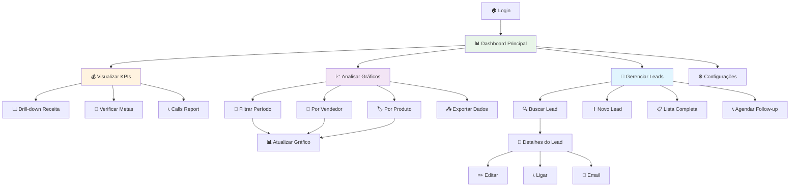

# Exemplo Prático - UX/UI Specialist Agent

Este exemplo mostra como usar o **UX/UI Specialist** para criar wireframes, design system e protótipos para um sistema de gestão de vendas.

## 🎯 Cenário: Dashboard de Vendas

**Solicitação do Cliente:** "Preciso de uma interface para o sistema de vendas onde os gerentes possam acompanhar métricas em tempo real, visualizar gráficos de performance e gerenciar leads."

## 📋 Passo-a-Passo Completo

### **PASSO 1: Configuração Inicial**

```powershell
# Navegar para workspace
cd "C:\Projetos\MeuWorkspace\IA"

# Criar nova atividade
.\powershell\start-manual.ps1 -Sprint 01 -Activity dashboard-vendas
```

### **PASSO 2: Executar Product Owner e Requirements**

```markdown
# data/in/sprint01/dashboard-vendas/business_request/solicitacao.md

# Dashboard de Vendas - Sistema CRM

## Contexto do Negócio
Nossa equipe de vendas precisa acompanhar métricas em tempo real para tomar decisões mais rápidas e assertivas.

## Funcionalidades Necessárias
1. **Visão Geral**: KPIs principais (receita, leads, metas)
2. **Gráficos**: Performance últimos 30 dias  
3. **Lista de Leads**: Gestão e acompanhamento
4. **Filtros**: Por período, vendedor, produto

## Usuários
- Gerentes de Vendas (uso principal)
- Vendedores (consulta)
- Diretoria (relatórios)

## Critérios de Sucesso
- Interface intuitiva e responsiva
- Carregamento < 2 segundos
- Funcionar em mobile e desktop
```

**Executar agentes:**
1. Product Owner → `00-business-context.md`
2. Requirements Analyst → `02-requisitos-bdd.md`
3. Systems Architect → `03-arquitetura.md`

### **PASSO 3: Executar UX/UI Specialist**

**Prompt no GitHub Copilot Chat:**
```
@agents/manual/ux-ui-specialist.agent.md

Contexto: Dashboard de Vendas para CRM
- Baseado na arquitetura em data/out/sprint01/dashboard-vendas/03-arquitetura.md
- Usuários: Gerentes, Vendedores, Diretoria
- Dispositivos: Desktop (principal), Mobile (consulta)
- Prioridade: Performance e usabilidade

Criar wireframes e design system completo.
```

### **PASSO 4: Configurar Ferramentas de Design**

```powershell
# Instalar extensões e gerar wireframes
.\powershell\setup-design-tools.ps1 -Sprint 01 -Activity dashboard-vendas -InstallDesignTools -GenerateWireframes

# Visualizar no navegador
.\powershell\view-wireframes.ps1 -Sprint 01 -Activity dashboard-vendas -OpenBrowser
```

## 📊 Resultado Gerado pelo UX/UI Specialist

### **1. Análise UX Inicial**

```markdown
# 05-ux-analysis.md

## Análise de Usuários
- **Gerentes**: Precisam visão macro + drill-down
- **Vendedores**: Foco em suas métricas pessoais  
- **Diretoria**: Relatórios executivos consolidados

## Jornada do Usuário Principal
1. Login → Dashboard geral
2. Análise de KPIs principais
3. Investigação via gráficos detalhados
4. Ação sobre leads em atraso
5. Configuração de alertas

## Requisitos de UX
- Navegação em até 3 cliques para qualquer ação
- Informação mais importante "above the fold"
- Filtros sempre visíveis e persistentes
- Feedback visual para todas as ações
```

### **2. Wireframes ASCII Detalhados**

```ascii
# Desktop Layout (1200px+)
┌─────────────────────────────────────────────────────────────┐
│ 🏢 SalesMax    [🔍 Busca Global...]    👤 João ▼ 🔔 3    │ 64px Header
├─────────────────────────────────────────────────────────────┤
│📊│ 💰 Receita Hoje        📈 Meta Mensal       👥 Leads   │
│📈│ R$ 127.350,00          87% (R$ 450K)        1.247     │ KPI Row
│📋│ ┌─────────────┐ ┌─────────────┐ ┌─────────────┐        │ (120px)
│⚙️│ │📞 Calls     │ │⏰ Follow-up │ │🎯 Conversion│        │
│  │ │    89       │ │     23      │ │   4.2%      │        │
│  │ └─────────────┘ └─────────────┘ └─────────────┘        │
├──┤                                                        │
│  │ 📊 Performance Dashboard                               │
│  │ ┌─ Filtros ─────────────────────────────────────────┐  │
│  │ │📅 [Últimos 30d ▼] 👤 [Todos ▼] 🏷️ [Produto ▼] │  │ 40px Filters
│  │ └───────────────────────────────────────────────────┘  │
│  │                                                        │
│  │ ┌─── Gráfico Principal ────┐ ┌─── Top Leads ─────────┐ │
│  │ │📈 Vendas por Semana      │ │🔥 Oportunidades Hot   │ │
│  │ │                          │ │                       │ │
│  │ │ R$ 200K ┤                │ │• Empresa ABC - R$ 50K │ │ Charts Area
│  │ │ R$ 150K ┤   ████         │ │• Cliente XYZ - R$ 30K │ │ (400px)
│  │ │ R$ 100K ┤ ████████       │ │• Prospect 123 - R$ 25K│ │
│  │ │ R$ 50K  ┤███████████     │ │                       │ │
│  │ │         └─────────────   │ │[➕ Novo Lead]        │ │
│  │ └──────────────────────────┘ └───────────────────────┘ │
└─┴────────────────────────────────────────────────────────┘

# Mobile Layout (390px)
┌──────────────────────────────────┐
│ ☰ SalesMax        🔔 3  👤      │ Header (56px)
├──────────────────────────────────┤
│ 💰 Receita Hoje                 │
│ R$ 127.350,00                   │ KPI Stack
│ 📈 Meta: 87% (R$ 450K)          │ (Auto height)
│ 👥 Leads: 1.247                 │
├──────────────────────────────────┤
│ [📅 30d] [👤 Todos] [🔍 Filtro] │ Filter Bar
├──────────────────────────────────┤
│ 📊 Vendas - Últimos 30 dias     │
│ ████████████████████████▲        │ Chart Section
│                                  │ (300px)
├──────────────────────────────────┤
│ 🔥 Top 3 Oportunidades          │
│ • Empresa ABC - R$ 50K    [>]   │ Quick Actions
│ • Cliente XYZ - R$ 30K    [>]   │ (Auto height)
│ • Prospect 123 - R$ 25K   [>]   │
└──────────────────────────────────┘
```

### **3. User Flow Mermaid**



### **4. Design System JSON**

```json
{
  "salesDashboard": {
    "colors": {
      "primary": {
        "main": "#1976d2",
        "light": "#42a5f5", 
        "dark": "#0d47a1"
      },
      "success": "#4caf50",
      "warning": "#ff9800",
      "error": "#f44336",
      "revenue": "#00c853",
      "leads": "#ff6f00",
      "calls": "#9c27b0"
    },
    "typography": {
      "kpi": {
        "fontSize": "2rem",
        "fontWeight": "700",
        "lineHeight": "1.2"
      },
      "kpiLabel": {
        "fontSize": "0.875rem",
        "fontWeight": "500",
        "color": "#666"
      }
    },
    "layout": {
      "header": "64px",
      "kpiRow": "120px", 
      "filterBar": "40px",
      "chartArea": "400px",
      "sidebar": "240px"
    },
    "components": {
      "kpiCard": {
        "padding": "24px",
        "borderRadius": "8px",
        "boxShadow": "0 2px 8px rgba(0,0,0,0.1)",
        "backgroundColor": "#ffffff",
        "border": "1px solid #e0e0e0"
      },
      "filterChip": {
        "padding": "6px 12px",
        "borderRadius": "16px",
        "fontSize": "0.875rem",
        "backgroundColor": "#f5f5f5"
      }
    }
  }
}
```

### **5. Component Specifications**

```html
<!-- KPI Card Component -->
<div class="kpi-card" data-metric="revenue">
  <div class="kpi-icon">💰</div>
  <div class="kpi-value">R$ 127.350,00</div>
  <div class="kpi-label">Receita Hoje</div>
  <div class="kpi-trend positive">
    <span class="trend-icon">↗️</span>
    <span class="trend-value">+12%</span>
  </div>
</div>

<!-- Filter Bar Component -->
<div class="filter-bar">
  <select class="filter-select" data-filter="period">
    <option>📅 Últimos 30 dias</option>
    <option>📅 Últimos 7 dias</option>
    <option>📅 Este mês</option>
  </select>
  
  <select class="filter-select" data-filter="user">
    <option>👤 Todos os vendedores</option>
    <option>👤 João Silva</option>
    <option>👤 Maria Santos</option>
  </select>
  
  <button class="btn btn-primary btn-sm">
    🔍 Aplicar Filtros
  </button>
</div>

<!-- Lead Item Component -->
<div class="lead-item hot" data-lead-id="123">
  <div class="lead-avatar">🏢</div>
  <div class="lead-info">
    <div class="lead-company">Empresa ABC</div>
    <div class="lead-value">R$ 50.000</div>
    <div class="lead-status hot">🔥 Quente</div>
  </div>
  <div class="lead-actions">
    <button class="btn-icon" title="Ligar">📞</button>
    <button class="btn-icon" title="Email">📧</button>
    <button class="btn-icon" title="Mais">⋯</button>
  </div>
</div>
```

## 🎯 Como Continuar o Desenvolvimento

### **PASSO 5: Visualizar e Refinar**

```powershell
# Abrir workspace completo no VS Code
code out\sprint01\dashboard-vendas\

# Visualizar wireframes interativos  
.\powershell\view-wireframes.ps1 -Sprint 01 -Activity dashboard-vendas -OpenBrowser

# Exportar diagramas para apresentação
.\powershell\view-wireframes.ps1 -Sprint 01 -Activity dashboard-vendas -ExportImages
```

### **PASSO 6: Implementar com Expert Developer**

**Prompt para Expert Developer:**
```
@agents/manual/expert-developer.agent.md

Implementar Dashboard de Vendas baseado em:
- Arquitetura: data/out/sprint01/dashboard-vendas/03-arquitetura.md
- UX Design: data/out/sprint01/dashboard-vendas/05-ux-wireframes.md
- Design System: data/out/sprint01/dashboard-vendas/04-design-system.md

Tecnologias: .NET 8, SignalR (real-time), Chart.js, Bootstrap 5
Priorizar: Performance, responsividade, acessibilidade
```

### **PASSO 7: Validar com Testing Validator**

Após implementação, validar:
- ✅ Responsividade em mobile/tablet/desktop
- ✅ Acessibilidade WCAG 2.1 AA
- ✅ Performance < 2s carregamento
- ✅ Componentes seguem design system

## 📊 Estrutura Final Gerada

```
data/out/sprint01/dashboard-vendas/
├── 00-business-context.md
├── 02-requisitos-bdd.md  
├── 03-arquitetura.md
├── 05-ux-analysis.md              ← Análise UX
├── 05-ux-wireframes.md            ← Wireframes ASCII + Mermaid  
├── 04-wireframes/
│   ├── ascii/
│   │   ├── desktop-layout.md
│   │   ├── mobile-layout.md
│   │   └── component-specs.md
│   ├── mermaid/
│   │   ├── user-flow.md
│   │   ├── navigation-map.md
│   │   └── component-tree.md
│   ├── html-preview/
│   │   ├── dashboard-prototype.html
│   │   └── mobile-prototype.html
│   └── images/                     ← PNGs exportados
│       ├── user-flow.png
│       └── desktop-layout.png
├── 04-design-system.md            ← Design tokens + Guidelines
├── 04-component-library.md        ← Especificações de componentes
└── 04-accessibility-guide.md      ← Guidelines WCAG 2.1 AA
```

## 🎨 Benefícios Obtidos

### ✅ **Para UX Designers:**
- **Wireframes versionáveis** em formato texto
- **Prototipação rápida** com HTML interativo
- **Design system consistente** desde o início
- **Documentação automática** de especificações

### ✅ **Para Desenvolvedores:**
- **Especificações claras** de layout e comportamento
- **Design tokens prontos** para CSS/SCSS
- **Componentes mapeados** com HTML semântico
- **Guidelines de acessibilidade** integradas

### ✅ **Para Product Owners:**
- **Visualização imediata** das funcionalidades
- **Validação antecipada** com stakeholders
- **Protótipos funcionais** para demonstração
- **Documentação completa** para handoff

---

**💡 Resultado:** Interface profissional, acessível e responsiva criada em **texto puro** e facilmente implementável pelos desenvolvedores!