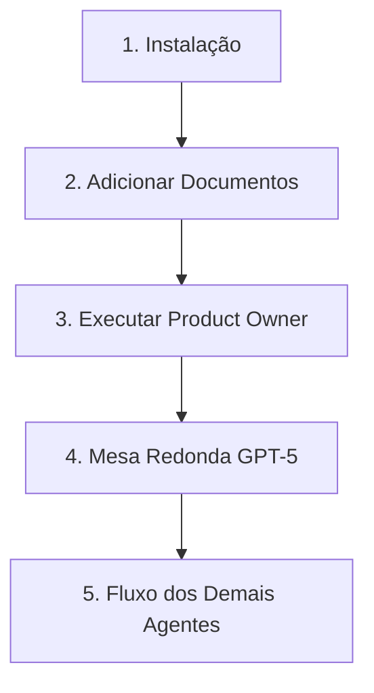

# 🚀 Fluxo Completo: Do Zero à Mesa Redonda

## 📋 **Visão Geral do Processo**



## 🛠️ **PASSO 1: Instalação**

### Executar o Instalador
```powershell
powershell -NoProfile -ExecutionPolicy Bypass -File .\Install\setup-workflow.ps1
```

**O que acontece:**
- ✅ Estrutura de pastas criada
- ✅ Ambiente configurado  
- ✅ Templates copiados
- ✅ **NOVO:** Análise automática de projeto existente (se selecionado)
- ❌ **Documentos ainda NÃO processados**

### **Nova Pergunta Durante Instalação:**
```
Tipo de trabalho: (1) Projeto novo ou (2) Implementacao em projeto existente? 2
Caminho do projeto .NET existente para analise: C:\Projetos\MeuSistema
```

**Se opção 2:** Sistema analisa automaticamente estrutura, tecnologias e padrões do projeto existente, gerando `project-analysis.md` com contexto completo para os agentes.

## 📁 **PASSO 2: Adicionar Seus Documentos**

### Estrutura Final (APÓS instalação):
```
C:\Projetos\MeuSistema\ia\
├── in\sprint01\01\
│   ├── attachments\                    ← VOCÊ ADICIONA AQUI
│   │   ├── pedido-cliente.docx         ← Documento do cliente
│   │   ├── tela-mockup-1.html          ← Mockups HTML
│   │   ├── tela-mockup-2.html
│   │   └── tela-mockup-3.html
│   └── business_request\               ← VOCÊ CRIA AQUI
│       └── analise-tecnica.md          ← Sua análise técnica
```

### Exemplo: `business_request/analise-tecnica.md`
```markdown
# Análise Técnica - Sistema de Notificação

## Contexto do Cliente
- **Objetivo:** Sistema de notificação desktop
- **Insumos:** 1 Word + 3 mockups HTML

## Decisões Técnicas Preliminares
- **Framework:** WPF (Windows Presentation Foundation)
- **Stack:** .NET 8, Material Design, SQLite
- **Deploy:** MSI installer
- **Justificativa:** Cliente quer "interface bonita estilo web"
```

## 🤖 **PASSO 3: Executar Product Owner**

### **Opção A: Manual (Recomendado para começar)**
1. **Abrir ChatGPT/Claude**
2. **Copiar prompt completo** de: `agents/manual/product-owner.agent.md`
3. **Informar contexto:**
   ```
   Sprint: 01
   Activity: 01
   Documentos em: business_request/ e attachments/
   ```
4. **Anexar todos os arquivos** (Word, HTMLs, analise-tecnica.md)

### **Opção B: Via Script (Futuro - ainda não implementado)**
```powershell
# WISHLIST - não existe ainda
.\powershell\run-agent.ps1 -Agent ProductOwner -Sprint 01 -Activity 01
```

### **O que o Product Owner produz:**
- ✅ `00-requirements-brief.md`
- ✅ `00-business-context.md`  
- ✅ `mesa-redonda-01-preparada.md` ← **TEMPLATE PREENCHIDO**

## 🎯 **PASSO 4: Mesa Redonda GPT-5**

### Executar a Mesa Redonda
1. **Abrir GPT-5**
2. **Copiar e colar** o conteúdo completo de `mesa-redonda-01-preparada.md`
3. **Executar** - GPT-5 facilitará discussão entre especialistas
4. **Salvar resultado** como `01-ata-mesa-redonda.md`

## 👥 **PASSO 5: Demais Agentes (Sequencial)**

### 5.1 Requirements Analyst (Gemini 2.5 Pro)
- **Input:** Ata da mesa redonda + documentos originais
- **Output:** `02-requisitos-bdd.md`

### 5.2 Systems Architect (GPT-5)  
- **Input:** Requisitos + contexto técnico
- **Output:** `03-arquitetura.md`

### 5.3 UX/UI Specialist (GPT-4o) 🆕
- **Input:** Arquitetura + requisitos + mockups existentes
- **Output:** `05-ux-wireframes.md` + estrutura de wireframes
- **Ferramentas:** `setup-design-tools.ps1` + `view-wireframes.ps1`

### 5.4 Frontend Specialist (GPT-4o)
- **Input:** Arquitetura + requisitos + mockups
- **Output:** `04-frontend-implementation.md`

### 5.5 Testing Specialist (Claude 4)
- **Input:** Todos os artefatos anteriores
- **Output:** `05-qa-plano.md`

## 📊 **Resultado Final**

### Estrutura de Saída:
```
out\sprint01\01\
├── 00-requirements-brief.md      ← Product Owner
├── 00-business-context.md        ← Product Owner  
├── 01-ata-mesa-redonda.md        ← Mesa Redonda GPT-5
├── 02-requisitos-bdd.md          ← Requirements Analyst
├── 03-arquitetura.md             ← Systems Architect
├── 04-desenvolvimento.md         ← Expert Developer
├── 04-frontend-implementation.md ← Frontend Specialist
├── 04-components\                ← Estrutura de componentes frontend
├── 04-ui-guidelines.md           ← Guidelines de UI/UX
├── 05-qa-plano.md                ← Testing Specialist
├── features\                     ← Arquivos .feature (BDD)
├── adrs\                         ← Architecture Decision Records
└── diagrams\                     ← Diagramas Mermaid
```

## ⚡ **Scripts de Apoio**

### Renderizar Diagramas
```powershell
.\powershell\render-diagrams.ps1
```

### Criar Estrutura Manual (alternativa)
```powershell
.\powershell\start-manual.ps1 -Sprint 01 -Activity 01
```

## 🎯 **Pontos Críticos**

### ❌ **Confusões Comuns:**
- **Instalação ≠ Execução:** Instalador só prepara ambiente
- **Documentos:** Devem ser adicionados APÓS instalação
- **Product Owner:** Não executa automaticamente durante instalação

### ✅ **Sequência Correta:**
1. **Instalar** (preparar ambiente)
2. **Documentar** (adicionar arquivos do cliente + análise)
3. **Executar PO** (preencher mesa redonda)
4. **Mesa redonda** (facilitar discussão)
5. **Demais agentes** (sequencial)

## 📚 **Documentação de Apoio**

- **[Processo Manual Detalhado](./manual-process.md)**
- **[Agentes Individuais](../agents/manual/)**
- **[Templates de Prompts](../prompts-manual/prompts/)**
- **[Personalização de Agentes](./exemplo-instrucoes-personalizada.md)**

---

**💡 DICA:** Na primeira vez, use a **Opção A (Manual)** para entender o fluxo. Depois, você pode automatizar partes específicas conforme sua necessidade.