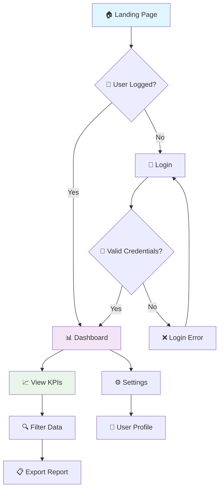
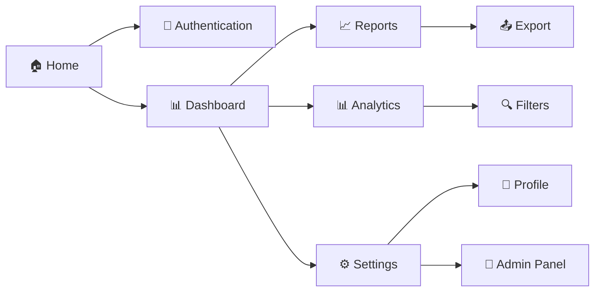
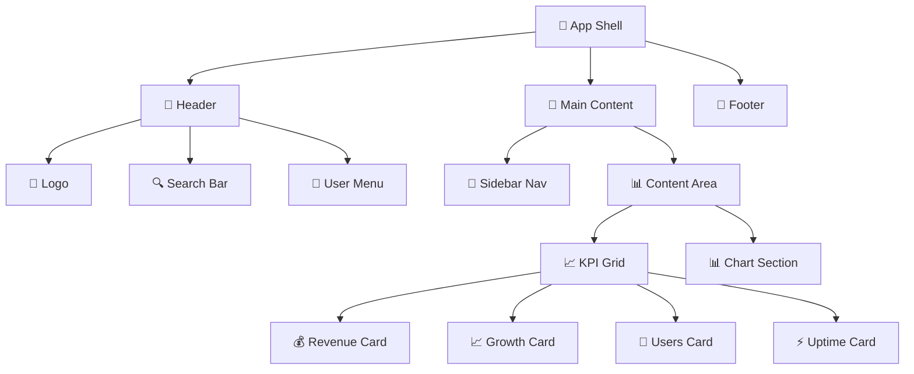
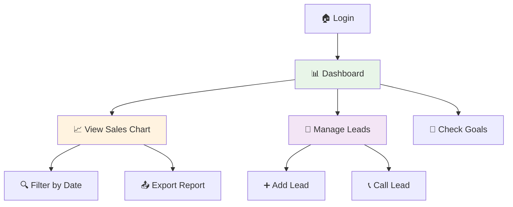

# Guia Completo - Ferramentas de Design e Wireframes

**Versão:** 2.2.0  
**Criado:** Dezembro 2024  
**Atualizado:** Dezembro 2024

## 🎯 **Objetivo**

Este guia apresenta as **ferramentas visuais integradas** ao AgileDevAgent para criação de wireframes, protótipos e design systems usando **texto, ASCII art e Mermaid diagrams**.

## 🎨 **Visão Geral do Sistema de Design**

O AgileDevAgent revoluciona a criação de interfaces ao combinar:

### **📐 Text-Based Wireframing**
- **ASCII Art**: Estrutura visual versionável
- **Emojis**: Componentes identificáveis rapidamente
- **Responsive Design**: Breakpoints documentados

### **🔄 Interactive Diagrams**  
- **User Flows**: Navegação e jornada do usuário
- **Sitemaps**: Arquitetura de informação
- **Component Trees**: Hierarquia de elementos

### **🌐 Live Prototypes**
- **HTML Preview**: Interação real
- **Responsive Grid**: Teste em diferentes telas
- **Component Showcase**: Biblioteca visual

## 🚀 **Começando Rapidamente**

### **PASSO 1: Setup Inicial**

```powershell
# Navegar para workspace dos agentes
cd "C:\Projetos\MeuWorkspace\IA"

# Configurar ferramentas de design
.\powershell\setup-design-tools.ps1 -Sprint 01 -Activity sistema-login -InstallDesignTools -GenerateWireframes
```

### **PASSO 2: Visualizar Resultados**

```powershell
# Abrir preview no navegador
.\powershell\view-wireframes.ps1 -Sprint 01 -Activity sistema-login -OpenBrowser

# Exportar diagramas para imagens
.\powershell\view-wireframes.ps1 -Sprint 01 -Activity sistema-login -ExportImages
```

### **PASSO 3: Editar e Refinar**

```powershell
# Abrir workspace no VS Code
code out\sprint01\sistema-login\04-wireframes\
```

## 📐 **Wireframes ASCII - Guia Prático**

### **Template Base**

```ascii
┌─────────────────────────────────────────────────────────────┐
│  🏢 LOGO              [🔍 Search]         👤 Profile ⚙️    │ Header (64px)
├─────────────────────────────────────────────────────────────┤
│ 📱│                                                       │
│ 📊│  📈 Dashboard Principal                               │ Main Content
│ 📋│  ┌─────────┐ ┌─────────┐ ┌─────────┐ ┌─────────┐      │ (Cards Grid)
│ ⚙️│  │  KPI 1  │ │  KPI 2  │ │  KPI 3  │ │  KPI 4  │      │
│   │  │  $1.2M  │ │  +15%   │ │  847    │ │  99.9%  │      │
│   │  └─────────┘ └─────────┘ └─────────┘ └─────────┘      │
│   │                                                       │
│   │  📊 [Chart Area - Interactive Visualization]         │ Chart Section
│   │  ████████████████████████▲                            │
│   │                                                       │ 
├───┴───────────────────────────────────────────────────────┤
│  © 2025 Company  │  📧 Support  │  🔗 Links  │  📱 Mobile  │ Footer (48px)
└─────────────────────────────────────────────────────────────┘
```

### **Elementos Visuais Disponíveis**

#### **📊 Layouts e Containers**
```ascii
┌──────┐  ╔══════╗  ╭──────╮  ┏━━━━━━┓
│ Card │  ║ Modal║  │ Round│  ┃ Alert┃
└──────┘  ╚══════╝  ╰──────╯  ┗━━━━━━┛
```

#### **🎯 Componentes UI**
- **Botões**: `[🔴 Primary]` `[⚪ Secondary]` `[🔗 Link]`
- **Input**: `[📧 Email____]` `[🔒 Password____]` `[🔍 Search____]`
- **Navigation**: `📱 ☰` `◀ Back` `Next ▶` `⬆ Top`
- **Status**: `✅ Success` `❌ Error` `⚠️ Warning` `ℹ️ Info`

#### **📱 Responsive Indicators**
```ascii
📱 Mobile (320px)   📟 Tablet (768px)   🖥️ Desktop (1024px+)
     ┌────┐             ┌────┬────┐           ┌────┬────┬────┐
     │ A  │             │ A  │ B  │           │ A  │ B  │ C  │
     ├────┤             ├────┴────┤           ├────┼────┼────┤
     │ B  │             │    C    │           │       D     │
     ├────┤             └─────────┘           └─────────────┘
     │ C  │
     └────┘
```

## 🔄 **Mermaid Diagrams - User Flows**

### **Template User Journey**



### **Sitemap Architecture**



### **Component Hierarchy**



## 🌐 **HTML Prototypes - Interactive Demos**

### **Estrutura CSS Grid Responsiva**

```css
/* Mobile-First Approach */
.wireframe-container {
    display: grid;
    grid-template-areas: 
        "header"
        "main"
        "footer";
    grid-template-rows: 64px 1fr 48px;
    min-height: 100vh;
}

.main-layout {
    display: grid;
    grid-template-columns: 1fr;
    gap: 16px;
}

/* Tablet */
@media (min-width: 768px) {
    .main-layout {
        grid-template-columns: 240px 1fr;
    }
    
    .kpi-grid {
        grid-template-columns: repeat(2, 1fr);
    }
}

/* Desktop */
@media (min-width: 1024px) {
    .kpi-grid {
        grid-template-columns: repeat(4, 1fr);
    }
}
```

### **Component Library CSS**

```css
/* Design Tokens */
:root {
    --color-primary: #2196f3;
    --color-success: #4caf50;
    --color-warning: #ff9800;
    --color-error: #f44336;
    
    --spacing-xs: 4px;
    --spacing-sm: 8px;
    --spacing-md: 16px;
    --spacing-lg: 24px;
    --spacing-xl: 32px;
    
    --border-radius: 8px;
    --shadow: 0 2px 4px rgba(0,0,0,0.1);
}

/* Component Styles */
.btn {
    padding: var(--spacing-sm) var(--spacing-md);
    border: none;
    border-radius: var(--border-radius);
    font-weight: 500;
    cursor: pointer;
    transition: all 0.2s ease;
}

.btn-primary {
    background: var(--color-primary);
    color: white;
}

.btn-primary:hover {
    background: #1976d2;
    transform: translateY(-1px);
    box-shadow: var(--shadow);
}

.card {
    background: white;
    border-radius: var(--border-radius);
    padding: var(--spacing-lg);
    box-shadow: var(--shadow);
    border: 1px solid #e0e0e0;
}

.card:hover {
    box-shadow: 0 4px 12px rgba(0,0,0,0.15);
}
```

## 🎯 **Design System - Tokens e Guidelines**

### **Color Palette**

```json
{
  "color": {
    "primary": {
      "50": "#e3f2fd", "100": "#bbdefb", "200": "#90caf9",
      "300": "#64b5f6", "400": "#42a5f5", "500": "#2196f3",
      "600": "#1e88e5", "700": "#1976d2", "800": "#1565c0", "900": "#0d47a1"
    },
    "secondary": {
      "50": "#fce4ec", "500": "#e91e63", "900": "#880e4f"  
    },
    "neutral": {
      "50": "#fafafa", "100": "#f5f5f5", "200": "#eeeeee",
      "500": "#9e9e9e", "700": "#616161", "900": "#212121"
    },
    "semantic": {
      "success": "#4caf50", "warning": "#ff9800", 
      "error": "#f44336", "info": "#2196f3"
    }
  }
}
```

### **Typography Scale**

```json
{
  "typography": {
    "fontFamily": {
      "primary": "Inter, system-ui, -apple-system, sans-serif",
      "secondary": "Roboto Mono, Consolas, monospace"
    },
    "fontSize": {
      "xs": "0.75rem", "sm": "0.875rem", "base": "1rem",
      "lg": "1.125rem", "xl": "1.25rem", "2xl": "1.5rem",
      "3xl": "1.875rem", "4xl": "2.25rem", "5xl": "3rem"
    },
    "fontWeight": {
      "light": "300", "normal": "400", "medium": "500",
      "semibold": "600", "bold": "700", "extrabold": "800"
    },
    "lineHeight": {
      "tight": "1.25", "normal": "1.5", "relaxed": "1.625"
    }
  }
}
```

### **Spacing System**

```json
{
  "spacing": {
    "0": "0px", "px": "1px",
    "0.5": "2px", "1": "4px", "1.5": "6px", "2": "8px",
    "2.5": "10px", "3": "12px", "3.5": "14px", "4": "16px",
    "5": "20px", "6": "24px", "7": "28px", "8": "32px",
    "9": "36px", "10": "40px", "11": "44px", "12": "48px",
    "14": "56px", "16": "64px", "20": "80px", "24": "96px"
  }
}
```

## ♿ **Accessibility Guidelines**

### **WCAG 2.1 AA Compliance Checklist**

#### **🎨 Color & Contrast**
- [ ] **Normal text**: Minimum 4.5:1 contrast ratio
- [ ] **Large text** (18pt+): Minimum 3:1 contrast ratio
- [ ] **Graphical elements**: Minimum 3:1 contrast ratio
- [ ] **Color not sole indicator**: Use icons + text combinations

#### **⌨️ Keyboard Navigation**
- [ ] **All interactive elements** focusable with Tab
- [ ] **Visible focus indicators** with 2px outline
- [ ] **Logical tab order** matches visual layout
- [ ] **Skip links** for main content navigation

#### **🔍 Screen Readers**
- [ ] **Semantic HTML**: Use proper heading hierarchy (h1-h6)
- [ ] **ARIA labels** for custom components
- [ ] **Alt text** for informative images
- [ ] **Form labels** explicitly associated

#### **📱 Responsive & Touch**
- [ ] **Touch targets**: Minimum 44px × 44px
- [ ] **Spacing**: 8px minimum between touch targets
- [ ] **Zoom support**: 200% zoom without horizontal scroll
- [ ] **Orientation**: Support both landscape/portrait

### **Implementation Examples**

```html
<!-- Accessible Button -->
<button 
    class="btn btn-primary"
    aria-describedby="btn-help"
    type="submit">
    💾 Save Changes
</button>
<div id="btn-help" class="sr-only">
    Saves all form data to database
</div>

<!-- Accessible Form -->
<form>
    <label for="email" class="required">
        📧 Email Address
    </label>
    <input 
        type="email" 
        id="email"
        required
        aria-describedby="email-error"
        aria-invalid="false">
    <div id="email-error" class="error-message" role="alert">
        Please enter a valid email address
    </div>
</form>

<!-- Accessible Navigation -->
<nav role="navigation" aria-label="Main navigation">
    <ul>
        <li><a href="/" aria-current="page">🏠 Home</a></li>
        <li><a href="/dashboard">📊 Dashboard</a></li>
        <li><a href="/reports">📈 Reports</a></li>
    </ul>
</nav>
```

## 🛠️ **Ferramentas e Workflow**

### **VS Code Extensions Recomendadas**

```powershell
# Design & Prototyping
code --install-extension figma.figma-vscode-extension
code --install-extension ms-vscode.live-server
code --install-extension bradlc.vscode-tailwindcss

# Diagrams & Documentation
code --install-extension bierner.markdown-mermaid
code --install-extension yzhang.markdown-all-in-one
code --install-extension shd101wyy.markdown-preview-enhanced

# Accessibility & Quality
code --install-extension deque-systems.vscode-axe-linter
code --install-extension webhint.vscode-webhint
```

### **NPM Tools para Design**

```powershell
# Diagram Generation
npm install -g @mermaid-js/mermaid-cli

# Component Documentation
npm install -g @storybook/cli

# Design Token Management
npm install -g style-dictionary

# Accessibility Testing
npm install -g @axe-core/cli

# Asset Optimization
npm install -g imagemin-cli
npm install -g svgo
```

### **Chrome Extensions Úteis**
- **axe DevTools** - Accessibility auditing
- **Lighthouse** - Performance & best practices  
- **Responsive Viewer** - Multi-device preview
- **ColorZilla** - Color picker & contrast checker

## 🚀 **Workflow Prático**

### **FASE 1: Análise e Estrutura**

```powershell
# 1. Criar atividade com análise de UX
.\powershell\start-manual.ps1 -Sprint 01 -Activity dashboard-vendas

# 2. Executar Product Owner → Systems Architect
# (seguir fluxo normal até arquitetura)

# 3. Executar UX/UI Specialist
@agents/manual/ux-ui-specialist.agent.md
```

### **FASE 2: Design e Wireframing**

```powershell
# 4. Configurar ferramentas de design
.\powershell\setup-design-tools.ps1 -Sprint 01 -Activity dashboard-vendas -GenerateWireframes

# 5. Editar wireframes no VS Code
code out\sprint01\dashboard-vendas\04-wireframes\ascii\layout-principal.md

# 6. Visualizar em tempo real
.\powershell\view-wireframes.ps1 -Sprint 01 -Activity dashboard-vendas -OpenBrowser
```

### **FASE 3: Desenvolvimento e Validação**

```powershell
# 7. Continuar fluxo: Testing Specialist → Expert Developer
# (implementação baseada nos wireframes)

# 8. Exportar assets finais
.\powershell\view-wireframes.ps1 -Sprint 01 -Activity dashboard-vendas -ExportImages -GenerateStorybook

# 9. Validação final com Testing Validator
# (incluir testes de acessibilidade e responsividade)
```

## 📊 **Métricas e Validação**

### **Performance Benchmarks**

| Metric | Target | Tool |
|--------|---------|------|
| **Largest Contentful Paint** | < 2.5s | Lighthouse |
| **First Input Delay** | < 100ms | Web Vitals |
| **Cumulative Layout Shift** | < 0.1 | Chrome DevTools |
| **Time to Interactive** | < 3.5s | Lighthouse |

### **Accessibility Checklist**

| Category | Items | Status |
|----------|-------|---------|
| **Color Contrast** | All text meets WCAG AA | ✅ |
| **Keyboard Navigation** | All elements focusable | ✅ |
| **Screen Reader** | Semantic HTML + ARIA | ✅ |
| **Touch Targets** | 44px minimum size | ✅ |

### **Browser Support Matrix**

| Browser | Desktop | Mobile | Support Level |
|---------|---------|---------|--------------|
| **Chrome** | 90+ | 90+ | Full ✅ |
| **Firefox** | 88+ | 88+ | Full ✅ |
| **Safari** | 14+ | 14+ | Full ✅ |
| **Edge** | 90+ | 90+ | Full ✅ |

## 🎯 **Exemplos Práticos**

### **Exemplo 1: Dashboard de Vendas**

**Wireframe ASCII:**
```ascii
┌─────────────────────────────────────────────────────────────┐
│  🏢 VendasPro        [🔍 Buscar...]      👤 João ▼ 🔔    │
├─────────────────────────────────────────────────────────────┤
│📊│  💰 Revenue Today: R$ 45.230,00                        │
│📈│  ┌──────────┐ ┌──────────┐ ┌──────────┐ ┌──────────┐   │
│📋│  │📈 Vendas │ │👥 Leads  │ │🎯 Metas  │ │📞 Calls  │   │
│⚙️│  │  R$ 45K  │ │   847    │ │   78%    │ │   156    │   │
│  │  └──────────┘ └──────────┘ └──────────┘ └──────────┘   │
│  │                                                         │
│  │  📊 Gráfico de Vendas (Últimos 7 dias)                │
│  │  ████████████████████████▲                              │
│  │  R$ 50K ┤                                              │
│  │  R$ 40K ┤     ███                                       │
│  │  R$ 30K ┤   ███████                                     │
│  │  R$ 20K ┤ ███████████                                   │
│  │  R$ 10K ┤█████████████████                             │
│  │        └─┬─┬─┬─┬─┬─┬─┬─                                │
│  │         S T Q Q S S D                                  │
└─┴─────────────────────────────────────────────────────────┘
```

**User Flow:**


### **Exemplo 2: Sistema de Login**

**Wireframe ASCII:**
```ascii
┌─────────────────────────────────────────┐
│                                         │
│    🏢 MeuSistema                        │
│                                         │
│    ┌─────────────────────────────────┐  │
│    │  📧 Email                       │  │
│    │  [________________________]    │  │
│    │                                 │  │
│    │  🔒 Password                    │  │
│    │  [________________________]    │  │
│    │                                 │  │
│    │  [🔑 Entrar]  [🔗 Esqueci]     │  │
│    │                                 │  │
│    │  ────────── ou ──────────       │  │
│    │                                 │  │
│    │  [🌐 Google] [📘 Facebook]      │  │
│    │                                 │  │
│    │  📝 Não tem conta? Cadastre-se  │  │
│    └─────────────────────────────────┘  │
│                                         │
└─────────────────────────────────────────┘
```

**Design Tokens:**
```json
{
  "loginForm": {
    "maxWidth": "400px",
    "padding": "32px",
    "borderRadius": "12px",
    "backgroundColor": "white",
    "boxShadow": "0 4px 20px rgba(0,0,0,0.1)"
  },
  "inputField": {
    "height": "48px",
    "borderRadius": "8px",
    "border": "1px solid #e0e0e0",
    "focusColor": "#2196f3"
  }
}
```

## 🔗 **Integração com Desenvolvimento**

### **Handoff para Desenvolvedores**

#### **1. Assets Entregues:**
```
04-wireframes/
├── ascii/layout-principal.md      ← Estrutura visual
├── html-preview/prototype.html    ← Protótipo funcional
├── images/user-flow.png           ← Fluxos exportados
└── design-system.json            ← Tokens para CSS
```

#### **2. Especificações Técnicas:**
- **Breakpoints**: Mobile (320px), Tablet (768px), Desktop (1024px+)
- **Grid System**: CSS Grid + Flexbox híbrido
- **Color Palette**: Baseada em Material Design
- **Typography**: Inter font family
- **Spacing**: 8px base unit system

#### **3. Checklist de Implementação:**
- [ ] HTML semântico implementado
- [ ] CSS responsivo baseado nos breakpoints
- [ ] JavaScript para interações mapeadas
- [ ] Testes de acessibilidade executados
- [ ] Performance otimizada (Core Web Vitals)

### **Ferramentas de Colaboração**

#### **Design Tokens → CSS Variables**
```css
/* Gerado automaticamente do design-system.json */
:root {
  --color-primary-500: #2196f3;
  --spacing-md: 16px;
  --typography-base: 1rem;
  --border-radius-md: 8px;
}

.btn-primary {
  background: var(--color-primary-500);
  padding: var(--spacing-md);
  border-radius: var(--border-radius-md);
}
```

#### **Component Mapping**
```javascript
// React Component gerado do wireframe
export const DashboardCard = ({ title, value, icon }) => {
  return (
    <div className="card kpi-card">
      <div className="card-icon">{icon}</div>
      <div className="card-value">{value}</div>
      <div className="card-title">{title}</div>
    </div>
  );
};
```

## 🎉 **Conclusão**

As **Ferramentas de Design integradas** ao AgileDevAgent proporcionam:

### ✅ **Benefícios Alcançados:**
- **📐 Wireframes versionáveis** em texto puro (Git-friendly)
- **🔄 Prototipação rápida** com feedback visual imediato
- **🎯 Design System consistente** com tokens reutilizáveis  
- **♿ Acessibilidade por design** com guidelines WCAG 2.1 AA
- **🚀 Handoff eficiente** para desenvolvedores

### 🔄 **Workflow Integrado:**
1. **Systems Architect** → Define arquitetura técnica
2. **UX/UI Specialist** → Cria wireframes e design system
3. **Expert Developer** → Implementa baseado nas especificações
4. **Testing Validator** → Valida acessibilidade e responsividade

### 🎯 **Próximos Passos:**
- Refinar wireframes com mais detalhes visuais
- Criar protótipos interativos no Figma/Adobe XD
- Implementar componentes baseados no design system
- Executar testes de usabilidade com usuários reais

---

**💡 Dica Final:** Use este sistema para criar interfaces consistentes, acessíveis e performantes seguindo as melhores práticas da indústria!